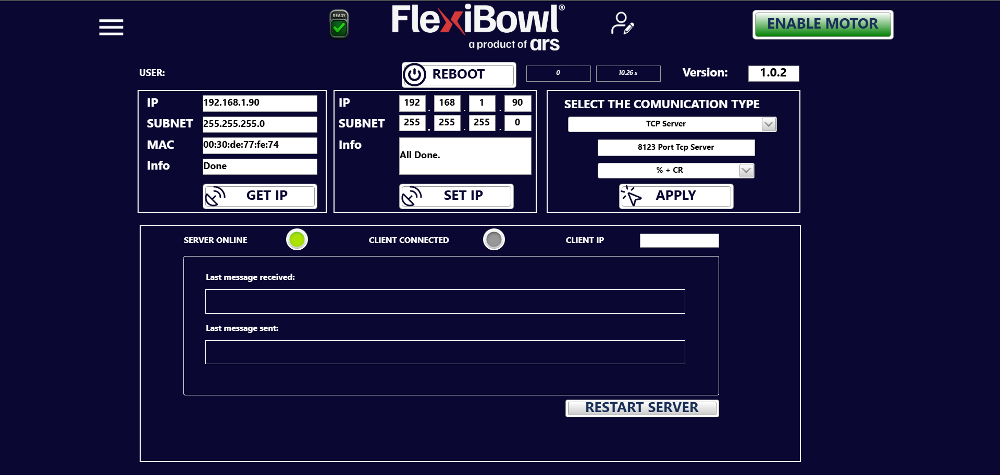
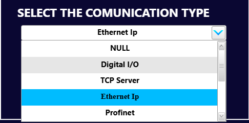
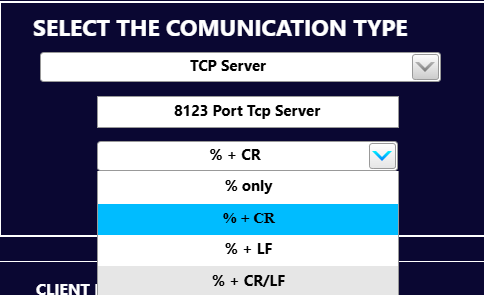

# **Setup**
## Présentation

La page **Setup** regroupe les paramètres réseau et de communication du FlexiBowl®. Elle permet de configurer l'adresse IP du dispositif, le type de protocole de communication avec le système externe (par ex. automate ou PC superviseur) et de surveiller l'état de la connexion en temps réel.

En haut à droite est indiquée la **version du firmware** installé (dans l'exemple : `1.0.2`).

---

## Barre supérieure

| Élément | Description |
|---|---|
| **Menu** (icône ☰) | Ouvre le menu de navigation entre les pages du logiciel |
| **READY** | Indicateur d'état du dispositif : signale que le FlexiBowl® est prêt à l'emploi |
| **USER** | Indique l'utilisateur actuellement connecté à l'interface logicielle |
| **REBOOT** | Redémarre le logiciel du FlexiBowl® sans éteindre le système |
| **Version** | Version du firmware actuellement installé sur le dispositif |
| **ENABLE MOTOR** | Active l'alimentation du moteur du FlexiBowl®. Avec le moteur désactivé, le dispositif n'exécute aucun mouvement |

:::{warning}
Le bouton **REBOOT** interrompt temporairement toutes les opérations en cours. Ne pas effectuer de reboot pendant une séquence active ou pendant un transfert de fichier.
:::

:::{warning}
Avant d'appuyer sur **ENABLE MOTOR**, s'assurer que la zone autour du FlexiBowl® est dégagée : l'activation du moteur rend le dispositif prêt à se déplacer.
:::

---

## Panneau GET IP

Le panneau de gauche affiche les paramètres réseau actuellement attribués au FlexiBowl®.

| Champ | Valeur d'exemple | Description |
|---|---|---|
| **IP** | 192.168.1.90 | Adresse IP actuelle du dispositif |
| **SUBNET** | 255.255.255.0 | Masque de sous-réseau actuel |
| **MAC** | 00:30:de:77:fe:74 | Adresse MAC de la carte réseau du dispositif |
| **Info** | Done | Résultat de la dernière opération de lecture |

Le bouton **GET IP** met à jour les champs en lisant les paramètres réseau actuellement configurés sur le dispositif.

---

## Panneau SET IP

Le panneau central permet de modifier l'adresse IP et le masque de sous-réseau du FlexiBowl®.

| Champ | Valeur d'exemple | Description |
|---|---|---|
| **IP** | 192.168.1.90 | Nouvelle adresse IP à attribuer au dispositif (saisissable octet par octet) |
| **SUBNET** | 255.255.255.0 | Nouveau masque de sous-réseau à attribuer |
| **Info** | All Done. | Résultat de la dernière opération de paramétrage |

Le bouton **SET IP** applique les valeurs saisies et les enregistre dans la configuration réseau du dispositif.

:::{important}
Après avoir modifié l'adresse IP avec **SET IP**, il est nécessaire d'effectuer un **REBOOT** du système pour que les modifications prennent effet. Le logiciel devra être reconnecté à la nouvelle adresse IP.
:::

:::{warning}
S'assurer que la nouvelle adresse IP n'est pas déjà utilisée par un autre dispositif sur le même réseau, afin d'éviter des conflits d'adresses qui pourraient rendre le FlexiBowl® injoignable.
:::

---

## Panneau SELECT THE COMMUNICATION TYPE

Le panneau de droite permet de configurer le protocole de communication entre le FlexiBowl® et le système externe (automate, PC superviseur, système de vision).

| Champ |  Description |
|---|---|
| **Type de communication** |  Protocole de communication sélectionné. Sélectionnable via le menu déroulant |
| **Port** |  Port TCP sur lequel le FlexiBowl® est à l'écoute en tant que serveur |
| **Chaîne de terminaison** | Caractère ou séquence de caractères qui délimite les messages échangés. Sélectionnable via le menu déroulant |

Le bouton **APPLY** confirme et applique les paramètres de communication sélectionnés.

:::{note}
Le mode **TCP Server** indique que le FlexiBowl® agit en tant que serveur : c'est le système externe (client) qui doit initier la connexion vers l'adresse IP et le port configurés.
:::

:::{tip}
Vérifier que le port configuré (par ex. 8123) n'est pas bloqué par un pare-feu sur le PC ou dans le réseau de l'entreprise. En cas de problèmes de connexion, consulter le responsable informatique.
:::

---

## Sélection de la chaîne de terminaison

Le troisième menu déroulant du panneau **SELECT THE COMMUNICATION TYPE** permet de choisir le **terminateur** des messages échangés avec le système externe, c'est-à-dire la séquence de caractères qui signale la fin de chaque commande envoyée et de chaque réponse reçue.

| Option | Terminateur | Description |
|---|---|---|
| **% only** | `%` | Uniquement le caractère `%`, sans caractères de fin de ligne |
| **% + CR** | `%` + `\r` | Caractère `%` suivi d'un Carriage Return (0x0D) |
| **% + LF** | `%` + `\n` | Caractère `%` suivi d'un Line Feed (0x0A) |
| **% + CR/LF** | `%` + `\r\n` | Caractère `%` suivi d'un Carriage Return et d'un Line Feed (0x0D 0x0A) |

Après avoir sélectionné l'option souhaitée, appuyer sur **APPLY** pour rendre le réglage effectif.

:::{important}
La chaîne de terminaison sélectionnée doit correspondre à celle attendue par le système externe (automate, PC superviseur ou système de vision). Si les deux réglages ne coïncident pas, les commandes envoyées ne sont pas reconnues et la communication échoue, même avec le serveur en ligne et le client connecté.
:::

:::{tip}
Si des commandes semblent envoyées mais restent sans réponse, vérifier dans le panneau d'état le champ **Last message received** : si le message arrive mais ne produit aucun effet, la cause est souvent une chaîne de terminaison erronée.
:::

---

## Panneau d'état de la communication

Le panneau inférieur affiche en temps réel l'état de la connexion entre le FlexiBowl® et le client externe.

### Indicateurs d'état

| Indicateur | Couleur active |  Description |
|---|---|---|
| **SERVER ONLINE** | 🟢 Vert |  Le serveur TCP du FlexiBowl® est actif et à l'écoute |
| **CLIENT CONNECTED** | 🟢 Vert |  Un client externe est actuellement connecté au serveur |
| **CLIENT IP** | — | Adresse IP du client actuellement connecté |

:::{note}
Lorsqu'un indicateur est gris, la condition correspondante n'est pas vérifiée : dans l'exemple, le serveur est en ligne mais aucun client n'est encore connecté.
:::

### Moniteur de messages

| Champ |  Description |
|---|---|
| **Last message received** | Dernier message reçu du client externe |
| **Last message sent** | Dernier message envoyé par le FlexiBowl® au client |

:::{note}
Le moniteur de messages est utile lors de l'intégration et du débogage de la communication avec le système externe. Les messages affichés suivent le protocole de communication du FlexiBowl® ; se référer à la documentation du protocole pour la liste complète des commandes disponibles.
:::

### Bouton RESTART SERVER

Le bouton **RESTART SERVER** redémarre le service TCP du FlexiBowl® sans effectuer un reboot complet du système. Il est utile pour rétablir la connexion en cas de déconnexion inattendue du client ou de blocage du serveur.

:::{warning}
**RESTART SERVER** interrompt la connexion TCP en cours. Si le FlexiBowl® exécute une séquence commandée à distance, celle-ci sera interrompue. Utiliser cette fonction uniquement lorsque le système est en veille.
:::
