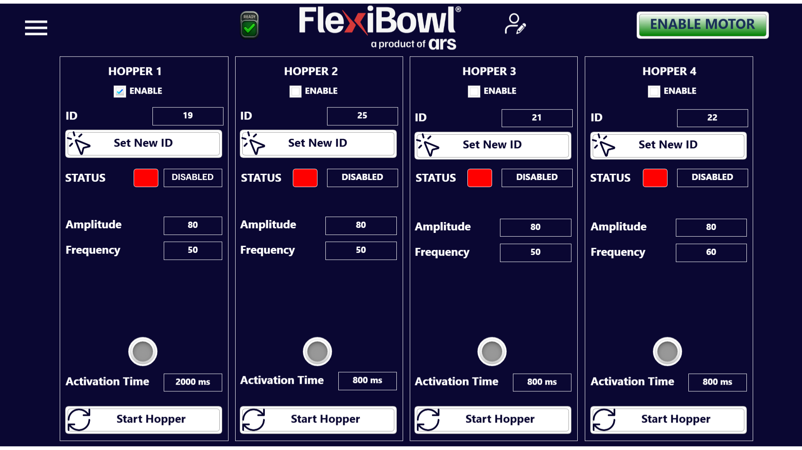

(hopper)=
# **Hopper**
## Présentation

La page **Hopper** permet de configurer et de gérer jusqu'à **4 Bulk Feeders** raccordés au FlexiBowl®. Chaque hopper est une unité d'alimentation autonome qui approvisionne le FlexiBowl® en composants, et peut être commandée indépendamment avec ses propres paramètres de vibration et de temporisation.

Chaque hopper est représenté par une colonne verticale avec les mêmes commandes, identifiée comme **HOPPER 1**, **HOPPER 2**, **HOPPER 3** et **HOPPER 4**.

 ---

## Structure de chaque panneau Hopper

### ENABLE

La case à cocher **ENABLE** en haut du panneau active ou désactive le hopper correspondant. Seuls les hoppers activés peuvent être démarrés et répondront aux commandes du système.

Dans l'exemple affiché, seul **HOPPER 1** a la case ENABLE cochée (coche bleue) ; les hoppers 2, 3 et 4 sont désactivés.

:::{note}
Un hopper désactivé ne répond pas au bouton **Start Hopper** et n'est pas activé pendant les séquences automatiques, même s'il est physiquement raccordé au système.
:::

---

### ID et Set New ID

| Champ |  Description |
|---|---|
| **ID** |  Identifiant unique attribué au hopper sur le réseau de communication |
| **Set New ID** | Bouton pour attribuer un nouvel ID au hopper. Utilisé lors de la configuration initiale ou en cas de remplacement de l'unité |

:::{warning}
Ne modifier l'ID d'un hopper que si c'est strictement nécessaire. Un ID erroné ou en double empêche la communication avec le hopper et peut provoquer des dysfonctionnements dans toute la chaîne d'alimentation. Après avoir défini un nouvel ID, vérifier qu'il a été correctement pris en compte au moyen de l'indicateur **STATUS**.
:::

---

### STATUS

L'indicateur **STATUS** affiche l'état opérationnel actuel du hopper.

| Couleur des LED | Étiquette | Description |
|---|---|---|
| 🔴 Rouge | **DISABLED** | Le hopper est désactivé |
| 🟢 Vert | **ENABLED** | Le hopper est activé |

---

### Paramètres de vibration

| Paramètre |  Description |
|---|---|
| **Amplitude** |  Amplitude de la vibration du hopper, exprimée en unités sans dimension. Des valeurs plus élevées produisent une vibration plus intense et un flux de composants plus important |
| **Frequency** | Fréquence de vibration du hopper. Elle influence la cadence à laquelle les composants sont acheminés vers le FlexiBowl® |

---

### Activation Time et LED d'état

| Champ  | Description |
|---|---|
| **Activation Time** | Durée de l'activation du hopper lorsqu'il est démarré manuellement avec **Start Hopper** ou appelé par une séquence |
| **LED** (gris/vert) |  Voyant lumineux qui s'allume pendant l'activation du hopper |

:::{note}
**HOPPER 1** a une **Activation Time** de 2000 ms, tandis que les autres hoppers sont réglés sur 800 ms. Des temps d'activation plus longs entraînent un apport plus important de composants au FlexiBowl® pour chaque cycle d'activation.
:::

---

### Start Hopper

Le bouton **Start Hopper** démarre manuellement le hopper pour la durée définie dans **Activation Time**. Une fois le temps écoulé, le hopper s'arrête automatiquement.

:::{important}
Le bouton **Start Hopper** n'est actif que si la case **ENABLE** du hopper correspondant est cochée. Vérifier que le hopper est activé avant de tenter son démarrage manuel.
:::

---

