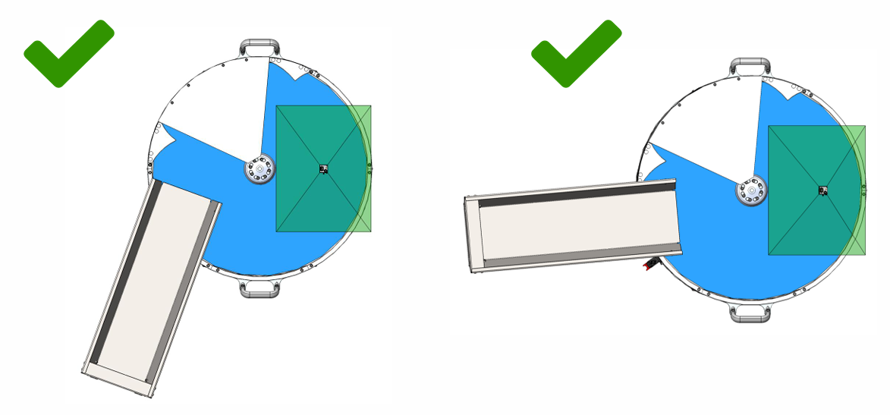
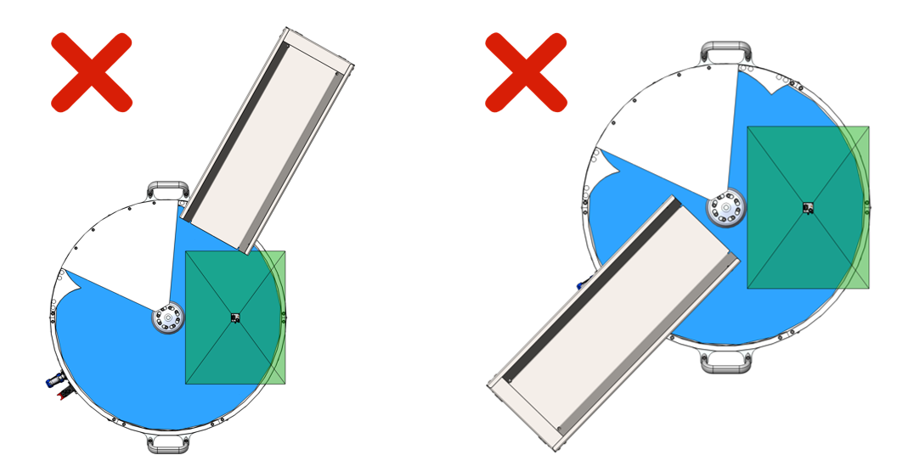

(layoutbp)=
# **Layout Best Practice**

La zone de travail du FlexiBowl® est virtuellement divisée en quatre secteurs, chacun dédié à une phase du cycle : **dépose** des composants depuis le Bulk Feeder, **séparation** par flip, **prise** par le robot et **recirculation** des composants non prélevés. Une bonne implantation respecte cette séquence dans le sens de rotation du FlexiBowl® et réduit au minimum les trajets de *pick and place*.

:::{figure} ../../../../_shared/media/images/Funz-standard.PNG
:align: center
:width: 50%

Secteurs de travail du FlexiBowl® : dépose, séparation, prise et recirculation.
:::

## Directives pour le positionnement du robot

:::{tip}
La meilleure façon de placer le robot par rapport au FlexiBowl® est celle qui réduit au minimum les trajets de *pick and place*.
:::

(layoutbp-traditional)=
### Traditional Feeding

Dans le {ref}`Traditional Feeding <sof-modalita-standard>`, la zone de prise coïncide avec la zone de vision. La zone de travail du robot doit donc couvrir entièrement la zone de vision, de manière à garantir que le robot puisse atteindre tous les composants identifiés comme prenables.

<!-- DA COMPLETARE: distanze consigliate robot/FlexiBowl® per taglia -->

(layoutbp-tracking)=
### Circular Tracking

Dans le {ref}`Circular Tracking <tracking>`, le FlexiBowl® tourne en continu : la zone de vision se trouve un secteur **en amont** de la zone de prise, qui est donc décalée **en aval** dans le sens de rotation. La zone de travail du robot doit couvrir le secteur de prise situé en aval de la zone de vision.

:::{figure} ../../../../_shared/media/images/TrackingLayout.PNG
:width: 80%
:align: center
:::

<!-- DA COMPLETARE -->

## Directives pour le positionnement des Bulk Feeders

### Précautions générales

- Placer le Bulk Feeder sur une surface stable et horizontale, à proximité du FlexiBowl®.
- Si le Bulk Feeder est installé sur le plan d'une machine sensible aux vibrations, interposer un matériau isolant et antivibratoire entre les surfaces, afin d'éviter que les vibrations ne se transmettent au FlexiBowl® (voir {ref}`tramoggia-antivibrazione`).
- Fixer le Bulk Feeder au support avec des vis M8 : 4 trous pour les Bulk Feeders standard, 2 trous pour le Bulk Feeder de 1,5 l.
- Un seul FlexiBowl® gère jusqu'à **4 Bulk Feeders** : dans le {ref}`Multiple Parts Feeding <funzionamento-in-mix-mode>`, il est possible de dédier un Bulk Feeder à chaque référence.

### Position recommandée

La goulotte du Bulk Feeder doit déverser les composants directement dans le **secteur de dépose**, en amont du flip, avec une inclinaison qui suit le profil du FlexiBowl®.

::::{tab-set}
:::{tab-item} Positionnement correct

:::
:::{tab-item} Positionnement incorrect

Une goulotte trop éloignée de la zone de travail génère une alimentation irrégulière et pénalise les performances de l'application.
:::
::::

## Directives pour le positionnement des zones de dépose

### Indications générales

Placer les zones de dépose (plateaux, tapis, postes d'assemblage) le plus près possible de la zone de prise, afin de réduire la course du robot à chaque cycle.

<!-- DA COMPLETARE -->

### Position recommandée

<!-- DA COMPLETARE -->

## Directives pour la configuration optimale du mouvement

<!-- DA COMPLETARE -->

## Directives pour le choix de l'outil de préhension

<!-- DA COMPLETARE -->

## Directives pour le positionnement du Toplight

Le {ref}`Toplight <toplight>` doit être centré sur la zone de vision, avec la surface émettrice parallèle au plan du FlexiBowl® et la caméra montée dans le trou central. La distance par rapport à la surface doit être similaire à celle de la caméra, afin de réduire les ombres et les reflets directs. Pour les modes de fixation, voir {ref}`montaggio_staffa`.

## Directives pour le positionnement de la caméra

La caméra doit être centrée sur la zone de vision, avec l'axe optique perpendiculaire à la surface du FlexiBowl® et, si présent, concentrique au Toplight. L'étalonnage avec la grille ARS doit être effectué avec le Backlight allumé et le Toplight éteint.

<!-- DA COMPLETARE: altezze di montaggio e ottiche consigliate per taglia -->
