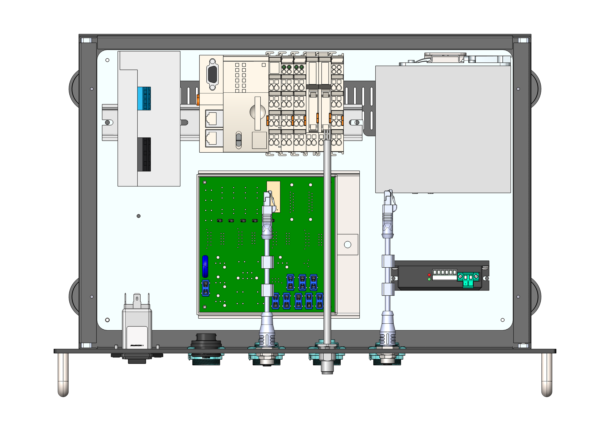
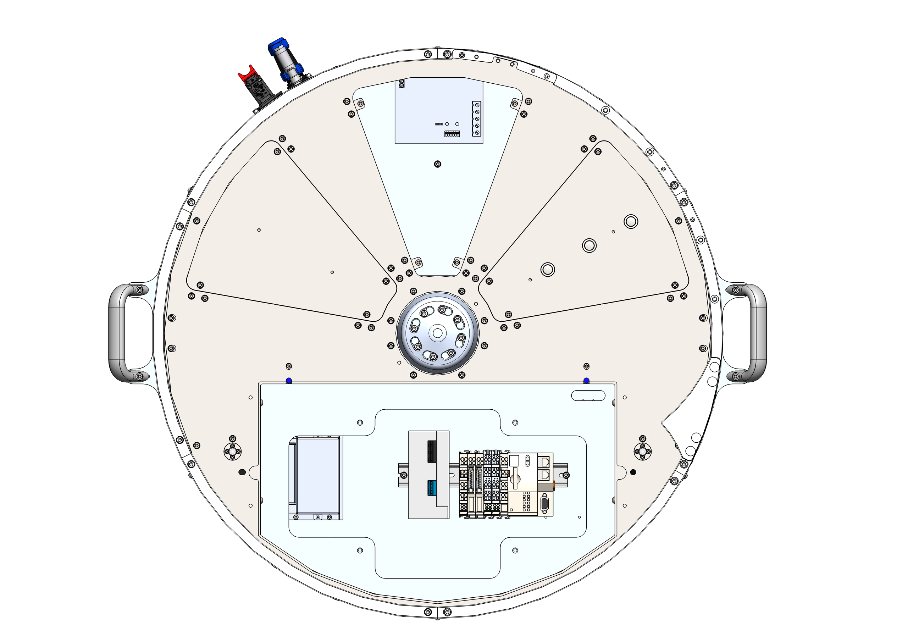

# **Remplacement des composants électroniques**

:::::{important}

:::{raw} html
   
:::

::::{list-table}
:widths: 30 60
:header-rows: 1
* - {ref}`Qualification de l'opérateur <operatori>`
  - {ref}`EPI nécessaires <dpi>`

* - **Mainteneur électricien**
  - :::{raw} html
       

         
         
         
       

    :::
::::
:::::

::::{warning}
<table style="width: 100%; border: none; background: transparent;">
  <tr style="background: transparent !important; border: none !important;">
    <td style="width: 10%; border: none; vertical-align: middle; text-align: center; background: transparent !important;">
      
    </td>
    <td style="width: 90%; border: none; vertical-align: middle; background: transparent !important; padding-left: 15px;">
      Débrancher l'alimentation électrique avant d'effectuer toute opération à l'intérieur du FlexiBowl®.
    </td>
  </tr>
</table>
::::

## Remplacement des principaux composants électroniques

Dans les tailles plus petites, toute l'électronique est contenue dans le rack, il suffit donc de démonter le panneau supérieur pour accéder à tous les composants. Dans les FlexiBowl® de taille 500 ou supérieure, en revanche, toutes les parties sont contenues dans la machine.

:::{raw} html

<!-- Tab bar -->

  <button class="fb-tab on"    onclick="fbSwitchTab('rack',this)">Électronique dans le rack</button>
  <button class="fb-tab"    onclick="fbSwitchTab('fb',this)">Électronique dans le FlexiBowl®</button>

<!-- ══════════ rack ══════════ -->

  

    

      
      
      

      
Sélectionner un composant dans la liste

    

    

      
N°ComposantDescription

      

    

  

<!-- ══════════ fb ══════════ -->

  

    

      
      
      

      
Sélectionner un composant dans la liste

    

    

      
N°ComposantDescription

      

    

  

:::

Dans les FlexiBowl® de taille 500 ou supérieure, la carte est ancrée à un support fixé sur la colonne à côté du backlight, du côté flip.

::: {figure} ../../../../_shared/media/images/schedapos.png
:align: center
:width: 90%
:::

:::{note}
Dans les FlexiBowl® de taille 650 ou supérieure, toute l'électronique est accessible par le haut en retirant l'illuminateur du backlight et le couvercle central du plateau supérieur. Sur le FlexiBowl® 500, il peut être plus pratique de démonter les carters pour accéder latéralement au groupe automate/alimentation 24 V et à la résistance de freinage.
:::

(scheda-interfaccia)=
## Maintenance de la carte d'interface

Cette section décrit le fonctionnement et la procédure de remplacement des **relais d'interface** et des **fusibles de protection** présents sur la carte d'interface.

La figure suivante montre la carte avec l'indication de la position des relais et des fusibles.

::: {figure} ../../../../_shared/media/images/schedafronte.png
:align: center
:width: 80%

Vue de face de la carte d'interface
:::

À l'arrière de la carte sont indiqués l'ampérage de chaque fusible et la référence de chaque relais d'interface.

(scheda-interfaccia-retro)=
::: {figure} ../../../../_shared/media/images/schedaretro.png
:align: center
:width: 80%

Vue arrière : références des relais et calibres des fusibles
:::

### Avertissements de sécurité

:::{danger}
**Risque électrique.** Avant d'intervenir sur la carte d'interface, mettre la machine hors tension au moyen de l'interrupteur général et attendre la décharge des condensateurs. Vérifier l'absence de tension avec un instrument de mesure approprié avant de toucher tout composant.
:::

Pendant les opérations de maintenance, respecter scrupuleusement les indications suivantes :

- l'intervention doit être effectuée exclusivement par du personnel technique qualifié et formé ;
- utiliser des équipements de protection individuelle (EPI) appropriés, y compris des gants antistatiques ;
- éviter de laisser tomber des outils ou des corps étrangers sur la carte pendant l'intervention ;
- ne pas remplacer un fusible par un fusible d'ampérage différent de celui d'origine ;
- ne pas forcer sur les relais lors de l'extraction : si un composant est bloqué, vérifier son bon accrochage avant de poursuivre ;
- à la fin de l'intervention, refermer correctement la porte/fente d'accès avant de rétablir l'alimentation.

### Description de la carte

(scheda-relè)=
#### Relais d'interface

La carte est dotée de cinq relais d'interface, identifiés par les sigles K1–K5. Le relais K1 est un relais électromécanique à double inverseur ; tous les autres relais (K2–K5) sont des relais statiques.

:::{list-table}
:widths: 10 55 35
:header-rows: 1

* - Réf.
  - Fonction
  - Type
* - K1
  - Relais d'interface pour backlight
  - Électromécanique à double inverseur
* - K2
  - Relais d'interface pour électrovanne du flip
  - Statique
* - K3
  - Relais d'interface pour électrovanne de soufflage central
  - Statique
* - K4
  - Relais d'interface pour électrovanne de soufflage radial
  - Statique
* - K5
  - Relais d'interface pour électrovanne de vidage (optionnel)
  - Statique
:::

(scheda-fusibili)=
#### Fusibles de protection

La carte est dotée de neuf fusibles de protection de type *automotive mini*. Le kit de fusibles de rechange est fourni avec le FlexiBowl®.

:::{list-table}
:widths: 10 70 20
:header-rows: 1

* - Réf.
  - Fonction
  - Calibre
* - F1
  - Alimentation principale
  - 10 A
* - F2
  - Alimentation 24 V — électrovannes flip, soufflage central/radial, vidage
  - 7.5 A
* - F3
  - Alimentation du connecteur STO
  - 2 A
* - F4
  - Alimentation vers le client
  - 5 A
* - F5
  - Capteur de vidage
  - 2 A
* - F6
  - Alimentation du backlight
  - 7.5 A
* - F7
  - Alimentation du backlight
  - 7.5 A
* - F8
  - Alimentation du moteur et du driver
  - 5 A
* - F9
  - Alimentation de l'automate
  - 7.5 A
:::

### Équipement nécessaire

- Extracteur pour fusibles *automotive mini* (ou pince à becs plats)
- Kit de fusibles de rechange fourni avec le FlexiBowl®
- Relais de rechange conformes à la référence d'origine (K1–K5)

### Remplacement des relais d'interface

La procédure s'applique au remplacement d'un ou de plusieurs relais d'interface (K1–K5).

1. Mettre la machine hors tension et vérifier l'absence de tension avec le multimètre, comme indiqué dans les avertissements de sécurité.
2. Accéder à la carte d'interface par l'ouverture prévue à cet effet.
3. Repérer le relais à remplacer en se référant à la {ref}`vue arrière <scheda-interfaccia-retro>` et au {ref}`tableau des relais <scheda-relè>`.
4. Si le relais à remplacer est **K1** (électromécanique), l'extraire délicatement de son support en tirant vers le haut sans forcer sur les bornes.
5. Si le relais à remplacer est **K2, K3, K4 ou K5** (statique), l'extraire avec la même précaution, en évitant de plier les broches de contact.
6. Insérer le relais de rechange dans le support en vérifiant que la référence et l'orientation correspondent exactement à celles du composant retiré.
7. Vérifier que le relais est correctement inséré et stable dans le support.
8. Refermer l'ouverture d'accès à la carte.
9. Rétablir l'alimentation et vérifier le bon fonctionnement de la fonction associée au relais remplacé.

### Remplacement des fusibles de protection

La procédure s'applique au remplacement d'un ou de plusieurs fusibles de protection (F1–F9).

1. Mettre la machine hors tension et vérifier l'absence de tension avec le multimètre, comme indiqué dans les avertissements de sécurité.
2. Ouvrir la fente d'accès aux fusibles de protection prévue à cet effet.
3. Repérer le fusible à remplacer en se référant à la {ref}`vue arrière <scheda-interfaccia-retro>` et au {ref}`tableau des fusibles <scheda-fusibili>`.
4. Extraire le fusible à l'aide de l'extracteur dédié (ou d'une pince), en le saisissant sans toucher les parties métalliques.
5. Si possible, vérifier la cause du déclenchement du fusible avant de procéder au remplacement.
6. Prélever dans le kit de rechange un fusible *automotive mini* de même calibre (ampérage) que celui indiqué dans le tableau.
7. Insérer le nouveau fusible dans son logement en vérifiant qu'il est correctement positionné.
8. Refermer la fente d'accès.
9. Rétablir l'alimentation et vérifier le bon fonctionnement du circuit protégé par le fusible remplacé.

:::{caution}
Ne jamais utiliser un fusible de calibre différent de celui d'origine.
:::

### Contrôles périodiques et maintenance préventive

- Vérifier périodiquement l'absence de signes de surchauffe ou de noircissement sur les relais, les fusibles et les supports.
- Vérifier que les connecteurs présents sur la carte sont correctement enfichés.
- Toujours disposer d'un stock du kit de fusibles de rechange.
- Consigner chaque remplacement effectué (date, référence du composant, cause) dans un registre de maintenance.
