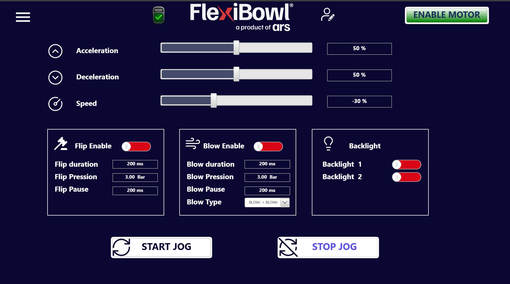

(tracking)=
# **Mode Circular Tracking**

## Fonctionnement en Tracking

L'option **Circular Tracking** permet de maximiser la productivité du FlexiBowl® en le faisant tourner de manière continue et sans interruption.
 Au lieu de s'arrêter à chaque cycle pour prendre la photo et laisser au robot le temps de prélever les pièces présentes dans la zone de vision, un encodeur suit l'angle de rotation effectué par la surface du disque rigide entre le moment de la prise de vue et celui de la saisie de la pièce par le robot.

:::{figure} ../../../../_shared/media/images/Tracking.png
:width: 50%
:align: center
:::

:::{image} ../../../../_shared/media/videos/TRACKING_MODE.GIF
:width: 100%
:align: center
:::

::::{tip}
Le fonctionnement en circular tracking déplace la zone de prise qui, si elle coïncide normalement avec la zone de vision, sera dans ce cas décalée en aval.
 Se référer au chapitre {ref}`Layout Best Practice <layoutbp>` pour plus d'informations sur le placement recommandé du robot et des autres accessoires en fonctionnement standard et en Circular Tracking.

:::{figure} ../../../../_shared/media/images/TrackingLayout.PNG
:width: 80%
:align: center
:::

::::
---

## Caractéristiques principales

<div class="tracking-features">

| Caractéristique | Description |
|---|---|
| **Performances** | Idéal pour maximiser les performances (jusqu'à 100 %) |
| **Zone de vision** | Un secteur en avant de la zone de prise |
| **Parallélisme** | Décharge du hopper, mouvement/impulsion du FlexiBowl®, vision et prélèvement exécutés simultanément |
| **Stabilité** | Plus grande stabilité du temps de cycle instantané |
| **Précision** | Précision inférieure à celle du mode standard |

</div>

---

## Cycle opérationnel

Le fonctionnement en circular tracking repose sur un cycle continu divisé en quatre phases qui se déroulent en parallèle :

```{list-table}
:header-rows: 1
:widths: 20 80

* - Phase
  - Description
* - **Detect**
  - La caméra acquiert l'image d'un secteur du FlexiBowl®, en anticipant la zone de prise.
* - **Move**
  - Le bowl tourne en continu, sans s'arrêter ; l'encodeur enregistre le déplacement angulaire en temps réel.
* - **Flip / Drop**
  - Les pièces mal orientées sont retournées ou déchargées dans la bonne position.
* - **Pick**
  - Le robot prélève les pièces en compensant le mouvement du FlexiBowl® grâce aux données de l'encodeur.
```

---

## Matériel et logiciel requis

Les composants suivants sont nécessaires pour activer le Circular Tracking :

- Option **Circular Tracking** sur le FlexiBowl®, disponible au tarif pour :

  | Taille | Code au tarif |
  |---|---|
  | FlexiBowl® 500 | Circular Tracking 500C · Circular Tracking 500CC |
  | FlexiBowl® 650 | Circular Tracking 650CC |
  | FlexiBowl® 800 | Circular Tracking 800C · Circular Tracking 800CC |
  | FlexiBowl® 1200 | Circular Tracking 1200C · Circular Tracking 1200CC |

- Option **conveyor tracking** sur le contrôleur du robot

(schema-di-collegamento)=
### Caractéristiques techniques de l'encodeur

L'option Circular Tracking comprend un encodeur relié à la rotation du disque. Le signal de l'encodeur est dédoublé à l'intérieur du FlexiBowl® et envoyé à la fois au driver du moteur et au contrôleur du robot.

:::{list-table}
:widths: 35 65
:stub-columns: 1

* - Modèle
  - 
* - Nombre max. d'impulsions
  - 49152 / 65536 impulsions/tour, selon la vitesse du FlexiBowl®
* - Interface de communication
  - Incrémental, TTL / HTL (réglage d'usine : TTL)
* - Certifications
  - Déclaration de conformité UE · Déclaration de conformité UK · Déclaration de conformité ACMA · Déclaration de conformité Maroc · China RoHS · cULus
* - Connexion sur le FlexiBowl®
  - {ref}`Passe-câble de l'encodeur <io-flexitrack>`
:::

---
## Page JOG 

La page **Jog Motor** permet de piloter le FlexiBowl® en mode circular tracking, sans utiliser de séquences programmées. Elle est principalement utilisée pendant les phases de configuration, de mise en service et de test du système, et permet à l'opérateur de contrôler directement la rotation du FlexiBowl® et les fonctions accessoires.


Pour plus d'informations, consulter la [page JOG](jog)

#### Comandi EXE JOG

| Commande | ControlWord | Busy pendant l'exécution | ReturnData_1 | Explication | 
|---|---|---|---|---|
| Start Jog Seq | 40 | OUI | 40 | Démarrer le Jog |
| Stop Jog Seq | 41 | OUI | 41 | Arrêter le Jog |

#### Comandi WRITE JOG

Les commandes du Jog (fonctionnement manuel continu) sont configurables séparément au moyen de ControlWord dans le bloc 20000.

| Commande | ControlWord | Range Data_1 | Notes |
|---|---|---|---|
| AccelerationJog | 20001 | 0–100 | Rampe d'accélération du jog (%) |
| DecelerationJog | 20002 | 0–100 | Rampe de décélération du jog (%) |
| SpeedJog | 20003 | 0–100 | Vitesse du jog (%). Valeurs 1000–1100 = vitesse négative (rotation inverse) |
| FlipJog_Enable | 20004 | 0–1 | 0 = flip désactivé, 1 = flip activé pendant le jog |
| FlipJog_Duration | 20005 | 0–1000 | Durée de l'impulsion de flip (ms) |
| FlipJog_Pressure | 20006 | 0–600 | Pression de flip (/100 = Bar) |
| FlipJog_Pause | 20007 | 0–1000 | Pause entre flips consécutifs (ms) |
| BlowJog_Enable | 20008 | 0–1 | 0 = blow désactivé, 1 = blow activé pendant le jog |
| BlowJog_Duration | 20009 | 0–1000 | Durée de l'impulsion de blow (ms) |
| BlowJog_Pressure | 20010 | 0–600 | Pression de blow (/100 = Bar) |
| BlowJog_Pause | 20011 | 0–1000 | Pause entre blows consécutifs (ms) |
| BlowJog_Type | 20012 | 0–2 | Type de blow : 0 = BLOWc, 1 = BLOWe, 2 = BLOWc+BLOWe |
| Backlight_1 | 20013 | 0–1 | 0 = éteint, 1 = allumé |
| Backlight_2 | 20014 | 0–1 | 0 = éteint, 1 = allumé |

#### Comandi READ JOG

Les mêmes commandes JOG accessibles en écriture (bloc 20000) sont lisibles dans le bloc 20100 :

| Commande | ControlWord READ | Plage ReturnData_2 |
|---|---|---|
| AccelerationJog | 20101 | 0–100 |
| DecelerationJog | 20102 | 0–100 |
| SpeedJog | 20103 | 0–100 (1000–1100 = négatif) |
| FlipJog_Enable | 20104 | 0–1 |
| FlipJog_Duration | 20105 | 0–1000 |
| FlipJog_Pressure | 20106 | 0–600 (/100) |
| FlipJog_Pause | 20107 | 0–1000 |
| BlowJog_Enable | 20108 | 0–1 |
| BlowJog_Duration | 20109 | 0–1000 |
| BlowJog_Pressure | 20110 | 0–600 (/100) |
| BlowJog_Pause | 20111 | 0–1000 |
| BlowJog_Type | 20112 | 0–2 |
| Backlight_1 | 20113 | 0–1 |
| Backlight_2 | 20114 | 0–1 |

::::{tip}
Pour les Codes d'erreur, consulter la page dédiée.
:::{card} ALLER À LA PAGE DÉDIÉE
:link: sec-err
:link-type: ref
:class-card: isw-card-field
:class-body: isw-card-body
:::
::::

---
## Avantages 


:::{grid-item-card} Avantages
- **Vitesse** : .
- **Stabilité du temps de cycle** : .
- **Empreinte au sol réduite** : .
:::

---
## Notes d'utilisation

:::{warning}
Le mode Circular Tracking offre des performances maximales mais avec une **précision légèrement inférieure** à celle du mode standard. Évaluer son adéquation en fonction des exigences de tolérance du composant à manipuler.
:::

:::{note}
Pour la configuration du paramètre de décalage entre la zone de vision et la zone de prise, se référer à la section de configuration logicielle du système.
:::

