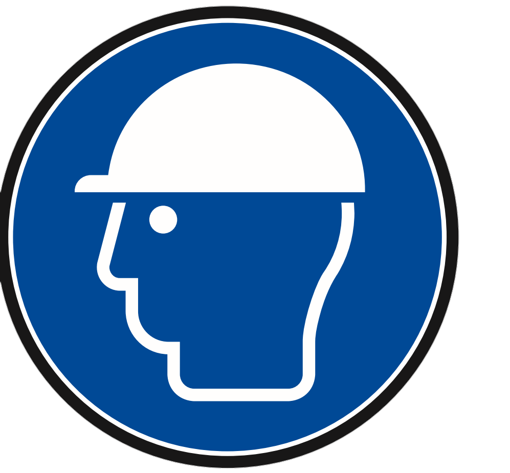

(trasporto)=
# **Transport et manutention**

## Emballage

La machine est expédiée par ARS S.r.l. de l'usine de production à celle du Client utilisateur. En fonction de la distance de transport, des demandes spécifiques du Client et de la durée de séjour de la charge dans l'emballage, l'expédition de la machine s'effectue de la manière suivante :

- emballage de protection normal pour les courtes et moyennes distances ;
- emballage de protection spécial pour les longues distances.

L'expédition doit être effectuée avec des moyens de transport couverts ou bâchés selon le type de chargement.

### **Inspection à l'arrivée**

```{note}
À la réception du produit, avant de signer le bon de livraison :

1. **Inspection extérieure de l'emballage** : Vérifier l'intégrité de la boîte et de l'emballage extérieur. Contrôler la présence d'éventuels signes de chocs, d'écrasements ou de mouillures.

2. **Vérification du contenu** : Comparer le contenu avec le bon de livraison. Vérifier la présence de tous les composants commandés.
```

### **En cas de dommages ou de divergences**

```{note}
Si des problèmes sont constatés :

- Ne PAS signer le récépissé comme « conforme »
- Noter les dommages sur le document de transport
- Photographier les éventuels dommages évidents
- Contacter immédiatement le service d'assistance ARS : [service@arsautomation.com](mailto:service@arsautomation.com) [us.service@arsautomation.com](mailto:us.service@arsautomation.com) en cas d'appel depuis l'Amérique
```

## Dimensions et poids de l'emballage

:::{list-table}
:widths: 20 20 20 20 20 20 20
:header-rows: 1

* - Spécification
  - FlexiBowl® 200
  - FlexiBowl® 350
  - FlexiBowl® 500/500E
  - FlexiBowl® 650
  - FlexiBowl® 800
  - FlexiBowl® 1200

* - Poids brut (avec emballage)
  - xxx kg
  - xxx kg
  - xxx kg
  - xxx kg
  - xxx kg
  - xxx kg

* - Dimensions de la caisse (mm)
  - xxxx
  - xxxx
  - xxxx
  - xxxx
  - xxxx
  - xxxx

:::

## Transport et manutention de l'emballage

:::{tip}
**Pendant le transport :**
- Manipuler toujours l'emballage en position verticale (respecter les flèches « HAUT » sur l'emballage)
- Ne pas faire tomber ni heurter le colis
- Utiliser des chariots ou transpalettes adaptés au poids
- Éviter les variations brusques de température
:::

:::{raw} html
   <style>
     .ars-img-row { display: flex; gap: 5px; align-items: center; justify-content: center; }
     .ars-img-row img { width: 25%; }
   </style>
:::

::::{list-table}
:widths: 30 60 60
:header-rows: 1
* - {ref}`Qualification de l'opérateur <operatori>`
  - {ref}`EPI nécessaires <dpi>`
  - Moyens de levage

* - **Conducteur de moyens de levage**
  - :::{raw} html
       <div class="ars-img-row">
         
         
         
         
       </div>
    :::
  - Chariot élévateur d'une capacité non inférieure à 50 kg
::::

:::{warning}
- Utiliser uniquement des moyens de levage appropriés et homologués, compatibles avec les dimensions et le poids du FlexiBowl®.
- S'assurer que personne ne stationne dans le rayon d'action du moyen de levage.
:::

Pour manutentionner le corps de la machine avec son emballage, procéder comme décrit :

::::{list-table}
:widths: 15 60
:header-rows: 1

* - Étape
  - Opération

* - 1
  - Positionner les fourches du chariot élévateur sous la caisse en bois dans laquelle est placée la machine.

* - 2
  - S'assurer que les fourches dépassent de l'avant de la charge (d'au moins 5 cm), sur une longueur suffisante pour éliminer tout risque de basculement de la partie transportée.

* - 3
  - Soulever les fourches jusqu'au contact avec la charge.
    :::{note}
    Si nécessaire, fixer la charge aux fourches avec des brides ou des dispositifs similaires.
    :::

* - 4
  - Soulever lentement la charge de quelques dizaines de centimètres et vérifier sa stabilité en veillant à ce que le centre de gravité de la charge soit positionné au centre des fourches de levage.

* - 5
  - Incliner le mât vers l'arrière (vers le poste de conduite) pour profiter du moment de renversement et garantir une plus grande stabilité de la charge pendant le transport.

* - 6
  - Adapter la vitesse de transport au revêtement du sol et au type de charge, en évitant les manœuvres brusques.

::::

::::{important}
Positionner les fourches du chariot élévateur comme indiqué sur la figure

::: {figure} ../../../../_shared/media/images/muletto.png
  :align: center
  :width: 50%
  :::

::::

### Stockage

:::{tip}
**Pendant le stockage :**
- Conserver dans un lieu sec et couvert
- Ne pas superposer d'autres charges sur l'emballage
- Ne pas monter sur l'emballage ni s'y appuyer
- Respecter les conditions environnementales indiquées dans le tableau précédent
:::

### Déballage

:::{tip}
**Pendant le déballage :**
- Ouvrir avec soin pour ne pas endommager les composants internes
- Conserver l'emballage d'origine pour d'éventuels retours ou transports futurs
- Vérifier la présence de tous les accessoires et de la documentation
:::

Pour **retirer l'emballage**, procéder comme décrit :

:::{list-table}
:widths: 15 60
:header-rows: 1

* - Étape
  - Opération

* - 1
  - Positionner le FlexiBowl® à l'emplacement qui lui est destiné.

* - 2
  - Dévisser le FlexiBowl® de la base de la caisse en bois utilisée pour l'expédition.

* - 3
  - Retirer de la caisse le dispositif USB et le dossier d'essai. Le conserver pour une utilisation ultérieure.

* - 4
  - {ref}`Soulever le FlexiBowl® <transflex>` et le retirer de la caisse.

:::

:::{warning}
Pour l'opération de levage manuel du FlexiBowl® hors de la caisse en bois, la présence de 2 opérateurs est nécessaire.
:::

Pour la manutention de la machine et/ou de ses parties, se référer au paragraphe {ref}`« Transport du FlexiBowl® » <transflex>`.

### Élimination de l'emballage

L'emballage fait partie intégrante de la fourniture et n'est pas repris ; son élimination est donc à la charge de l'acheteur. L'éventuelle élimination ou destruction doit être effectuée dans le respect des réglementations en vigueur dans le pays de l'utilisateur, en tenant compte de la nature des matériaux :
- bois pour les caisses ;
- film plastique pour la protection de la machine et rubans adhésifs pour leur fixation ;
- sachets de substance absorbant l'humidité ;
- etc.

(transflex)=
## Transport du FlexiBowl®

**ARS S.r.l.**, en fonction du mode de transport, utilise des emballages et des fixations adaptés pour garantir l'intégrité et la conservation pendant le transport.

À la réception de la machine, vérifier qu'aucune partie n'a subi de dommages pendant le transport et/ou la manutention. **Si des dommages sont constatés, il est obligatoire de les signaler immédiatement au Constructeur.**

Les activités de manutention décrites dans ce paragraphe doivent être effectuées par du personnel qualifié pour ces opérations : personnel spécialement formé pour exécuter en toute sécurité les opérations de chargement, de déchargement et de manutention au moyen de moyens de levage, et connaissant les règles de prévention des accidents.

:::{warning}
ARS S.r.l. ne répond pas des dommages aux biens ou aux personnes causés par des accidents provoqués par le non-respect des instructions figurant dans le présent manuel.
:::

Après le déballage, le FlexiBowl® se présente déjà entièrement monté. Se référer au tableau suivant pour les poids et les encombrements des différents modèles :

(dims&weight)=
:::{list-table}
:widths: 40 40 40
:header-rows: 1

* - Modèle
  - Poids
  - Encombrements

* - FlexiBowl® 200
  - 7 kg*
  - Ø240 x 196 mm

* - FlexiBowl® 350
  - 14 kg*
  - Ø384 x 234 mm

* - FlexiBowl® 500
  - 35 kg
  - 668 x 535 x 275 mm

* - FlexiBowl® 650
  - 51 kg
  - 821 x 694 x 314.50 mm

* - FlexiBowl® 800
  - 67 kg
  - 973 x 884 x 342 mm

* - FlexiBowl® 1200
  - 144 kg
  - 1386 x 1240 x 388 mm

:::

:::{note}
Mesure se référant uniquement au FlexiBowl® ; le rack pour l'électronique déportée, annexé aux tailles concernées, pèse 10 kg.
:::

:::{warning}
La norme **EN ISO 11228-1-2022** interdit de soulever manuellement des charges supérieures à 25 kg (la limite peut même être inférieure selon le sexe et l'âge de l'opérateur) ; par conséquent, pour des raisons de sécurité, l'utilisation de machines de levage est obligatoire pour les FlexiBowl® qui dépassent cette limite. Les FlexiBowl® qui dépassent la limite de 25 kg sont ceux de taille 500 et supérieure.
:::

Les FlexiBowl® de taille 500 et supérieure sont équipés d'anneaux de levage, à utiliser pour le transport de la machine de la boîte d'emballage à sa position finale.

::::{important}
Les anneaux de levage sont fixés sur des bases orientables : lors de l'élingage du FlexiBowl®, il est important de s'assurer que la charge se trouve dans le plan de l'œil de l'anneau et qu'elle ne dépasse pas 45° par rapport à l'axe vertical, situation qui pourrait provoquer des charges de cisaillement sollicitant les anneaux de manière anormale.

:::{figure} ../../../../_shared/media/images/din580.png
  :align: center
  :width: 50%
:::
::::

:::{warning}
Les poignées présentes sur les FlexiBowl® de taille 500 et supérieure ne sont **PAS** à utiliser pour le levage ; elles servent uniquement à guider la mise en place sur le plan de la machine.
:::

### Dimensionnement des câbles de levage

Le diamètre des câbles doit être suffisant pour supporter le {ref}`poids <dims&weight>` du FlexiBowl®, tandis que la longueur doit être telle qu'elle garantisse l'orientation correcte de la charge sur l'anneau selon les principes décrits ci-dessus, fondés sur la norme DIN 580 :

:::{figure} ../../../../_shared/media/images/FB650sol.png
  :align: center
  :width: 100%
:::

:::{list-table}
:widths: 50 50
:header-rows: 1

* - Modèle de FlexiBowl®
  - Longueur minimale des câbles A

* - 500
  - 300 mm

* - 650
  - 396 mm

* - 800
  - 495 mm

* - 1200
  - 687 mm
:::