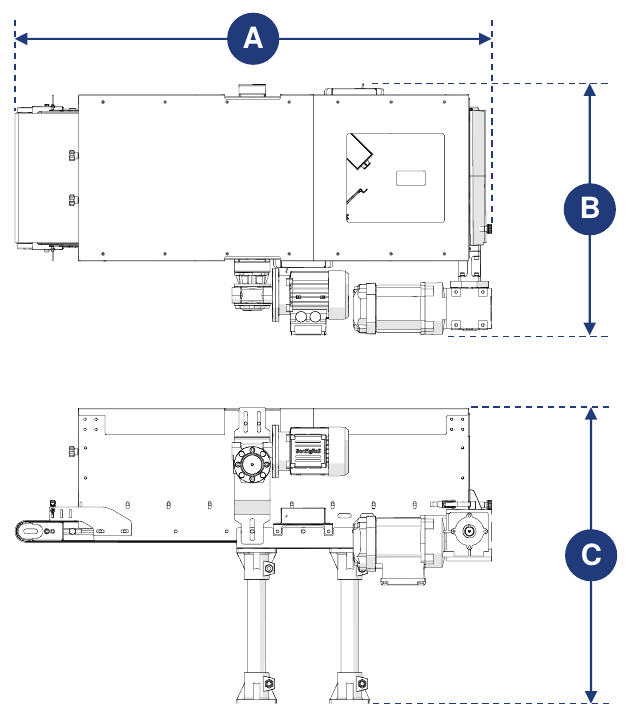
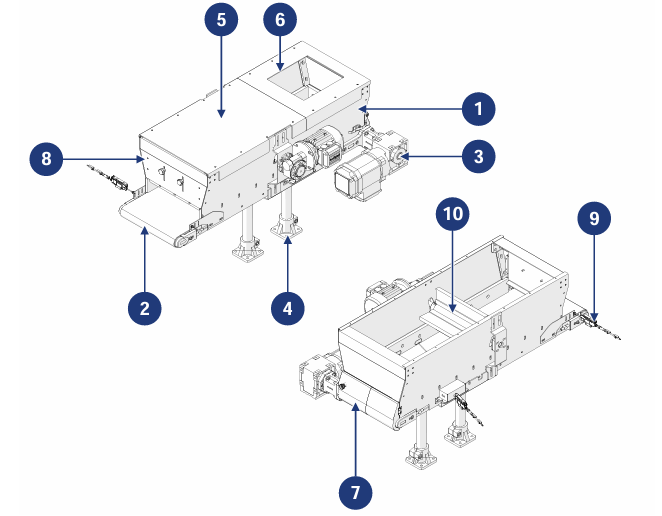

# **Description de la machine**

:::{important}
Pour pouvoir être utilisée, la machine incomplète doit être incorporée dans d'autres machines/machines incomplètes convenablement structurées.
:::

## Description

La Conveyor Hopper est conçue et construite pour recevoir des composants en vrac de petite, moyenne et grande taille depuis un système en amont et les transférer vers un système en aval.

Elle est entraînée par un motoréducteur relié à un rouleau d'entraînement, qui déplace le tapis convoyeur situé à la base de la trémie. À l'arrière se trouve une porte pour la vidange manuelle en fin de cycle, tandis qu'à l'avant se trouve une barrière doseuse permettant de régler la sortie du matériau.

La machine peut être associée à un système d'alimentation (fourni par le client) qui, en se connectant aux capteurs de présence fournis avec la machine, gère automatiquement le chargement du matériau sur le tapis.

## Utilisation prévue

| Opération | Autorisé | Non autorisé | Environnement |
|:--- |:--- |:--- |:--- |
| Manutention de composants en vrac de différentes tailles et caractéristiques | Oui | Tout usage autre que celui autorisé | Industriel |

:::{important}
La machine ne peut pas être utilisée pour transporter :
- des objets plus grands que les dimensions de la trémie ;
- des objets dont les surfaces extérieures sont adhésives ou collantes ;
- des objets tranchants susceptibles d'endommager la toile du tapis.
:::

La machine a été conçue pour répondre aux exigences spécifiques indiquées dans le contrat de vente et pour être utilisée conformément aux instructions et aux limites d'utilisation indiquées dans le manuel. Elle fonctionne en sécurité si :
- elle est incorporée dans une ligne dotée de dispositifs de sécurité et de protection adéquats, conformément aux normes en vigueur ;
- elle est utilisée dans les limites indiquées dans le contrat et dans le manuel ;
- les procédures du manuel d'instructions sont respectées ;
- l'entretien courant est effectué aux échéances et selon les modalités indiquées ;
- la maintenance extraordinaire est effectuée rapidement lorsque nécessaire ;
- les dispositifs de sécurité ne sont pas retirés et/ou neutralisés.

## Mauvais usage (raisonnablement prévisible)

- utilisation de la machine sans avoir préalablement lu le manuel d'instructions ;
- utilisation de la machine sans l'incorporer dans une ligne conformément aux normes en vigueur ;
- utilisation par des opérateurs non formés de manière adéquate ;
- utilisation de la machine comme point d'appui, même à l'arrêt ;
- utilisation visant à obtenir des valeurs de production supérieures aux limites prescrites ;
- utilisation d'une manière non spécifiée dans la section « Utilisation prévue ».

Tout autre usage non spécifié doit être préalablement autorisé par écrit par le Constructeur. En l'absence d'une telle autorisation, l'usage est considéré comme « incorrect » : le Constructeur décline toute responsabilité pour les dommages aux biens ou aux personnes et considère toute garantie comme caduque.

:::{important}
L'usage incorrect de la machine exclut toute responsabilité du Constructeur.
:::

## Obligations et interdictions

### Obligations des utilisateurs

L'utilisateur (entrepreneur ou employeur) doit :
- tenir compte des capacités et des conditions des opérateurs au regard de leur santé et de leur sécurité ;
- fournir des EPI adaptés à chaque procédure ;
- fournir des moyens et des procédures de levage standard ;
- s'assurer que les travailleurs respectent les règles de sécurité de l'entreprise et l'utilisation des dispositifs de protection collective et individuelle disponibles ;
- former le personnel aux procédures à suivre en cas d'accident ;
- former le personnel sur les risques résiduels existants ;
- former le personnel sur les dispositifs prévus pour la sécurité de l'opérateur ;
- former le personnel sur les risques liés à l'émission de bruit sur le lieu de travail ;
- former le personnel sur les règles générales de prévention des accidents établies par les directives européennes et par la législation du pays de destination.

Ne permettre de travailler sur la machine qu'au personnel ayant lu le manuel et formé de manière adéquate.

### Obligations du personnel affecté (opérateurs/techniciens de maintenance/techniciens)

Le personnel doit :
- effectuer les interventions de maintenance uniquement machine à l'arrêt ;
- attacher les cheveux longs afin d'éviter qu'ils ne s'accrochent ou ne contaminent le produit ;
- intervenir sur le tableau électrique, les boîtes de dérivation, les câbles et tous les composants électriques uniquement avec l'interrupteur général déclenché ;
- s'assurer que personne n'ait un accès direct aux parties en mouvement pendant le fonctionnement ;
- utiliser correctement les dispositifs de protection fournis par l'employeur ;
- signaler immédiatement à l'employeur, au dirigeant ou au préposé toute défaillance des dispositifs de sécurité.

### Interdictions pour le personnel préposé

Le personnel ne doit pas :
- utiliser la machine de manière inappropriée, c'est-à-dire pour des usages non spécifiés dans la section « Utilisation prévue » ;
- retirer ou modifier des dispositifs ou des signaux de sécurité sans autorisation ;
- effectuer de leur propre initiative des opérations ou des manœuvres qui ne relèvent pas de leur compétence ou qui peuvent compromettre leur sécurité ou celle d'autrui ;
- s'approcher de la machine en état d'ébriété ou sous l'effet de drogues ;
- remplacer ou modifier la vitesse et/ou la puissance des composants de la machine sans l'autorisation d'un responsable ;
- modifier le cycle de la machine ;
- modifier les raccordements électriques pour neutraliser les dispositifs de sécurité internes ;
- utiliser la machine si elle n'a pas été installée conformément aux normes applicables ;
- utiliser la machine comme point d'appui, même à l'arrêt (risque de chute et/ou de dommages) ;
- utiliser la machine en dehors des conditions environnementales admises (voir *Transport et incorporation*).

:::{attention}
Le Constructeur n'est pas responsable des dommages aux biens ou aux personnes si :
- il est établi que la machine a été utilisée en dehors des environnements admis ;
- les obligations et interdictions décrites dans le manuel n'ont pas été respectées.
:::

## Données techniques

```{list-table} Alimentation électrique
:header-rows: 0
:widths: 40 60

* - **Tension**
  - 400 Vac
* - **Puissance**
  - 0,18 kW (motorisation du tapis) · 0,09 kW (motorisation de la brosse, en option)
* - **Fréquence**
  - 50 Hz
```

```{list-table} Limites d'utilisation
:header-rows: 0
:widths: 40 60

* - **Poids maximal transportable**
  - 15 kg/m
* - **Vitesse maximale du tapis**
  - 8 m/min
```

:::{important}
Pour plus d'informations, se reporter au schéma électrique et aux manuels des sous-traitants, annexés au manuel.
:::

## Dimensions d'encombrement



| Dimension | Valeur |
|:--- |:--- |
| **Longueur (A)** | 1075 mm (avec motorisation à gauche) · 1050 mm (avec motorisation à droite) |
| **Largeur (B)** | 564 mm (avec motorisation à gauche) · 562 mm (avec motorisation à droite) |
| **Hauteur (C)** | 666 mm |

## Composants principaux



| Pos. | Description |
|:--- |:--- |
| 1 | Cuve de la trémie |
| 2 | Tapis convoyeur |
| 3 | Groupe d'entraînement |
| 4 | Pied d'appui |
| 5 | Couvercle de la trémie |
| 6 | Compartiment d'entrée du matériau |
| 7 | Porte arrière |
| 8 | Porte avant |
| 9 | Capteur de présence du matériau |
| 10 | Brosse motorisée *(composant en option)* |

## Cycle de travail

| Phase | Description |
|:--- |:--- |
| 1 | Le matériau, provenant du système en amont, est introduit dans la trémie par le compartiment de chargement et tombe sur le tapis. |
| 2 | Le tapis transporte le matériau vers la zone de sortie. |
| 3 | Le matériau est déchargé vers le système en aval selon les besoins de production. |

:::{important}
Les capteurs présents servent à vérifier la présence ou l'absence de produit sur le tapis, dans les zones d'entrée et de sortie.

Lors de l'incorporation, ils doivent être correctement raccordés afin de permettre la communication de la machine avec les systèmes en amont et en aval (non inclus dans la fourniture).
:::
