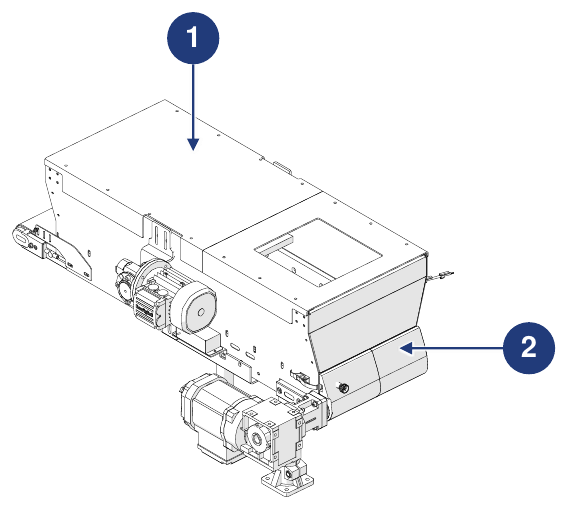
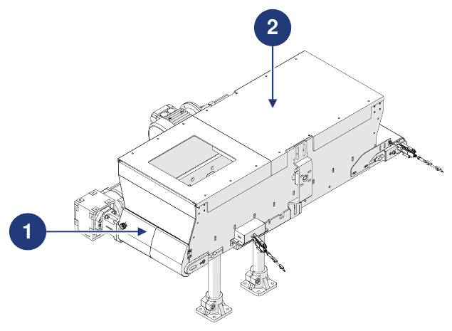

# **Informations préliminaires et sécurité**

:::{important}
Avant d'installer, d'utiliser ou d'effectuer la maintenance de la machine, lire attentivement l'intégralité du manuel et toute la documentation jointe.

Le non-respect des instructions fournies peut entraîner :
- des dommages à la machine ;
- la perte des conditions de sécurité ;
- des risques pour les opérateurs et les agents de maintenance ;
- la déchéance de la garantie.
:::

## Identification

### Constructeur

| | |
|:--- |:--- |
| **Constructeur** | ARS S.r.l. |
| **Adresse** | Via Aretina Nord, 157 – 52041 Pieve al Toppo (AR), Italie |
| **Contacts** | Tél. +39 0575 398611 · Fax +39 0575 398620 |
| **E-mail / Web** | info@arsautomation.com · www.arsautomation.com |

### Identification de la machine incomplète

| | |
|:--- |:--- |
| **Type** | Trémie avec tapis convoyeur motorisé |
| **Dénomination** | Conveyor Hopper |
| **Modèle** | CH60 |
| **Capacité** | 60 L |

### Plaque d'identification

La machine est équipée d'une plaque d'identification située du côté de la motorisation du tapis. En communiquant au Constructeur les données figurant sur la plaque, il est possible de retrouver l'identification exacte de la machine.

:::{warning}
**ATTENTION — Plaque d'identification**

Il est absolument interdit de retirer la plaque d'identification ou de la remplacer par d'autres plaques. Si la plaque est endommagée ou retirée accidentellement, le client est **tenu** d'en informer le Constructeur.
:::

## Déclaration d'incorporation

La machine est fournie avec la **Déclaration d'incorporation de machine incomplète**, rédigée conformément à la Directive Machines 2006/42/CE (Annexe II, partie 1, section B).

```{list-table}
:header-rows: 0
:widths: 30 70

* - **Machine**
  - Trémie à tapis 60 litres – Trémie avec tapis convoyeur motorisé, capacité 60 litres
* - **Modèle**
  - CH60, révision 1.0 et suivantes
* - **Fonction**
  - Système à tapis pour l'alimentation de composants en vrac
* - **Exigences essentielles appliquées**
  - 1.1.1, 1.1.2, 1.1.3, 1.3.7, 1.5.1, 1.5.5, 1.5.6, 1.5.8, 1.6.1, 1.7.1, 1.7.3, 1.7.4
* - **Directives**
  - 2006/42/CE (Directive Machines) · 2014/30/UE (Compatibilité électromagnétique)
* - **Documentation technique**
  - Rédigée conformément à l'Annexe VII, partie B, et mise à la disposition des autorités nationales sur demande motivée
```

:::{attention}
La machine incomplète ne doit pas être mise en service tant que la machine finale dans laquelle elle doit être incorporée n'a pas été déclarée conforme aux dispositions de la Directive 2006/42/CE.
:::

## Directives de référence

Avant la mise sur le marché, le Constructeur a effectué l'évaluation des risques afin de vérifier la conformité aux exigences essentielles de sécurité et de santé, ainsi que les essais et contrôles prévus par les normes de référence. Le dossier technique de construction est rédigé conformément à l'**Annexe VII** de la Directive 2006/42/CE et est disponible pour les organes de surveillance sur demande motivée.

La machine est mise sur le marché accompagnée de :
- Déclaration d'incorporation
- Manuel d'instructions *(point 1.7.4 et Annexe VI de la Directive Machines 2006/42/CE)*

| Référence | Description / Domaine d'application |
|:--- |:--- |
| **2006/42/CE** | Directive Machines |
| **2014/30/UE** | Directive Compatibilité électromagnétique |
| **UNI EN ISO 12100:2010** | Sécurité des machines – Principes généraux de conception – Appréciation du risque et réduction du risque |

## Destinataires, fourniture et conservation

Le manuel est destiné aux opérateurs chargés d'utiliser et de gérer la machine durant **toutes les phases de sa vie technique**. Avec la Déclaration d'incorporation, il fait **partie intégrante de la machine** et doit l'accompagner lors de tout déplacement ou revente.

| Aspect | Prescription |
|:--- |:--- |
| **Intégrité** | Conserver intact dans toutes ses parties. En cas de perte ou de détérioration, demander immédiatement une copie au Constructeur. |
| **Changements de propriétaire** | Il doit suivre la machine jusqu'à sa démolition (déplacements, vente, etc.). |
| **Format** | Fourni au format papier et électronique ; la documentation complémentaire est fournie en annexe. |
| **Annexes** | Les documents annexés en font partie intégrante ; les mêmes prescriptions s'appliquent. |
| **Langue originale** | Italien. En cas d'incohérences avec les traductions, le texte original fait foi. |
| **Mises à jour** | En cas de modifications ou de remplacements fonctionnels, la mise à jour incombe au Constructeur. L'utilisateur garantit que seule la version à jour est disponible sur les lieux d'utilisation. |

:::{attention}
Le Constructeur décline toute responsabilité en cas d'usage inapproprié de la machine et pour les dommages causés par des opérations non prévues dans la documentation technique.
:::

## Profils des opérateurs et qualifications

| Qualification | Définition |
|:--- |:--- |
| **Opérateur** | Personnel formé par le Constructeur, qualifié pour utiliser la machine en production. Il doit savoir exécuter toutes les opérations nécessaires au bon fonctionnement et protéger sa propre sécurité et celle de ses collègues. En cas de doute, il signale les anomalies à son responsable. **Il n'est pas autorisé à effectuer des interventions de maintenance.** |
| **Technicien de maintenance mécanique** | Technicien qualifié pour la maintenance préventive et corrective de toutes les parties mécaniques. Peut conduire la machine comme un opérateur, intervenir sur les réglages, la maintenance et les réparations mécaniques, et lire les schémas, les dessins techniques et les listes de pièces de rechange. Non qualifié pour intervenir sur des installations électriques sous tension. |
| **Technicien de maintenance électricien** | Technicien qualifié pour la maintenance préventive et corrective de toutes les parties électriques. Peut conduire la machine comme un opérateur, intervenir sur les réglages et les installations électriques, et lire les schémas électriques. En présence de tension, il ne peut intervenir dans les armoires et les boîtes de dérivation que s'il est une personne désignée (PEI – EN 50110-1). |
| **Conducteur d'engins de levage** | Personne en bonne santé, formée et instruite à la manutention des charges et à l'utilisation des engins de levage. |

Toutes les qualifications doivent relever de la catégorie **personne formée** : individu informé, instruit et formé au travail et aux dangers découlant d'un usage inapproprié, qui connaît l'importance des dispositifs de sécurité, des règles de prévention des accidents et des conditions de travail sûres.

## Symboles utilisés dans le manuel

| Symbole | Signification |
|:--- |:--- |
| **Attention / Danger** | Avertissements importants pour la sécurité de l'opérateur et/ou de la machine. |
| **Important / Remarque** | Informations importantes, également relatives à la sécurité du personnel impliqué dans l'utilisation de la machine. |

## Glossaire

| Terme | Définition |
|:--- |:--- |
| **Accessoires de levage** | Composants ou équipements non reliés aux machines, placés entre la machine et la charge ou sur la charge elle-même, permettant sa préhension. Les élingues et leurs composants sont également des accessoires de levage. |
| **ATEX** | De *ATmosphères EXplosibles* : nom conventionnel de deux directives de l'UE (2014/34/UE pour les appareils destinés à être utilisés en atmosphères explosibles ; 99/92/CE pour la sécurité et la santé des travailleurs en atmosphères explosibles). |
| **Chaînes, câbles et sangles** | Éléments conçus et construits pour le levage, faisant partie de machines ou d'accessoires de levage. |
| **Chariot élévateur** | Véhicule conduit par un opérateur pour la manutention de marchandises dans des entrepôts, des environnements industriels ou des cours, équipé de roues et entraîné par un moteur électrique, diesel ou à gaz. |
| **Dommage** | Toute conséquence négative résultant d'un événement dangereux. |
| **EPI** | Équipement de Protection Individuelle : vêtement ou équipement destiné à protéger celui qui le porte contre les risques pour la santé et la sécurité. |
| **Défaillance** | État d'une entité caractérisé par l'incapacité d'accomplir la fonction requise. |
| **Machine** | Ensemble équipé ou destiné à être équipé d'un système d'entraînement, composé de pièces ou de composants dont au moins un est mobile, reliés entre eux solidairement pour une application bien déterminée. |
| **Machine incomplète** | Ensemble qui constitue presque une machine, mais qui ne peut pas à lui seul assurer une application déterminée. |
| **Mesure de protection** | Mesure destinée à réduire le risque, mise en œuvre par le concepteur (conception intrinsèquement sûre, protecteurs, informations pour l'utilisation) et/ou par l'utilisateur (organisation, procédures de travail sûres, EPI, formation). |
| **Danger** | Source potentielle de blessure ou d'atteinte à la santé. |
| **Personne exposée** | Toute personne se trouvant entièrement ou en partie dans une zone dangereuse. |
| **Prévention** | Ensemble des dispositions ou mesures nécessaires, selon la particularité du travail, l'expérience et la technique, pour éviter les risques ou en réduire la probabilité. |
| **Protecteur** | Barrière physique, conçue comme partie de la machine, pour assurer la protection. |
| **Protecteur fixe** | Protecteur maintenu en position (fermé) de façon permanente ou par des systèmes de fixation (vis, boulons, etc.) qui empêchent son retrait ou son ouverture sans outils. Les systèmes de fixation faciles à retirer (par ex. boutons en plastique) ne sont pas admis. |
| **Protecteur mobile** | Protecteur relié mécaniquement à la structure (par ex. par des charnières ou des glissières) pouvant être ouvert sans l'aide d'outils. |
| **Risque** | Combinaison de la probabilité d'un dommage et de sa gravité. |
| **Risque résiduel** | Risque subsistant après l'adoption des mesures de protection et de prévention. |
| **Utilisation prévue** | Utilisation de la machine conformément aux informations fournies dans la notice d'instructions. |
| **Mauvais usage raisonnablement prévisible** | Utilisation de la machine d'une manière non prévue par le concepteur, mais pouvant résulter d'un comportement humain facilement prévisible. |

## Équipements de protection individuelle (EPI)

Lorsque l'on travaille à proximité de la machine (installation, maintenance, réglages), il est obligatoire de respecter les règles générales de prévention des accidents et d'utiliser les EPI prévus pour chaque opération. La tenue de celui qui intervient sur la machine doit respecter les exigences essentielles de sécurité du Règlement UE 2016/425 et les lois en vigueur dans le pays d'installation.

| Obligation | Description |
|:--- |:--- |
| **Gants** | Port obligatoire de gants de sécurité ou isolants à usage professionnel. |
| **Lunettes** | Port obligatoire de lunettes de sécurité pour protéger les yeux. |
| **Chaussures** | Port obligatoire de chaussures de sécurité pour protéger les pieds. |
| **Protection de l'ouïe** | Port obligatoire de casques ou de bouchons d'oreille pour protéger l'ouïe. |
| **Vêtements de protection** | Port obligatoire des vêtements de protection spécifiques. |
| **Lecture du manuel** | Il est obligatoire de lire (et de comprendre) les instructions d'utilisation et les avertissements de sécurité avant d'utiliser la machine. |

## Garantie

:::{important}
Les conditions complètes de garantie figurent dans le contrat de vente. Les conditions du contrat, si elles diffèrent, prévalent sur ce qui est indiqué dans cette section.
:::

La garantie est subordonnée aux conditions générales suivantes :
- l'ouverture de l'emballage et l'incorporation doivent avoir lieu en présence de techniciens autorisés par le Constructeur ;
- le premier démarrage et les essais doivent être effectués en présence et sous la direction des techniciens du Constructeur, sauf accord contraire entre les parties ;
- la machine doit être utilisée dans les limites déclarées dans le contrat et spécifiées dans la documentation technique ;
- l'entretien doit être effectué aux échéances et selon les modalités indiquées dans le manuel, avec des pièces de rechange d'origine et par du personnel qualifié.

La garantie est **caduque** en cas de :
- non-respect des règles de sécurité ;
- retrait ou altération des dispositifs de commande et de sécurité (protecteurs, capteurs, etc.) ;
- usage inapproprié de la machine ;
- utilisation par du personnel non formé et/ou non autorisé, ou ne remplissant pas les conditions prévues par le manuel ;
- modifications ou réparations effectuées par l'utilisateur sans l'autorisation du Constructeur ;
- non-respect, partiel ou total, des instructions ;
- anomalies de l'alimentation électrique ;
- absence d'entretien ;
- utilisation de pièces de rechange non d'origine ;
- événements exceptionnels tels que des inondations ou des incendies (s'ils ne sont pas causés par les machines).

## Mesures de sécurité

### Dispositifs de sécurité

La machine est conçue et équipée de systèmes de sécurité afin de réduire au minimum les risques pour l'opérateur.



| Pos. | Appareil | Description |
|:--- |:--- |:--- |
| 1 | **Protecteur fixe** | Protecteurs fixes (carters) qui, dans les zones à accès exclusif pendant la maintenance, empêchent l'accès aux zones dangereuses. Des outils spécifiques sont nécessaires pour les retirer. |
| 2 | **Protecteur mobile** | Protecteurs ouvrants (portillons) qui permettent, dans certaines situations, l'accès à la zone de travail. Pour les ouvrir en sécurité, il faut suivre des procédures spécifiques. |

:::{warning}
Pour l'incorporation de la machine dans la ligne finale, le raccordement électrique externe doit être prévu afin d'intégrer les fonctions de sécurité de la machine dans la logique de commande de la ligne elle-même.
:::

### Bruit

Le bruit a été mesuré conformément aux normes UNI EN 11200 et UNI EN ISO 3746. Pendant les cycles de travail, le personnel est exposé à un niveau de bruit :
- inférieur à **70 dB(A)** sans pièces à l'intérieur ;
- inférieur à **75 dB(A)** avec des pièces à l'intérieur. La valeur est basée sur l'expérience du Constructeur ; certaines pièces/composants, en raison de leur mouvement relatif provoqué par le tapis et la brosse, peuvent produire une émission supérieure. L'évaluation du bruit émis, en fonction de la spécification, incombe à l'intégrateur/incorporateur.

Le niveau de bruit réel de la machine installée dans un processus de production diffère de celui mesuré, car il est influencé par le type et les caractéristiques du site et par les autres machines en fonctionnement à proximité. L'utilisateur est responsable de l'application des mesures de prévention et de protection prévues par la législation du pays d'installation.

### Vibrations

Le niveau de vibrations produit par la machine est négligeable et non dangereux pour la santé des opérateurs.

:::{warning}
Des vibrations excessives ne peuvent être causées que par une panne mécanique, qui doit être signalée et résolue immédiatement afin de ne pas compromettre la sécurité de la machine et des opérateurs.
:::

### Compatibilité électromagnétique

La machine contient des composants électroniques soumis aux normes de Compatibilité Électromagnétique, concernés par des émissions conduites et rayonnées. Les valeurs d'émission respectent les exigences normatives grâce à l'utilisation de composants conformes, à des raccordements adéquats et, si nécessaire, à l'installation de filtres. La machine est donc conforme à la directive CEM.

:::{warning}
Toute maintenance non conforme sur l'installation électrique ou tout remplacement incorrect de composants peut compromettre l'efficacité des solutions adoptées.
:::

### Risques résiduels

La sécurité a été intégrée autant que possible dans la conception et la construction de la machine ; certains risques subsistent néanmoins, contre lesquels les opérateurs doivent être protégés.

| Risque | Description et indications |
|:--- |:--- |
| **Risques dus au transport** | Le déchargement de l'emballage, son ouverture et la manutention de la machine exposent au risque de charges suspendues et d'écrasement. Les procédures sont décrites dans la page *Transport et incorporation*. Ces opérations ne peuvent être effectuées que par du personnel expérimenté dans l'utilisation d'engins de levage et formé de manière adéquate, avec des EPI appropriés. |
| **Risque dû aux parties sous tension** | Les interventions de maintenance et l'accès à la machine exposent au risque électrique. Les travaux sur des installations sous tension ne peuvent être effectués que par du personnel expérimenté et qualifié. Prêter la plus grande attention aux pictogrammes de risque électrique ; ne pas effectuer de maintenance tant que l'alimentation n'a pas été coupée ; consulter les manuels des composants du commerce pour les indications spécifiques ; contrôler périodiquement le circuit équipotentiel en s'assurant qu'il n'y a pas de discontinuités. |
| **Risque dû à la présence de poussières, de fragments, etc.** | En fin de cycle, des résidus de matériau ou des accumulations de poussière peuvent subsister sur les surfaces de la machine. Nettoyer soigneusement après chaque utilisation, comme décrit dans la page *Maintenance*. |

:::{warning}
Le constructeur final de la ligne de destination doit pourvoir à la réduction des risques mécaniques dans les différentes zones de la machine, sur la base de l'analyse générale des risques de la ligne elle-même.
:::

:::{warning}
Les fonctions de sécurité de la fourniture ARS S.r.l. doivent être intégrées par le constructeur de la ligne de destination dans les fonctions de sécurité des autres machines incomplètes ou machines associées.
:::

**Il incombe à l'utilisateur de :**
- analyser les risques pouvant se présenter lors de la manutention et de l'incorporation dans ses locaux (les analyses relatives à la manutention ne tiennent compte que des caractéristiques de la machine) ;
- délimiter par un marquage au sol le parcours des chariots élévateurs et/ou des véhicules à guidage laser ;
- sensibiliser et former le personnel impliqué dans les opérations et dans l'utilisation de la machine ;
- apposer des signaux de sécurité visuels autour du poste de travail après avoir évalué les risques dans les zones de passage ou de contrôle.

### Pictogrammes de sécurité apposés sur la machine

La machine est fournie avec une série de pictogrammes qui permettent d'identifier immédiatement les risques résiduels.

:::{warning}
Il est interdit de retirer et/ou de remplacer les pictogrammes par d'autres de signification différente. L'utilisateur a l'obligation de remplacer ceux qui manquent ou qui sont peu lisibles.
:::



| Pos. | Description |
|:--- |:--- |
| 1 | Danger d'entraînement / d'écrasement des mains. |
| 2 | Interdiction de retirer les dispositifs de sécurité. |
