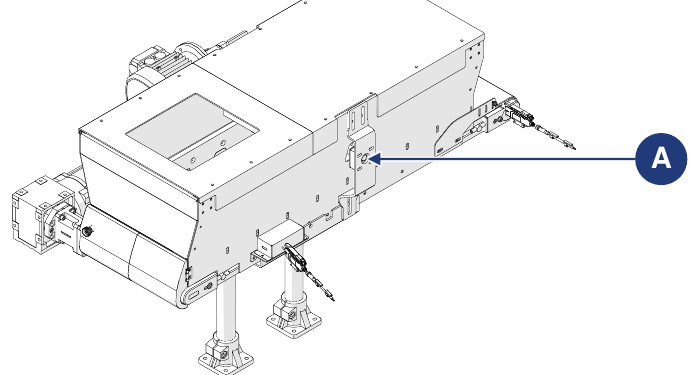

# **Maintenance**

:::{warning}
Effectuer la maintenance uniquement machine à l'arrêt et hors tension (interrupteur général du tableau d'alimentation en position « 0-OFF »). Apposer sur l'interrupteur général l'écriteau « MACHINE EN MAINTENANCE – NE PAS METTRE EN MARCHE ».
:::

:::{warning}
Les opérations de maintenance doivent être effectuées par du personnel qualifié et autorisé.
:::

La maintenance comprend les interventions (inspections, contrôles, réglages et remplacements) rendues nécessaires par l'utilisation normale.

**Lignes directrices pour une maintenance correcte :**
- utiliser uniquement des pièces de rechange d'origine et des outils adaptés à l'usage et en bon état ;
- respecter les fréquences d'intervention indiquées pour la maintenance programmée (préventive et périodique) : l'intervalle (exprimé en temps ou en cycles de travail) entre deux interventions s'entend comme le maximum admissible ; il ne doit pas être dépassé mais peut être réduit.

Une bonne maintenance préventive exige une attention constante et une surveillance continue de la machine. Vérifier immédiatement la cause de toute anomalie (bruit excessif, surchauffe, fuites de fluides, etc.) et y remédier : l'élimination rapide des causes d'anomalie prévient d'autres dommages et garantit la sécurité de l'opérateur.

Le personnel chargé de la maintenance doit être bien formé et connaître à fond les règles de prévention des accidents ; le personnel non autorisé doit rester en dehors de la zone de travail pendant les opérations. Le nettoyage et les réglages doivent eux aussi être effectués uniquement pendant la maintenance, machine à l'arrêt et déconnectée du tableau électrique.

:::{warning}
Les éventuelles réparations ou interventions de maintenance non indiquées dans le manuel ne peuvent être effectuées qu'avec l'autorisation préalable du Constructeur, qui ne répond pas des dommages aux personnes ou aux biens résultant d'opérations différentes de celles décrites ou effectuées de manière différente de ce qui est indiqué.
:::

| Type | Description |
|:--- |:--- |
| **Maintenance ordinaire** | Toutes les opérations que le mainteneur doit effectuer à titre préventif pour garantir dans le temps le bon fonctionnement de la machine : inspections, contrôles, réglages, nettoyage et lubrification. |
| **Maintenance extraordinaire** | Toutes les opérations que le mainteneur doit effectuer lorsque la machine l'exige : inspections, réparations, rétablissement des conditions nominales de fonctionnement ou remplacement d'une unité cassée, défaillante ou usée. |

## Maintenance ordinaire

La maintenance ordinaire comprend les inspections, les contrôles et les interventions qui, afin de prévenir les pannes, maintiennent sous contrôle :
- l'état mécanique de la machine ;
- la lubrification ;
- le nettoyage ;
- l'installation d'alimentation électrique.

Les fréquences indiquées se réfèrent aux conditions normales de fonctionnement, c'est-à-dire conformes aux conditions d'utilisation prévues.

### Contrôles et inspections

| Opération | Fréquence |
|:--- |:---: |
| Contrôler visuellement l'intégrité de tous les dispositifs de protection et de sécurité de la machine. | Quotidienne |
| Contrôler visuellement l'état d'usure et la propreté de la machine. | Quotidienne |
| Vérifier le bon fonctionnement des capteurs (le cas échéant). | Hebdomadaire |
| Vérifier le bon fonctionnement des entraînements. | Mensuelle |
| Contrôler l'état d'usure de l'isolation des câbles de raccordement et des connecteurs électriques. | Mensuelle |
| Vérifier la tension correcte de la toile du tapis. | Mensuelle |
| Contrôler l'état d'usure de la toile du tapis et la remplacer si nécessaire. | Semestrielle |

:::{important}
Pour la description des procédures de maintenance du tapis intégré dans la machine, se reporter au manuel du fournisseur du tapis, annexé à la documentation.
:::

### Nettoyage

:::{warning}
Les opérations de nettoyage doivent être effectuées par du personnel qualifié et autorisé. Respecter les normes en vigueur dans le pays d'installation pour le traitement des éventuelles eaux de lavage.
:::

| Opération | Fréquence |
|:--- |:---: |
| Nettoyage général. | Hebdomadaire |

:::{important}
Le nettoyage général doit être effectué chaque fois que du matériau est introduit dans la machine, afin d'éliminer les éventuels résidus du traitement précédent.
:::

:::{warning}
Ne jamais diriger de jets d'eau ou de liquides vers les parties électriques de la machine. Ne pas utiliser d'acides, de solvants, de substances inflammables ni d'outils abrasifs pour le nettoyage.
:::

**Nettoyage général**

| Phase | Action |
|:--- |:--- |
| 1 | Déconnecter l'alimentation de la machine. *Remarque : se référer au manuel de la ligne dans laquelle la machine est incorporée.* |
| 2 | À l'air comprimé ou avec un chiffon doux imbibé de détergent non agressif, éliminer les résidus de traitement et la saleté accumulés sur les surfaces. *Remarque : pour faciliter l'opération, accéder au tapis par la porte arrière.* |
| 3 | Éliminer les éventuels résidus de graisse et/ou d'huile des surfaces avec un chiffon doux imbibé de détergent non agressif. |
| 4 | Attendre que la machine soit complètement sèche avant de la remettre en service. |

### Lubrification

:::{important}
Aucun des entraînements de la machine ne nécessite de lubrification. Pour les opérations de lubrification, utiliser une pompe à graisse manuelle.
:::

| Opération | Fréquence |
|:--- |:---: |
| Graissage du support (A) de la brosse motorisée (en option). | Mensuelle |

## Maintenance extraordinaire

:::{warning}
Les interventions de maintenance extraordinaire et les réparations ne doivent être effectuées que par des techniciens qualifiés, formés et autorisés, employés par le Constructeur ou par le centre d'assistance agréé. Ces interventions exigent une connaissance approfondie et spécialisée de la machine, des opérations nécessaires, des risques associés et des procédures correctes pour travailler en sécurité.
:::

En cas d'événements exceptionnels nécessitant une maintenance extraordinaire, les mainteneurs ordinaires de l'utilisateur doivent :
- vérifier l'état des unités endommagées ou déphasées ;
- effectuer les opérations décrites dans cette section ;
- si les opérations à effectuer ne sont pas indiquées dans le manuel, envoyer au Constructeur le compte rendu de l'incident, le résultat de l'inspection et d'éventuelles observations.

Le Constructeur ou le centre d'assistance agréé évaluera chaque cas et conviendra avec le personnel de maintenance de la solution la plus adaptée :
- le Constructeur envoie un technicien autorisé, formé et qualifié pour effectuer les travaux nécessaires ;
- ou le Constructeur autorise les mainteneurs ordinaires de l'utilisateur à effectuer les travaux et envoie d'éventuelles instructions supplémentaires.

:::{warning}
Les pièces de rechange doivent être commandées auprès du Constructeur. Si le client n'utilise pas de pièces de rechange d'origine ou autorisées par écrit par le Constructeur, ce dernier est dégagé de toute responsabilité quant au fonctionnement de la machine et à la sécurité des opérateurs. Les autorisations et/ou instructions doivent toujours être fournies par écrit : en l'absence d'autorisation écrite, toute intervention est interdite.
:::

:::{important}
S'il est nécessaire d'exécuter des procédures non indiquées dans le manuel, ou en cas de doute, toute intervention est interdite. Contacter le Constructeur pour des éclaircissements.
:::

### Remplacement de la toile du tapis

| | |
|:--- |:--- |
| **Qualification de l'opérateur** | Agent de maintenance électrique |
| **Outils à utiliser** | Outils de vissage |

| Phase | Action |
|:--- |:--- |
| 1 | Dévisser les vis de fixation (A) du corps de la trémie à la plaque de support des pieds d'appui, des deux côtés de la structure. |
| 2 | Séparer le corps de la trémie (B) des pieds d'appui (C) : manuellement, avec deux opérateurs ; ou à l'aide d'un chariot élévateur (voir les informations sur la manutention dans *Transport et incorporation*). |
| 3 | Amener le corps de la trémie à l'établi. |
| 4 | Retirer les vis de fixation (D) du tapis à la trémie, des deux côtés de la structure. |
| 5 | Séparer le tapis (E) de la trémie (F). *Remarque : peut être effectué manuellement par un opérateur.* |
| 6 | Pour le remplacement de la toile, suivre les instructions du manuel du fournisseur du tapis. *Remarque : le manuel du fournisseur du tapis est annexé à la documentation.* |
| 7 | Remonter la machine en procédant dans l'ordre inverse. |
