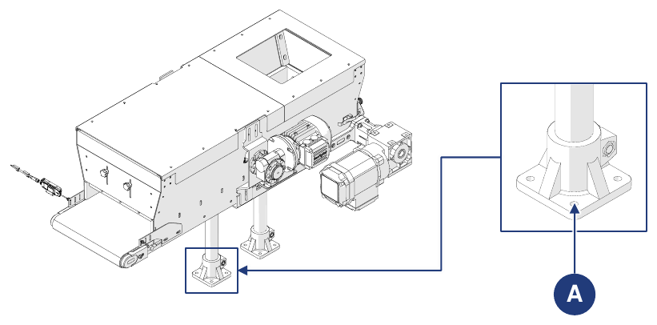

# **Transport et incorporation**

## Emballage

La machine est expédiée par le Constructeur depuis l'usine de production jusqu'au site du Client. Selon la distance, les demandes du Client et la durée de séjour dans l'emballage, l'expédition s'effectue avec :
- un emballage de protection normal pour les distances courtes et moyennes ;
- emballage de protection spécial pour les longues distances.

Le transport doit s'effectuer avec des véhicules fermés ou bâchés, selon le type de chargement.

À la réception de la machine, le client doit vérifier qu'il n'y a aucun dommage causé par le transport ou par le personnel chargé des opérations.
- Si des dommages sont constatés, laisser l'emballage tel quel et demander immédiatement l'estimation des dommages au transporteur ; envoyer ensuite un procès-verbal de dommages pour en informer l'assurance du transporteur et le point de vente.
- Si la machine est livrée en caisse sur palette ou sur des planches de bois protégées par un film rétractable, retirer d'abord l'emballage ou la protection. Pour libérer complètement la machine, retirer les vis et les feuillards métalliques. Soulever ensuite la machine avec une grue ou un chariot élévateur et retirer la palette utilisée pour le transport.

### Retrait de l'emballage

| Phase | Action |
|:--- |:--- |
| 1 | Amener la machine à l'emplacement prévu. |
| 2 | Déballer les parties livrées en caisse : retirer le film rétractable ; retirer les feuillards ; retirer la caisse ; retirer d'éventuels systèmes de fixation au plancher en bois. |
| 3 | Déballer les parties livrées sur palette : retirer les feuillards ; retirer le film rétractable ; retirer d'éventuels systèmes de fixation au plancher en bois. |

Pour manipuler la machine et/ou ses parties, voir la section *Manutention*.

### Élimination de l'emballage

L'emballage fait partie intégrante de la fourniture et n'est pas repris : il doit être éliminé par l'acheteur. Toute élimination ou destruction doit respecter les normes en vigueur dans le pays de l'utilisateur, en tenant compte de la nature des matériaux.

## Manutention

:::{important}
Les activités de manutention décrites dans cette section doivent être effectuées par du personnel qualifié et formé aux opérations de chargement, de déchargement et de manutention avec des moyens de levage. Le personnel doit être autorisé, formé à l'utilisation des moyens de levage et respecter les normes en vigueur en matière de protection individuelle.
:::

:::{warning}
Le Constructeur :
- n'est pas responsable des dommages aux biens ou aux personnes dus à des accidents causés par le non-respect des instructions du manuel ;
- n'est pas responsable des dommages à la machine résultant du non-respect des instructions fournies.
:::

### Unités et poids

La machine est normalement divisée et transportée selon les groupes suivants :

| Unité | Poids |
|:--- |:--- |
| **Corps de la trémie + tapis** | Voir document de transport |
| **Pieds d'appui** | Voir document de transport |

Dans certains cas, la machine peut également être transportée entière :

| Unité | Poids |
|:--- |:--- |
| **Machine complète (sans options)** | 45 kg |

Caractéristiques de l'emballage utilisé pour l'expédition :

| Emballage | |
|:--- |:--- |
| **Type d'emballage** | Caisse en bois |
| **Dimensions de la caisse** | 1200 x 800 x 650 mm |
| **Poids de la machine avec emballage** | 80 kg |

### Manutention avec chariot élévateur

| | |
|:--- |:--- |
| **Qualification de l'opérateur** | Conducteur d'engins de levage |
| **Moyen de levage** | Chariot élévateur |
| **Outils nécessaires** | Cordes, serre-joints ou similaires (si nécessaire) |

:::{danger}
- Utiliser uniquement des moyens de levage appropriés et homologués, compatibles avec les dimensions et le poids de la machine.
- S'assurer que personne ne se trouve dans le rayon d'action du moyen de levage.
:::

**Machine emballée**

| Phase | Action |
|:--- |:--- |
| 1 | Positionner les fourches du chariot sous la base de la charge à transporter. |
| 2 | S'assurer que les fourches dépassent de l'avant de la charge suffisamment pour éliminer le risque de renversement. |
| 3 | Soulever les fourches jusqu'à toucher la charge. *Remarque : si nécessaire, fixer la charge aux fourches avec des cordes, des serre-joints ou des dispositifs similaires.* |
| 4 | Soulever lentement la charge d'une dizaine de centimètres du sol et en contrôler la stabilité, en vérifiant que le centre de gravité se trouve à mi-longueur des fourches. |
| 5 | Adapter la vitesse de transport au sol et au type de charge, en évitant les manœuvres brusques. |

**Machine sans emballage**

| Phase | Action |
|:--- |:--- |
| 1 | Positionner les fourches du chariot sous le plan de travail de la machine. |
| 2 | S'assurer que les fourches dépassent de l'avant de la charge suffisamment pour éliminer le risque de renversement. |
| 3 | Soulever les fourches jusqu'à toucher la charge. *Remarque : si nécessaire, fixer la charge aux fourches avec des cordes, des serre-joints ou des dispositifs similaires.* |
| 4 | Soulever lentement la charge d'une dizaine de centimètres du sol et en contrôler la stabilité, en vérifiant que le centre de gravité se trouve à mi-longueur des fourches. |
| 5 | Adapter la vitesse de transport au sol et au type de charge, en évitant les manœuvres brusques. |

## Incorporation

### Préparatifs

Il incombe normalement à l'utilisateur de prévoir :
- les locaux (y compris les éventuels travaux de maçonnerie, tels que fondations ou canalisations, et l'éclairage) ;
- les installations électriques de la machine, selon les normes en vigueur dans le pays d'utilisation et en fonction de la logique de fonctionnement de la ligne dans laquelle la machine sera incorporée ;
- l'alimentation de la machine, y compris le conducteur de terre ;
- les services auxiliaires adaptés aux besoins de la machine ;
- les outils et consommables nécessaires à l'incorporation ;
- les éventuels lubrifiants nécessaires à la mise en service ;
- les moyens de levage et de manutention appropriés.

### Conditions environnementales admises

L'environnement d'utilisation doit être fermé, protégé des agents atmosphériques (pluie, grêle, neige, brouillard, poussière en suspension et poussières combustibles) et des agents agressifs (vapeurs corrosives, sources de chaleur excessive), et **ne doit pas être classé ATEX**. Il n'est pas permis d'utiliser la machine, les systèmes de commande associés et les entraînements dans des conditions différentes de celles énumérées.

En particulier, l'environnement d'utilisation ne doit pas être :
- exposé à des fumées corrosives ;
- exposé à une humidité excessive (supérieure à 85 %) et à des variations rapides de l'humidité relative (supérieures à 0,005 p.u./h) ;
- exposé à une poussière excessive ou abrasive ;
- exposé à des vapeurs huileuses ;
- exposé à des mélanges explosifs de poussières ou de gaz ;
- exposé à de l'air salin ;
- exposé à des vibrations, chocs ou coups anormaux ;
- exposé à des conditions atmosphériques défavorables au-delà des limites admises ou à des égouttements ;
- exposé à des conditions anormales de transport ou de stockage ;
- exposé à des variations de température élevées ou rapides (supérieures à 5 K/h) ;
- exposé à des rayonnements nucléaires.

La machine est conçue et construite pour fonctionner en sécurité dans les conditions environnementales suivantes :

| Condition | Valeur |
|:--- |:--- |
| **Température ambiante** | min. +5 °C / max. +40 °C |
| **Humidité relative** | min. 5 % / max. 90 % (sans condensation) |
| **Lieu d'installation** | Bâtiment industriel |
| **Surface d'appui** | Sol industriel en béton |
| **Éclairage** | Éclairage autour de la machine >100 lux ; éclairage à la disposition de l'opérateur ≥400 lux (néon) |

:::{warning}
Des conditions environnementales différentes de celles spécifiées peuvent causer de graves dommages à la machine. L'installation dans des environnements non conformes à ce qui précède entraîne la déchéance de la garantie sur les pièces à remplacer.
:::

:::{important}
Le plan de travail doit être suffisamment éclairé. En présence de zones d'ombre ou irrégulières sur le lieu de travail, il appartient à l'utilisateur de prévoir des dispositifs d'éclairage adéquats. Si ces exigences ne sont pas respectées, le Constructeur décline toute responsabilité.
:::

### Montage

Si la machine arrive divisée en groupes, ceux-ci doivent être assemblés.

| Phase | Action |
|:--- |:--- |
| 1 | Positionner la plaque de support des pieds d'appui en correspondance avec les trous de la base du corps de la trémie. |
| 2 | Fixer les deux groupes à l'aide des vis de fixation appropriées. |

### Positionnement

:::{important}
Le positionnement de la machine à l'intérieur de la ligne de destination doit se faire selon le layout convenu avec le Constructeur.
:::

Pour le positionnement et les raccordements successifs, prévoir une zone adaptée aux dimensions de la machine et des moyens de levage, en prêtant attention aux éventuels obstacles (autres machines, parois ou similaires) le long du parcours des moyens de manutention.

:::{important}
Une fois la position optimale de la machine sur le lieu de travail déterminée, celle-ci doit être fixée au sol au moyen de chevilles adaptées, à placer dans les trous prévus (A) sur les pieds d'appui.
:::

## Raccordements

Pour démarrer la machine, il est nécessaire de la raccorder correctement aux réseaux locaux : **raccordement électrique** (y compris la mise à la terre), conforme aux normes en vigueur dans le pays d'installation. Il incombe à l'utilisateur de garantir les caractéristiques de raccordement requises.

:::{warning}
Les raccordements requis doivent être effectués par du personnel qualifié et autorisé.
:::

### Raccordement électrique

:::{warning}
- Avant d'effectuer tout raccordement électrique, s'assurer que la machine est à l'arrêt et que l'alimentation électrique a déjà été coupée.
- L'opération doit être effectuée uniquement par du personnel spécialisé et autorisé (technicien de maintenance électricien).
:::

Avant de procéder au raccordement électrique, s'assurer que :
- le technicien de maintenance connaît parfaitement les normes en vigueur dans le pays d'installation ;
- les valeurs de fréquence et de tension d'alimentation de la machine correspondent à celles du réseau ;
- la section des câbles électriques est adaptée à l'absorption ;
- la ligne d'alimentation supporte les absorptions maximales de la machine ;
- la mise à la terre du circuit est conforme à la norme EN 60204-1 ;
- les matériaux de l'installation de mise à la terre ont une résistance adéquate ou une protection mécanique adéquate.

:::{warning}
Ne pas travailler avec les mains ou des objets mouillés. En cas d'incendie, ne pas utiliser d'eau sur les composants électriques.
:::

| | |
|:--- |:--- |
| **Qualification de l'opérateur** | Agent de maintenance électrique |
| **Outils à utiliser** | Outils de vissage |

:::{important}
L'utilisateur doit prévoir le raccordement de la machine à une ligne d'alimentation équipée d'un interrupteur général apte à sectionner l'alimentation énergétique de la machine.
:::

| Phase | Action |
|:--- |:--- |
| 1 | Insérer les câbles R, S et T dans les bornes respectives à l'intérieur de la boîte à bornes du moteur. *Remarque : s'assurer que la gaine en plastique a été retirée de l'extrémité du câble.* |
| 2 | Serrer les vis pour fixer les câbles aux bornes. |
| 3 | Fixer la cosse du câble de terre à la plaque de terre en serrant le boulon prévu à cet effet. *Remarque : s'assurer que la gaine en plastique a été retirée de l'extrémité du câble.* |
| 4 | Vérifier avec un testeur la présence des tensions prévues et des trois phases aux bornes. |
