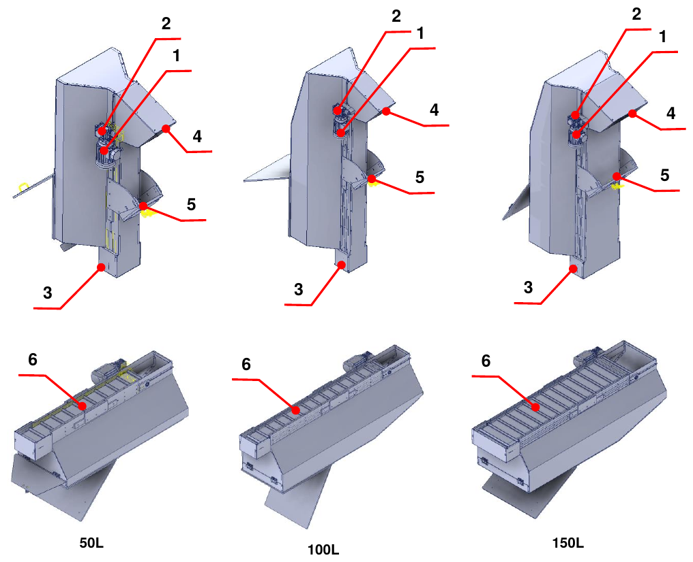
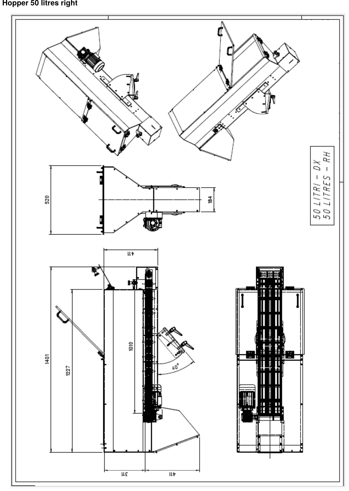
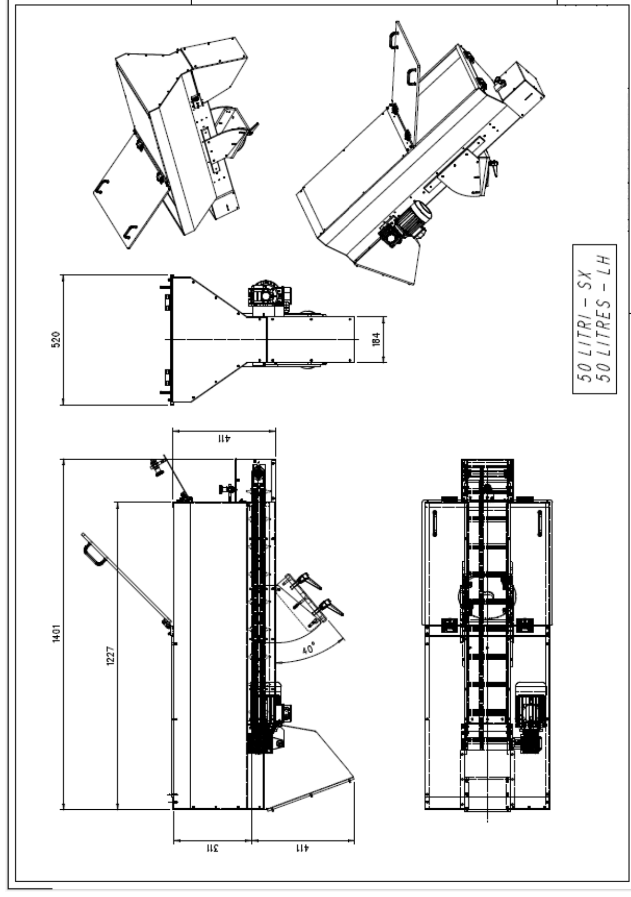
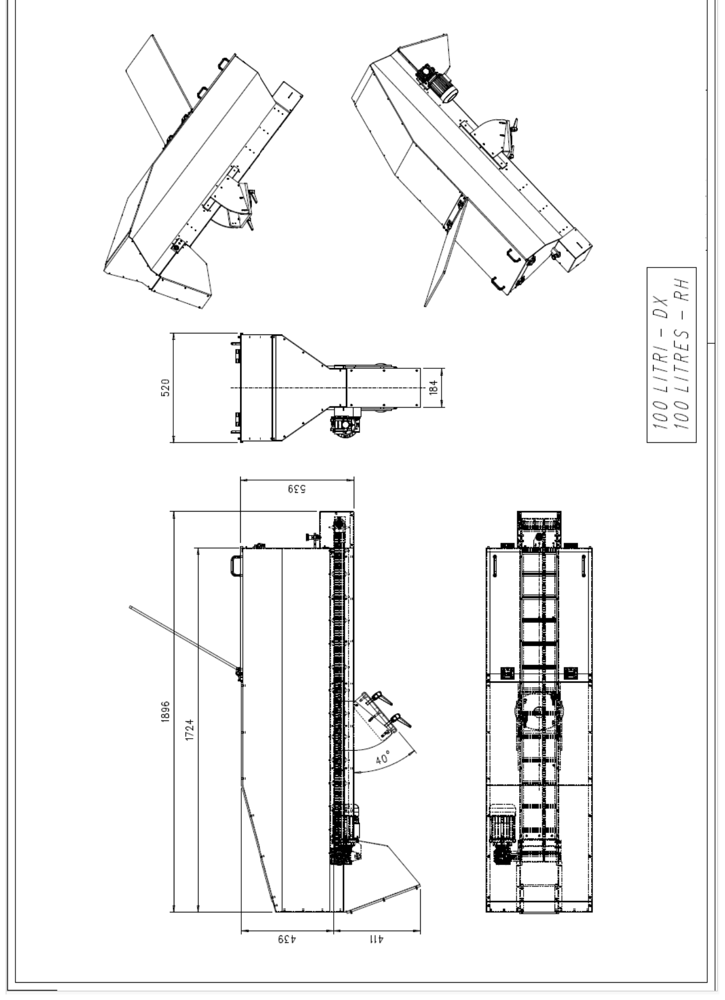
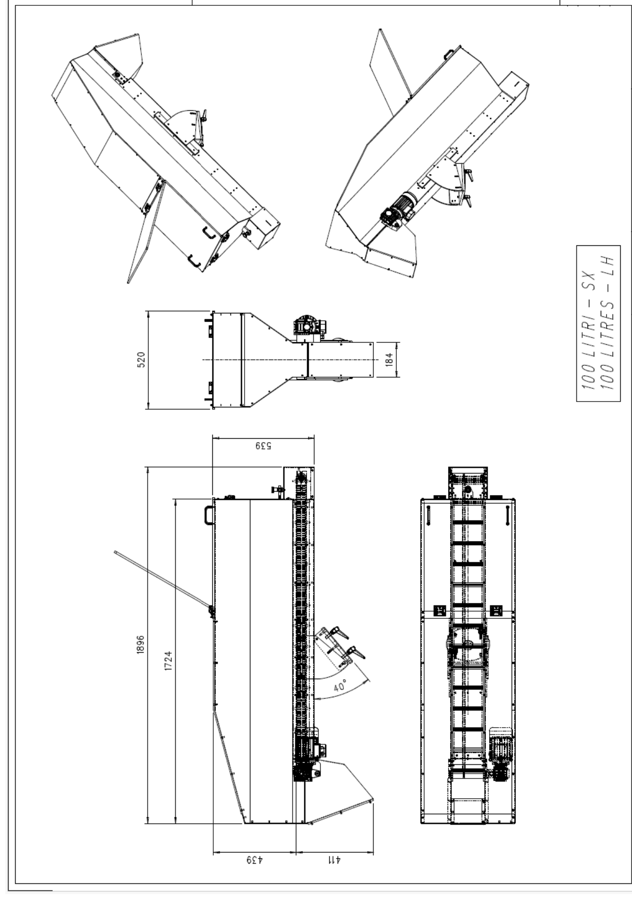
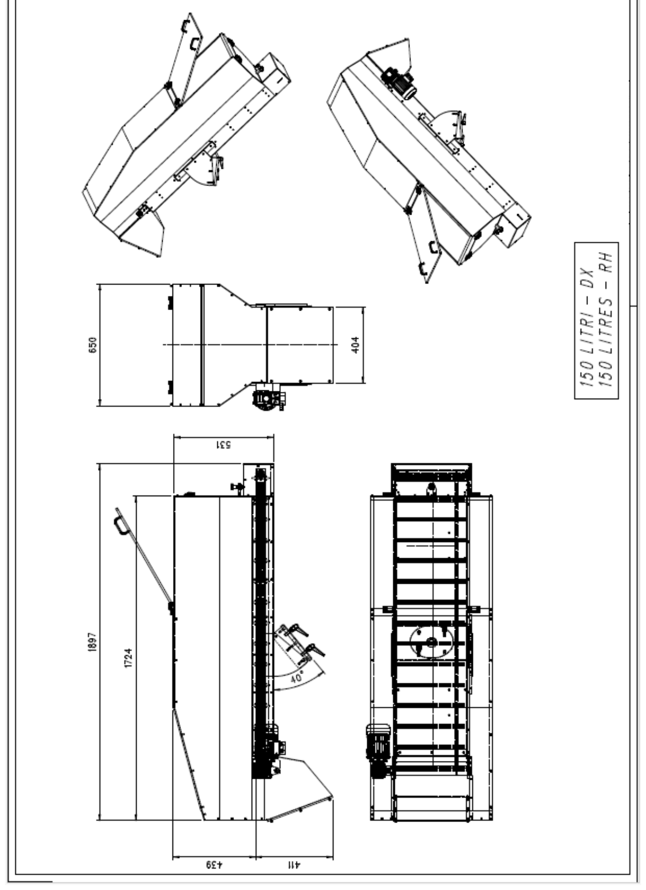
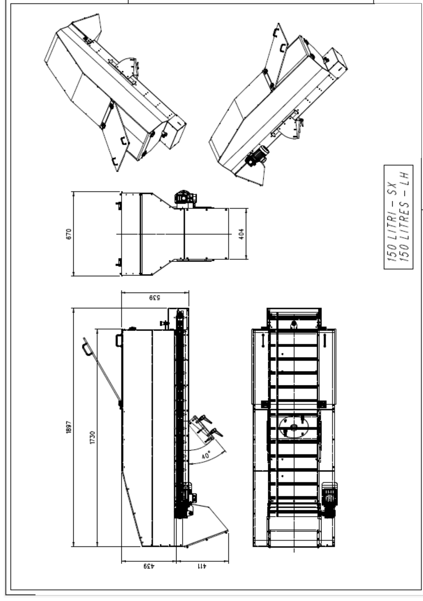
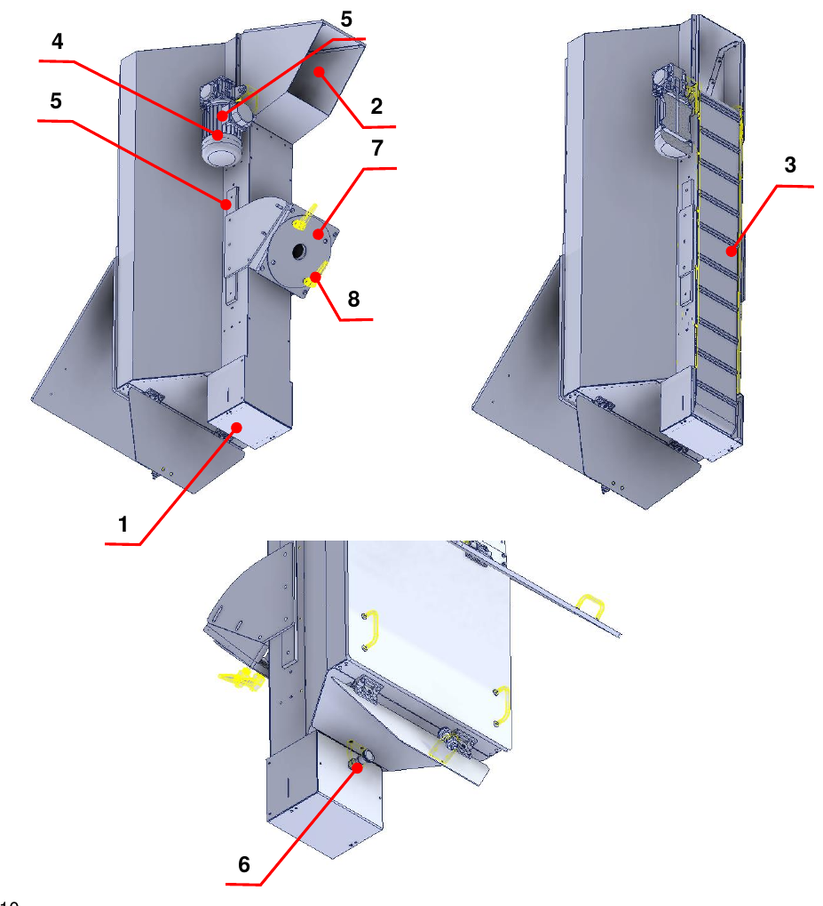

# **Description de la machine**

La machine incomplète est conçue et construite pour **transporter du matériau de bas en haut au moyen d'un tapis à palettes**.

## Implantation

| Pos. | Description | Pos. | Description |
|:--- |:--- |:--- |:--- |
| 1 | Moteur électrique | 4 | Porte de vidange |
| 2 | Réducteur | 5 | Support réglable |
| 3 | Porte de remplissage | 6 | Tapis à palettes |

## Données techniques

Les tableaux suivants présentent les principales caractéristiques techniques de la machine incomplète.

| | **50 litres** | **100 litres** | **150 litres** |
|:--- |:--- |:--- |:--- |
| **Matériau des palettes** | PVC | PVC | PVC |
| **Inclinaison maximale / minimale** | 50° / 34° | 50° / 34° | 50° / 34° |
| **Poids de la trémie** | 75 kg | 100 kg | 125 kg |
| **Diamètre du rouleau d'entraînement du tapis** | 50 mm | 50 mm | 50 mm |
| **Moteur d'entraînement du tapis** | 0,18 kW, 4 pôles, bride B14 – courant 0,75 A avec couplage étoile, 400 Vac | 0,18 kW, 4 pôles, bride B14 – courant 0,75 A avec couplage étoile, 400 Vac | 0,18 kW, 4 pôles, bride B14 – courant 0,75 A avec couplage étoile, 400 Vac |
| **Couple nominal** | 1,2 Nm | 1,2 Nm | 1,2 Nm |
| **Réducteur d'entraînement du tapis** | À vis sans fin, rapport 1:50 | À vis sans fin, rapport 1:50 | À vis sans fin, rapport 1:50 |
| **Charge maximale admise** | Volume 50 litres / poids 30 kg | Volume 100 litres / poids 30 kg | Volume 150 litres / poids 30 kg |

:::{note}
Les caractéristiques indiquées peuvent être modifiées : pour plus de précision ou pour des vérifications, se référer aux schémas annexés.
:::

## Dimensions d'encombrement

Pour chaque taille, la version avec motorisation à droite et à gauche est disponible.

### Trémie de 50 litres

### Trémie de 100 litres

### Trémie de 150 litres

## Description de la machine incomplète

La machine incomplète est dotée d'une structure de support sur laquelle se trouvent une porte de remplissage (1), par laquelle le matériau est introduit, et une porte de vidange (2) pour la sortie du matériau.

À l'intérieur de la trémie se trouve un tapis à palettes (3) entraîné par un moteur électrique (4) et un réducteur (5), qui déplace le matériau à l'intérieur de la machine incomplète.

Dans la partie inférieure se trouve la porte de remplissage, dont la fermeture et l'ouverture sont réglées par un pion d'indexage spécifique (6). Pour maintenir la machine incomplète en position, un support réglable (7) est prévu, actionnable au moyen de poignées dédiées (8).

