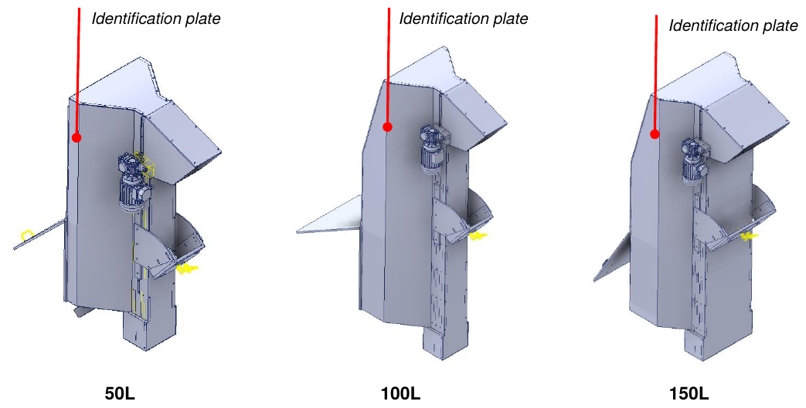
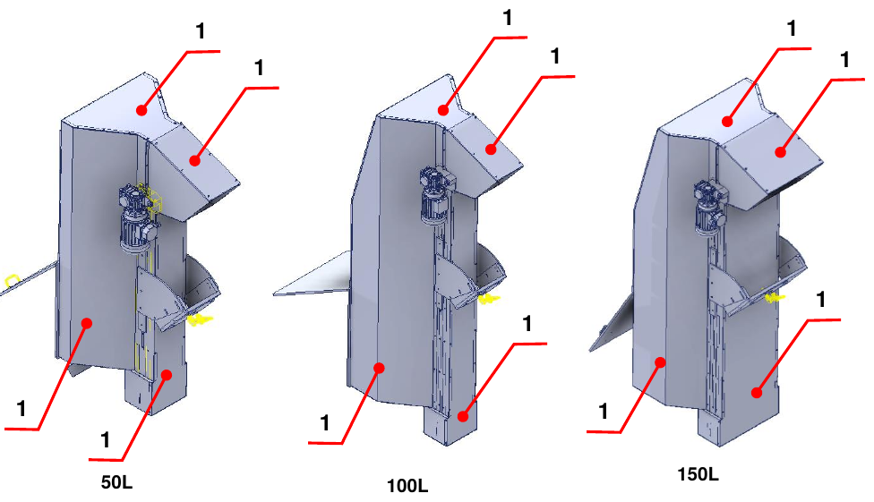
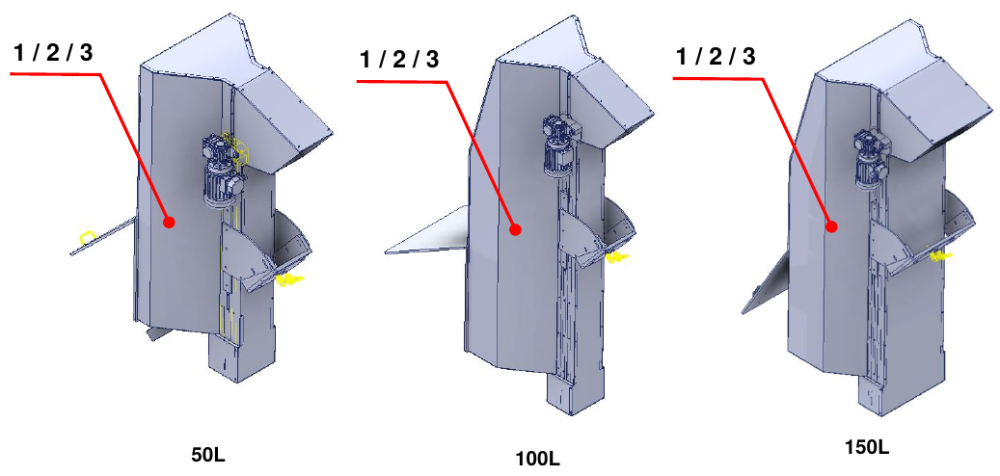

# **Informations préliminaires et sécurité**

:::{important}
Avant d'installer, d'utiliser ou d'effectuer la maintenance de la machine, lire attentivement l'intégralité du manuel et toute la documentation jointe.

Le non-respect des instructions fournies peut entraîner :
- des dommages à la machine ;
- la perte des conditions de sécurité ;
- des risques pour les opérateurs et les agents de maintenance ;
- la déchéance de la garantie.
:::

## Introduction

Le manuel contient toutes les informations nécessaires pour installer, utiliser et entretenir correctement la machine incomplète. Le Constructeur impose la lecture du document au personnel chargé de la conduite et de la maintenance, ainsi qu'au personnel chargé du transport et du montage.

Ce document est le manuel d'instructions pour le montage des **Motorized Hopper 50 L / 100 L / 150 L** (modèles TRM/MOT 50/100/150 D/S) et est rédigé conformément à la Directive Machines 2006/42/CE. Il fait partie intégrante de la machine incomplète et doit être conservé jusqu'à son démantèlement définitif, par les soins du responsable de la machine incomplète après l'installation finale.

:::{note}
ARS S.r.l., constructrice de la machine incomplète, est désignée dans le manuel comme le **Constructeur**. L'entreprise qui achète la machine incomplète est désignée comme le **Client**.
:::

## Assistance et contacts

Le Bureau Technique du Constructeur est toujours à disposition pour toute information ou clarification sur l'utilisation, la maintenance, l'installation, etc. Formuler les questions de manière claire, en se référant au manuel et en indiquant toujours les données figurant sur la plaque d'identification de la machine incomplète.

| | |
|:--- |:--- |
| **Constructeur** | ARS S.r.l. |
| **Adresse** | Via Aretina Nord, 157 – 52041 Pieve al Toppo (AR), Italie |
| **Contacts** | Tél. +39 0575 398611 · Fax +39 0575 398620 |
| **E-mail / Web** | info@arsautomation.com · www.arsautomation.com |

## Identification

La position de la plaque d'identification, avec les données principales de la machine incomplète, est indiquée sur la figure pour les trois tailles.

## Glossaire

| Terme | Définition |
|:--- |:--- |
| **Arrêt d'urgence** | Fonction destinée à éviter l'apparition de dangers ou à réduire ceux existants pour les personnes, les dommages à la machine ou au travail en cours, activée par une seule action humaine. |
| **Composant de sécurité** | Composant destiné à remplir une fonction de sécurité, mis sur le marché séparément, dont la défaillance et/ou le dysfonctionnement met en danger la sécurité des personnes, et qui n'est pas indispensable au fonctionnement de la machine incomplète. |
| **Directive Machines** | Directive 2006/42/CE du Parlement européen et du Conseil relative aux machines. |
| **Dispositif de protection** | Moyen de protection autre qu'un protecteur. |
| **Fournisseur** | Entité (constructeur, installateur, intégrateur de systèmes) qui fournit des équipements ou des services associés à la machine incomplète. |
| **Fonction de sécurité** | Fonction de la machine incomplète dont la défaillance peut entraîner une augmentation immédiate des risques. |
| **Défaillance** | Cessation de l'aptitude d'un élément à accomplir la fonction requise. |
| **Informations pour l'utilisation** | Mesure de protection consistant en moyens de communication (textes, mots, signaux, symboles, diagrammes) utilisés séparément ou en combinaison pour transmettre des informations à l'utilisateur. |
| **Dysfonctionnement** | Incapacité d'une machine incomplète à accomplir la fonction prévue. |
| **Marquage** | Symbole et inscription pour l'identification de la machine incomplète, apposés par le constructeur. |
| **Matériau** | Produit à manutentionner. |
| **Mesure de sécurité** | Moyen qui élimine ou réduit un danger. |
| **Opérateur** | Personne chargée de conduire la machine incomplète. |
| **Danger** | Source potentielle de dommage. |
| **Technicien qualifié / mainteneur spécialisé** | Personne ayant suivi des cours de spécialisation, une formation professionnelle, etc., et experte en installation, mise en service, maintenance, réparations, transport et manutention de la machine incomplète. |
| **Machine incomplète** | Ensemble qui constitue presque une machine, mais qui ne peut pas à lui seul assurer une application déterminée. Elle est destinée exclusivement à être incorporée ou assemblée à d'autres machines, machines incomplètes ou équipements pour constituer une machine régie par la directive. |
| **Protecteur** | Barrière physique, conçue comme partie de la machine incomplète, pour assurer la protection. |
| **Risque** | Combinaison de la probabilité d'un dommage et de sa gravité. |
| **Risque résiduel** | Risque subsistant après l'adoption des mesures de protection. |
| **Situation d'urgence** | Situation dangereuse qui doit être terminée ou évitée de toute urgence. |
| **Transport** | Ensemble des opérations nécessaires pour transférer la machine incomplète du lieu de montage du constructeur à son emplacement définitif chez le client. |
| **Utilisation prévue** | Utilisation de la machine incomplète conformément aux informations pour l'utilisation fournies dans les instructions. |
| **Mauvais usage raisonnablement prévisible** | Utilisation de la machine incomplète d'une manière non prévue par le concepteur, mais pouvant résulter d'un comportement humain facilement prévisible. |
| **Utilisateur** | Entité qui utilise la machine incomplète et les équipements électriques associés. |
| **Zone de travail** | Volume délimité par les protecteurs de sécurité et destiné au fonctionnement de la machine incomplète. |
| **Zone dangereuse** | Tout espace à l'intérieur et/ou autour de la machine dans lequel une personne peut être exposée à un danger. |

## Symboles utilisés dans le manuel

| Symbole | Signification |
|:--- |:--- |
| **DANGER** | Situation de danger imminent qui, si elle n'est pas évitée, peut causer des blessures graves ou la mort de l'opérateur. Identifie les opérations strictement interdites et les procédures obligatoires à appliquer pour les éviter. |
| **AVERTISSEMENT** | Situation de danger potentiel qui, si elle n'est pas évitée, peut causer des blessures graves ou la mort de l'opérateur. Décrit des opérations nécessitant une attention particulière. |
| **ATTENTION** | Situation de danger non immédiat ou potentiel qui, si elle n'est pas évitée, peut causer des blessures, même légères, ou des atteintes à la santé de l'opérateur. |
| **REMARQUE** | Informations importantes et/ou procédures qui, si elles sont ignorées ou observées seulement en partie, peuvent endommager la machine incomplète ou les équipements connectés. |
| **INFORMATIONS COMPLÉMENTAIRES** | Informations utiles et/ou renvois à d'autres documents (manuels d'instructions annexés, documents techniques ou autres sections du manuel). |

## Règles de sécurité

Les prescriptions, instructions, règlements et notes de sécurité associés décrits dans le manuel définissent les comportements et les règles à suivre dans les activités constituant l'utilisation prévue de la machine incomplète, afin d'opérer en sécurité pour le personnel, les équipements et l'environnement environnant. Les instructions de sécurité s'adressent à tout le personnel autorisé, formé et délégué aux activités de :
- transport ;
- installation ;
- utilisation ;
- gestion ;
- maintenance ;
- nettoyage ;
- mise hors service et démantèlement.

## Responsabilité du Constructeur

Le Constructeur décline toute responsabilité découlant d'une utilisation erronée ou inappropriée de la machine incomplète et des dommages causés par l'utilisation de pièces de rechange non prescrites, par des opérations de maintenance mal effectuées et par des altérations de circuits et de composants.

La responsabilité de l'application des exigences de sécurité incombe au personnel technique responsable des activités prévues pour la machine incomplète, qui doit s'assurer que les opérateurs autorisés sont qualifiés, respectent et connaissent les prescriptions du manuel et les règles de sécurité de caractère général. Le non-respect des instructions de sécurité peut causer des blessures aux personnes et des dommages aux équipements.

## Gestion de la machine incomplète

La gestion n'est permise qu'aux personnes autorisées et formées de manière adéquate, ou en tout cas dotées d'une compétence technique suffisante. Quiconque utilise et entretient la machine incomplète doit savoir que la connaissance et l'application des règles de sécurité font partie intégrante de son travail.

Avant de démarrer la machine incomplète :
- lire attentivement le manuel ;
- savoir quels protecteurs et dispositifs d'arrêt d'urgence sont présents, où ils se trouvent et comment ils fonctionnent.

Il est strictement interdit de retirer, même partiellement, les protecteurs, les dispositifs de sécurité et les plaques d'avertissement apposés sur la machine incomplète. En cas de dysfonctionnement ou de panne de ces dispositifs, ils doivent être réparés ou remplacés immédiatement.

## Garantie

Le Constructeur garantit que ses machines sont exemptes de défauts de matériau et/ou de fabrication. Pour toute précision, se référer aux conditions contractuelles.

- L'acheteur a droit uniquement au remplacement des pièces reconnues défectueuses ; les frais d'emballage, de transport et d'éventuelle installation sont à sa charge. Dans ce cas, il faut préciser : la date et le numéro du document d'achat, le modèle de la machine incomplète, le numéro de série.
- Aucune indemnisation n'est reconnue pour la perte de production causée par d'éventuelles périodes d'inactivité de la machine incomplète.
- Sont exclus de la garantie les dommages causés par une utilisation autre que celle indiquée dans le manuel, y compris une maintenance non conforme aux instructions.
- La garantie n'est pas reconnue pour les machines incomplètes sur lesquelles des modifications non autorisées ont été effectuées. Les modifications ou altérations des dispositifs de sécurité sont strictement interdites.
- En cas de dommages pendant la période de garantie, la garantie n'est valable qu'avec l'utilisation de pièces de rechange d'origine.
- Les réparations ne peuvent être effectuées que par des opérateurs qualifiés connaissant la machine incomplète.

## Sécurité

### Informations générales

Le Client doit former les opérateurs sur les risques d'accident, sur les dispositifs de sécurité installés sur la machine incomplète et sur les règles générales de prévention des accidents prévues par les directives communautaires et par la législation du pays d'installation. Les opérateurs doivent connaître la position et le fonctionnement de toutes les commandes ainsi que les caractéristiques de la machine incomplète.

L'altération ou le remplacement non autorisé d'un ou de plusieurs composants, l'adoption d'accessoires et l'utilisation de pièces autres que celles recommandées peuvent entraîner des risques de blessure.

:::{warning}
Il est absolument interdit de neutraliser ou d'altérer les dispositifs de sécurité de la machine incomplète. Le Constructeur décline toute responsabilité quant à la sécurité de la machine incomplète en cas de non-respect de cette interdiction.
:::

:::{warning}
Il appartient à l'opérateur qui utilise la machine incomplète de s'assurer que la zone est sûre et libre de personnes et/ou d'objets.
:::

### Certification

La machine incomplète est fournie avec la Déclaration d'incorporation, conformément aux exigences essentielles de sécurité spécifiées dans la Directive Machines 2006/42/CE (Annexe II B) et dans la Directive Compatibilité électromagnétique 2014/30/UE.

:::{note}
Toute modification apportée à la machine incomplète annule immédiatement la Certification d'incorporation délivrée par le Constructeur.
:::

### Usages prévus et non prévus

La machine incomplète est conçue et construite pour **transporter du matériau de bas en haut au moyen d'un tapis à palettes**. Elle ne peut pas être utilisée à des fins autres que celles prévues ni pour le traitement de pièces au-delà des limites convenues.

:::{danger}
L'utilisation de la machine incomplète à des fins de traitement non décrites dans le manuel constitue un **USAGE INAPPROPRIÉ**. Le Constructeur décline toute responsabilité pour les dommages aux biens et/ou aux personnes et considère toute garantie comme caduque. Le Constructeur décline toute responsabilité en cas d'altération, de modifications non autorisées ou d'opérations de maintenance effectuées par du personnel non formé.
:::

:::{warning}
La machine incomplète ne doit être utilisée que par des opérateurs expérimentés et qualifiés ayant lu et compris le contenu du manuel.
:::

:::{note}
Il est interdit d'effectuer le moindre mouvement en cas de comportement anormal de la machine incomplète ou de manque d'alimentation, car cela relève de la compétence spécifique du personnel de maintenance.
:::

### Conditions environnementales de fonctionnement

La machine incomplète doit être installée dans un environnement couvert, doté de toutes les mesures de sécurité prévues par les lois en vigueur dans le pays de l'utilisateur.

| Aspect | Indication |
|:--- |:--- |
| **Protection incendie** | La machine incomplète ne dispose pas de son propre système anti-incendie. |
| **Atmosphère explosive** | Elle n'est ni conçue ni construite pour fonctionner dans des atmosphères explosives ou partiellement explosives. |
| **Éclairage** | Elle ne dispose pas de son propre système d'éclairage : il est du devoir et de la responsabilité du client de la placer dans une zone correctement éclairée. |
| **Bruit** | Mesuré conformément aux normes acoustiques. À vide, le bruit global généré est inférieur à **75 dB(A)**, mesuré au poste de l'opérateur. Le niveau réel dépend du type de traitement ; la mesure de l'exposition des travailleurs au bruit incombe à l'utilisateur, conformément à la législation en vigueur dans son pays. |
| **Émissions électromagnétiques** | Les valeurs d'émission sont conformes aux normes grâce à l'utilisation de composants compatibles CEM, de raccordements adéquats et, si nécessaire, de filtres. Une maintenance non conforme de l'installation électrique ou un remplacement incorrect de composants peut en compromettre l'efficacité. |
| **Vibrations** | La machine incomplète ne produit pas de vibrations dangereuses pour la santé du personnel. Des vibrations excessives ne peuvent être causées que par une panne mécanique, à signaler et à éliminer immédiatement. |

### Fonctions de sécurité

| Type de dispositif | Fonction |
|:--- |:--- |
| **Protecteurs fixes** | Séparation des zones dangereuses de la machine incomplète. |

**Protecteurs fixes :** empêchent l'accès aux parties en mouvement pendant le fonctionnement. Ils ne sont pas contrôlés et ne doivent être retirés que pour des opérations de maintenance, les sources d'énergie de la machine incomplète étant déconnectées.

:::{warning}
Le Constructeur n'est en aucun cas responsable si la machine incomplète est utilisée avec des protecteurs incomplets, ouverts et/ou non installés.
:::

### Équipements de protection individuelle (EPI)

L'opérateur doit utiliser les équipements de protection individuelle afin de réduire au minimum la possibilité de risques.

:::{warning}
Le personnel doit porter des vêtements de travail adaptés pour prévenir les accidents. Pour éviter les risques mécaniques (entraînement, coincement, etc.), garder les cheveux attachés et ne pas porter de bracelets, de montres, de bagues ni de chaînes.
:::

:::{note}
La tenue de toute personne travaillant ou effectuant la maintenance sur la machine incomplète doit respecter les exigences essentielles de sécurité établies par les directives de l'UE et par les lois du pays d'installation.
:::

### Risques résiduels

Lors de la conception, toutes les zones ou parties à haut risque ont été évaluées et les précautions nécessaires ont été prises pour éviter les risques pour les personnes et les dommages aux composants de la machine incomplète. L'analyse des risques effectuée, conservée dans le Dossier Technique du Constructeur, ne fait apparaître aucun risque résiduel.

:::{warning}
Contrôler périodiquement le fonctionnement de tous les dispositifs de sécurité. Ne pas retirer les protecteurs installés.
:::

### Plaques apposées sur la machine incomplète

Le Constructeur a installé sur la machine incomplète une série de plaques d'avertissement, définies conformément aux normes européennes sur les symboles graphiques à utiliser et placées en position bien visible. Le service de maintenance doit remplacer immédiatement toutes les plaques qui deviennent illisibles par usure.

:::{warning}
Il est absolument interdit de retirer les plaques d'avertissement apposées sur la machine incomplète. Le Constructeur décline toute responsabilité quant à la sécurité de la machine incomplète en cas de non-respect de cette interdiction.
:::

:::{note}
Pour les informations sur les plaques d'avertissement installées sur les parties incorporées de la machine incomplète, consulter les manuels spécifiques.
:::

| Plaque | Description |
|:--- |:--- |
| 1 | Interdiction d'intervenir sur des organes en mouvement. |
| 2 | Interdiction de retirer les dispositifs de sécurité. |
| 3 | Obligation de lire le manuel d'utilisation et de maintenance. |
