# **Maintenance**

## Précautions générales de sécurité

La maintenance, la recherche de pannes et les réparations sont réservées au seul personnel autorisé. Le personnel chargé de la conduite et de la maintenance doit être bien formé et avoir une pleine connaissance des règles de prévention des accidents ; le personnel non autorisé doit rester en dehors de la zone de travail pendant les opérations. Les précautions de sécurité de cette section doivent toujours être respectées. À la fin de chaque intervention, il est obligatoire de rétablir les protections en vérifiant leur bon fonctionnement.

### Avertissements généraux de danger

- Les hautes tensions peuvent causer la mort par contact. Toujours opérer avec la plus grande prudence et conformément aux normes de sécurité en vigueur dans le pays.
- Sur la machine incomplète en fonctionnement, il y a des parties en mouvement susceptibles de causer de graves dommages aux personnes. Les opérations spécialisées de nettoyage et de maintenance, relatives au retrait ou au remplacement de composants ou des unités de commande, doivent être effectuées avec l'alimentation coupée et les installations non sous pression.
- Les interrupteurs généraux d'alimentation doivent être en position OFF et bloqués par un cadenas de sécurité.
- Apposer des panneaux d'avertissement appropriés (« MACHINE INCOMPLÈTE EN MAINTENANCE – NE PAS ALIMENTER ») sur le tableau électrique et sur le groupe de traitement de l'air.
- Se tenir à l'écart des orifices de purge et des robinets pendant les opérations de décharge de la pression de l'installation.
- Toujours porter des lunettes et des gants de protection lors des interventions sur les équipements.
- S'assurer que les outils utilisés sont en parfait état et dotés de poignées isolantes, le cas échéant.
- Vérifier que l'isolation des câbles et des conducteurs des appareils de test ne présente aucune rupture ni aucun dommage.
- Les équipements non reliés à la terre peuvent causer de graves blessures aux personnes. S'assurer toujours de la présence des liaisons de terre et de leur conformité aux normes.
- En cas d'incendie, ne jamais utiliser de jets d'eau sur l'équipement : déconnecter toute alimentation et utiliser des extincteurs à CO2.
- Avant d'effectuer les raccordements, les contrôler attentivement et s'assurer de l'absence de défauts ou de saleté sur les filetages.
- Avant de mettre l'installation sous pression après une réparation, contrôler l'étanchéité des raccords et des jonctions.
- Avant de démarrer l'équipement, s'assurer toujours que le personnel de maintenance se trouve hors de l'espace protégé et qu'aucun outil ni matériel n'a été laissé à proximité.
- La recherche de pannes doit être effectuée, autant que possible, en restant hors de la zone protégée ; lorsqu'il est nécessaire d'intervenir avec l'unité de commande et l'installation sous tension, adopter toutes les précautions prévues par les normes de sécurité pour opérer en présence de tensions dangereuses et de groupes mobiles sous tension.
- Ne rien porter qui puisse s'accrocher dans les équipements ou servir de conducteur (colliers, bracelets, etc.).
- La maintenance, la réparation et la recherche de pannes doivent se terminer par la vérification du bon fonctionnement de la machine incomplète et par le rétablissement de tous les dispositifs de sécurité.

### Avertissements généraux

- La fiabilité maximale et les coûts de maintenance les plus bas sont le résultat d'un programme de maintenance et d'inspection planifié et suivi scrupuleusement pendant toute la vie de la machine incomplète. Respecter les intervalles de maintenance indiqués et programmer les interventions en fonction des besoins spécifiques du cycle de production.
- Si des interventions d'une certaine ampleur sont nécessaires, contacter le Constructeur pour tout doute ou toute assistance technique.
- Avant de commencer toute opération de contrôle et de maintenance, éliminer la saleté de la machine incomplète.
- Pour le nettoyage, utiliser toujours de l'air parfaitement sec à une pression ne dépassant pas 0,2 MPa.
- Utiliser toujours des outils en parfait état de conservation et spécialement conçus pour l'opération à effectuer : des outils inadaptés ou inefficaces peuvent causer de graves dommages.
- Pendant le démontage, repérer chaque pièce au moyen d'une étiquette afin de garantir son remontage correct.
- Après toute maintenance impliquant la déconnexion de câblages et/ou de parties fixes et mobiles, vérifier la correspondance de la numérotation des parties fixes et mobiles.
- Avant de remettre l'équipement en service après une panne, l'inspecter et le contrôler attentivement afin de repérer d'éventuels dommages.
- Outre les activités de maintenance traditionnelles, le mainteneur doit exécuter, lorsque prévu, des opérations de maintenance prédictive consistant en analyses instrumentales et contrôles spécialisés, visant à prévoir à temps la survenue de pannes de certains composants.

## Qualification du personnel de maintenance

:::{warning}
Le Responsable de la sécurité doit s'assurer que toutes les personnes qui interviennent sur la machine incomplète ont reçu toutes les instructions contenues dans le manuel, y compris les opérations initiales d'installation et de mise en service.
:::

Le personnel de maintenance doit :
- connaître les directives en vigueur sur la prévention des accidents lors des travaux sur les machines et être en mesure de les appliquer ;
- avoir lu et compris le chapitre sur la sécurité ;
- connaître la construction de base et les fonctions des systèmes de manutention ;
- savoir utiliser et consulter les documents de construction et la documentation de la machine incomplète ;
- assumer la responsabilité de leurs propres décisions concernant les interventions sur la machine incomplète ;
- être disposé à s'adapter aux évolutions technologiques de la machine incomplète ;
- observer les irrégularités dans le processus de production et, si nécessaire, adopter les mesures appropriées.

## Plan des contrôles de sécurité

:::{warning}
Contrôler périodiquement l'efficacité des systèmes de sécurité de la machine incomplète. Cette procédure doit être répétée comme pratique normale de maintenance.
:::

Le personnel de maintenance a l'obligation de contrôler périodiquement le fonctionnement des dispositifs de sécurité. L'opération doit être effectuée par du personnel compétent, ayant une connaissance spécifique de l'utilisation des dispositifs de sécurité.

:::{warning}
Effectuer les contrôles fonctionnels, de serrage et de positionnement des systèmes de sécurité indiqués dans la section *Fonctions de sécurité*.
:::

## Procédure d'arrêt de la machine incomplète

Avant d'exécuter les procédures de maintenance décrites ci-après, l'opérateur doit arrêter la machine incomplète et la mettre en état de maintenance en suivant cette procédure :
- vérifier l'éventuelle présence d'énergie résiduelle et, si nécessaire, la décharger avant d'intervenir sur les dispositifs ;
- apposer le panneau « NE PAS EFFECTUER DE MOUVEMENTS – MACHINE EN MAINTENANCE » à proximité de l'interrupteur général ;
- après les interventions de maintenance, rétablir les sources d'énergie précédemment désactivées ;
- avant de reprendre le fonctionnement normal, contrôler à nouveau l'ensemble du système, comme décrit dans le manuel.

## Règles de sécurité pour la maintenance

Les principales précautions à adopter pendant les interventions de maintenance :
- les opérations complexes sur la machine incomplète ne sont permises qu'aux opérateurs spécialisés ;
- ne jamais toucher des bornes nues ou des dispositifs électriques avant d'avoir déconnecté l'alimentation (interrupteur général en position OFF) ;
- déconnecter l'alimentation électrique avant de retirer tout protecteur fixe ou de remplacer tout composant électrique ;
- ne pas porter de bagues, de montres, de colliers ni de bracelets pendant la maintenance ;
- placer sous les pieds un tapis en caoutchouc à haute impédance pendant les interventions ; ne pas travailler sur des sols mouillés ni dans des environnements très humides ; éviter l'accumulation d'électricité statique pouvant endommager les composants électriques ;
- porter toujours des gants et des vêtements de protection couvrant le plus grand nombre possible de parties du corps ;
- ne pas utiliser de flammes nues, d'outils pointus ni d'épingles pour le nettoyage ;
- ne pas fumer.

## Tableau de maintenance

Pour garantir la fiabilité de la machine incomplète, il est nécessaire d'assurer une maintenance régulière et efficace ainsi que le contrôle constant des paramètres des instruments indicateurs. La maintenance, la recherche de pannes et les réparations ne sont permises qu'au personnel autorisé.

| Fréquence | Description | Moyen |
|:--- |:--- |:--- |
| Quotidienne | Effectuer un nettoyage approfondi de la machine incomplète. | Chiffon + alcool |
| Mensuelle | Vérifier la tension correcte du tapis à palettes. | Manuel |
| Mensuelle | Contrôler le serrage des vis et des écrous des parties en mouvement. | Clé dynamométrique |
| Mensuelle | Contrôler l'usure des parties en mouvement. | Contrôle visuel |

## Tableau de lubrification

| Composant | Lubrifiant recommandé |
|:--- |:--- |
| Disques rotatifs | Huile pour engrenages, ISO VG 320 |
| Freins hydrauliques | Huile hydraulique, ISO VG 46 |
| Parties en mouvement en général | Graisse multi-usage EP |

## Réglages mécaniques

### Tension et réglage du tapis

La machine incomplète comprend un tapis à palettes qui élève les pièces de la cuve de chargement jusqu'à la goulotte de sortie. Pour que le tapis défile correctement, il faut le tendre et le régler en agissant sur les vis.

La **tension** sert à éviter tout glissement entre le tapis et le rouleau d'entraînement, tandis que le **réglage** garantit que le tapis reste dans la bonne position pendant la course et ne dérive ni vers la gauche ni vers la droite.

La tension et le réglage s'effectuent en vissant ou en dévissant les vis M8 **pendant que le tapis est en mouvement**, puis en contrôlant le comportement du tapis des deux côtés du rouleau. Le réglage doit être effectué simultanément du côté gauche et du côté droit, car il faut trouver le bon équilibre entre les deux vis.

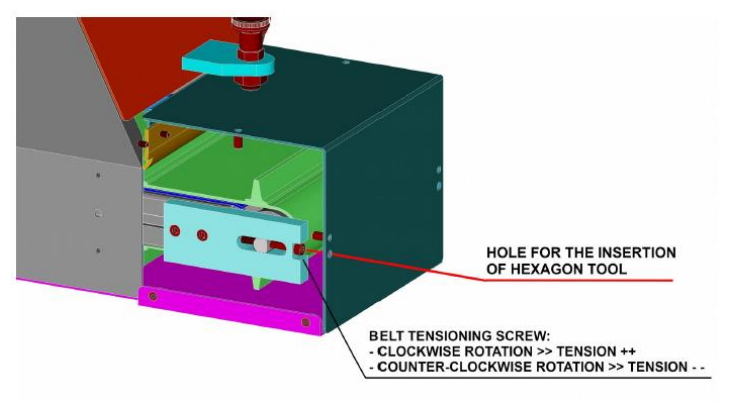

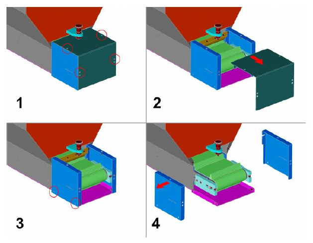

### Remplacement du tapis à palettes

:::{warning}
Cette opération doit être effectuée uniquement par des techniciens expérimentés, disposant des connaissances et des outils appropriés. En cas de doute, contacter les techniciens ARS.
:::

| Phase | Action |
|:--- |:--- |
| 1 | Déconnecter la trémie des sources d'alimentation, afin d'éviter tout mouvement involontaire du tapis. |
| 2 | Séparer la trémie de la structure de support (non incluse dans la fourniture) : il est recommandé d'utiliser des moyens de levage appropriés (par ex. des élingues) pour éviter les mouvements brusques de la charge pendant la manutention. Une fois séparée, poser la trémie sur une surface plane, couchée sur un côté et avec le moteur tourné vers le bas. Pour la maintenir en position, insérer une cale entre le sol et le flanc de la trémie. |
| 3 | Séparer la plaque latérale du corps de la trémie. |
| 4 | Séparer le couvercle inférieur (composé de 3 parties : partie centrale + côté droit + côté gauche) du corps de la trémie. |
| 5 | Séparer la porte de vidange du corps de la trémie. |
| 6 | Séparer le protecteur fixe situé sur le côté supérieur de la trémie du corps principal. |
| 7 | Séparer la goulotte de sortie du corps de la trémie. Retirer d'abord les 4 vis mises en évidence (deux sur le côté supérieur + deux sur le côté inférieur) ; retirer ensuite les autres vis qui relient les parties extérieures des tôles. |
| 8 | Séparer le protecteur transparent du côté supérieur du corps de la trémie. |
| 9 | Séparer la porte de remplissage du corps de la trémie. |
| 10 | Séparer la tôle latérale du corps de la trémie. |
| 11 | Détendre complètement le tapis comme décrit dans *Tension et réglage du tapis*. |
| 12 | Retirer le tapis en le tirant vers le haut. Si le détendage ne suffit pas pour dépasser les plaques latérales qui guident le tapis, il faudra les retirer. |
| 13 | Insérer le nouveau tapis en le laissant tomber par le haut. |
| 14 | Effectuer une première mise en tension du tapis, afin de garantir une bonne adhérence entre le rouleau d'entraînement et le tapis. Le réglage fin de la tension sera effectué ensuite, lorsqu'il sera possible de faire défiler le tapis. |
| 15 | Remonter la tôle latérale sur le corps de la trémie (voir étape 10). |
| 16 | Remonter la porte de remplissage sur le corps de la trémie (voir étape 9). |
| 17 | Remonter le protecteur transparent sur le côté supérieur de la trémie (voir étape 8). |
| 18 | Remonter la goulotte de décharge sur le corps de la trémie (voir étape 7). Remettre d'abord les vis entre les parties extérieures des tôles, puis les quatre vis mises en évidence (deux par le haut + deux par le bas). |
| 19 | Remonter le protecteur fixe supérieur sur le corps de la trémie (voir étape 6). |
| 20 | Remonter la porte de vidange sur le corps de la trémie (voir étape 5). |
| 21 | Remonter le couvercle inférieur (3 parties : partie centrale + côté droit + côté gauche) sur le corps de la trémie (voir étape 4). |
| 22 | Remonter la plaque latérale sur le corps de la trémie (voir étape 3). |
| 23 | Remonter la trémie sur la structure de support. Il est recommandé d'utiliser des moyens de levage appropriés (par ex. des élingues) pour éviter les mouvements brusques de la charge pendant la manutention. |
| 24 | Reconnecter la trémie aux sources d'alimentation. |
| 25 | Démarrer la trémie sans pièces à l'intérieur et effectuer le réglage fin de la tension du tapis. |

**Figures de référence (étapes 2 à 12)**

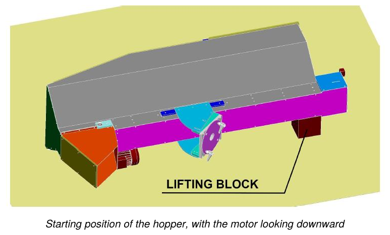

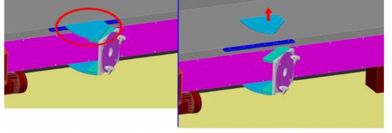

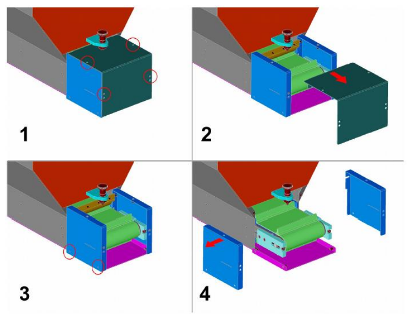

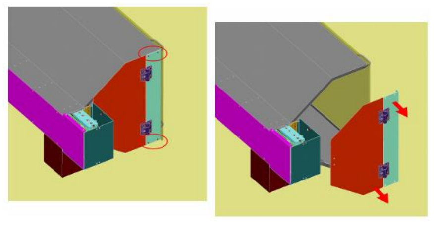

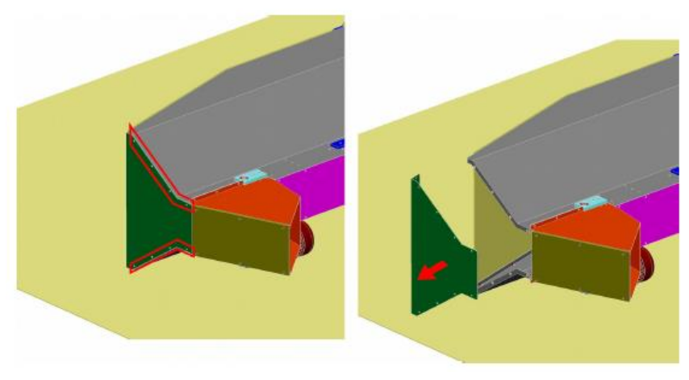

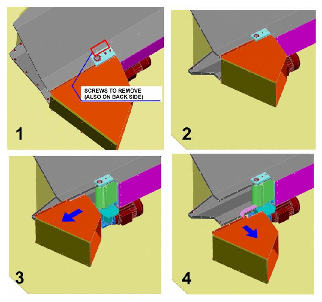

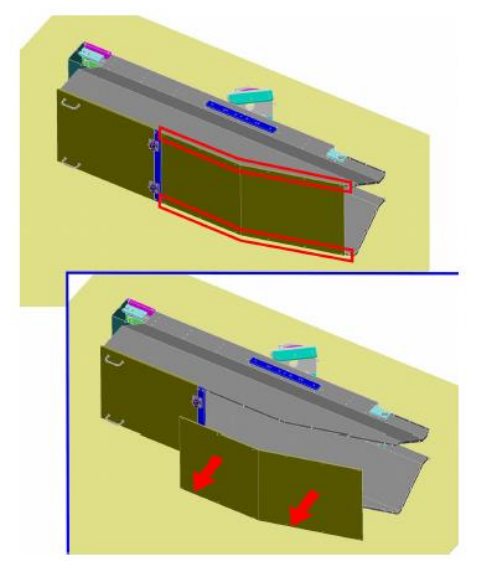

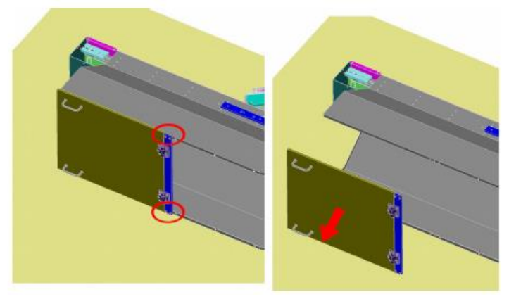

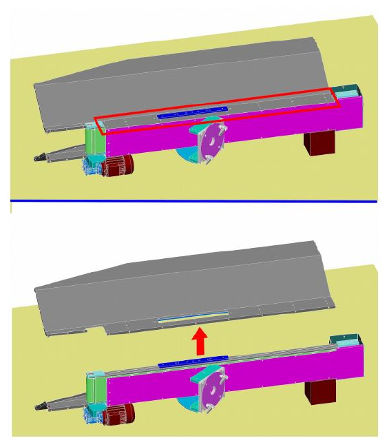

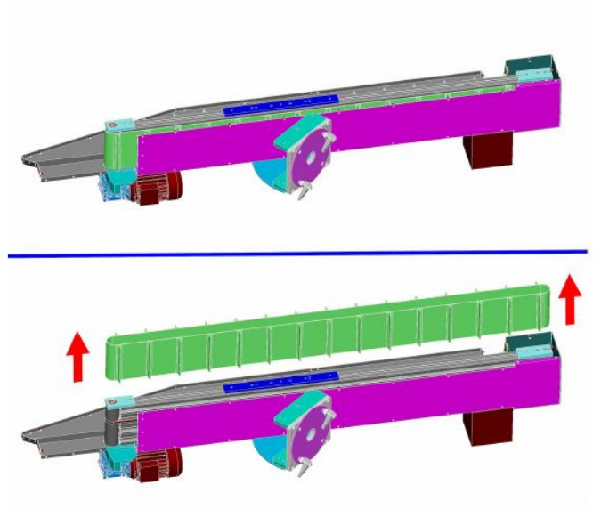

## Diagnostic des pannes mécaniques

| Panne | Causes | Solutions |
|:--- |:--- |:--- |
| **Fuite d'huile de lubrification** | 1. Usure du joint. 2. Quantité excessive d'huile de lubrification. | 1. Remplacer le composant usé. 2. Réduire la quantité d'huile de lubrification. |
| **Rayures ou jeux sur les systèmes de guidage (tiges, bagues, glissières)** | 1. Usure des composants. 2. Nécessité d'un réglage. 3. Lubrification insuffisante. | 1. Remplacer le composant usé. 2. Régler le composant. 3. Rétablir le niveau correct de lubrifiant. |

## Maintenance extraordinaire

Les interventions de maintenance extraordinaire sont des interventions non ordinaires, relatives au remplacement de composants sujets à usure/rupture et au démontage de parties de la machine incomplète. En outre, ces interventions :
- peuvent prolonger la durée de vie utile et/ou améliorer, à titre subsidiaire, l'efficacité, la fiabilité, la productivité, la maintenabilité et les procédures d'inspection ;
- ne modifient pas les caractéristiques d'origine (données de plaque, dimensionnement, valeurs de construction, etc.) ni la structure essentielle ;
- n'entraînent aucune variation de la destination d'usage.

:::{warning}
Les interventions de maintenance extraordinaire doivent être effectuées uniquement par des techniciens qualifiés, experts dans les différents domaines (électrique ou mécanique).
:::

:::{note}
Pour procéder aux interventions de maintenance extraordinaire, contacter le Constructeur, comme indiqué dans la section *Assistance et contacts*.
:::

## Fiche des interventions de maintenance

| Date | Opérateur | Description de l'intervention |
|:--- |:--- |:--- |
| | | |
| | | |
| | | |
