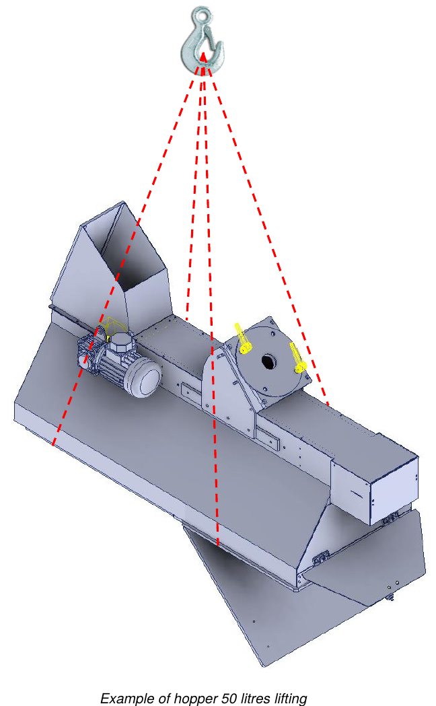

# **Emballage, transport et installation**

## Emballage

La machine incomplète est expédiée par le Constructeur depuis l'usine de production jusqu'au site du Client emballée dans un **film de cellophane**.

L'emballage ne protège pas des agents atmosphériques extérieurs tels que pluie, neige, grêle, etc. : si la machine incomplète reste exposée aux intempéries, elle doit être conservée dans des conteneurs fermés jusqu'au stockage final. Toutes les parties extérieures sujettes à l'oxydation (surfaces usinées, parties non peintes, etc.) sont protégées par un film d'huile antioxydante.

:::{note}
La charge doit toujours être maintenue en position verticale.
:::

## Transport

Les points d'ancrage pour le levage sont indiqués sur l'emballage expédié. Sur l'extérieur des emballages figurent en outre toutes les indications permettant d'identifier le contenu et de manutentionner en sécurité :
- adresse du destinataire et de l'expéditeur ;
- dimensions (longueur, largeur, hauteur) ;
- poids brut, net et tare ;
- centre de gravité ;
- notes et symboles (par ex. fragile, haut, etc.) ;
- pochette porte-documents avec la packing list.

## Levage et manutention

Avant toute manutention et/ou tout levage, il est important de connaître le poids.

:::{note}
- Toutes les opérations de manutention et de levage doivent être effectuées par des opérateurs qualifiés, qui connaissent et respectent les règles de levage et de manutention des charges.
- Utiliser des moyens de levage adaptés au poids et aux dimensions de la charge.
- Toujours contrôler le bon équilibrage de la charge. Si elle est déséquilibrée, la poser immédiatement au sol et repositionner les fourches/élingues.
- Pour le transport sur de longues distances, il est recommandé de placer la trémie sur une palette et de la fixer avec des sangles appropriées. La palette doit ensuite être déplacée avec un transpalette ou des chariots élévateurs.
:::

:::{warning}
Lorsque la charge est soulevée à plus de 50 cm du sol, les opérateurs doivent rester à une distance de sécurité, à plus de 2 m du périmètre. Un mouvement incontrôlé de la charge constitue en effet un grave danger pour la sécurité des opérateurs.
:::

| Description | Poids |
|:--- |:--- |
| **Trémie 50 litres** | environ 75 kg |
| **Trémie 100 litres** | environ 100 kg |
| **Trémie 150 litres** | environ 125 kg |

### Levage avec un pont roulant

Pour soulever et déplacer la machine incomplète, procéder comme suit :
- élinguer correctement la machine incomplète aux points indiqués ;
- fixer les sangles aux crochets du moyen de levage ;
- soulever lentement la charge en évitant les mouvements brusques et la transférer en la maintenant le plus près possible du sol ;
- une fois arrivé à destination, abaisser la charge lentement et progressivement ;
- retirer les sangles seulement après que la charge repose parfaitement au sol.

## Installation

Avant d'installer la machine incomplète, il faut retirer l'emballage de protection et les éventuelles fixations utilisées pour le transport.

### Contrôle de l'intégrité

Vérifier que la machine incomplète n'a pas subi de dommages pendant le transport. En cas d'accidents ou de dommages visibles (marques ou traces de chocs), procéder comme suit :
- noter le dommage sur le document de transport ;
- informer le transporteur et le Constructeur du dommage constaté par lettre recommandée, dans les 48 heures suivant la réception de la machine incomplète.

### Précautions générales de sécurité

Les opérations décrites dans ce chapitre doivent être effectuées par du personnel autorisé. Les personnes non autorisées doivent rester en dehors de la zone d'installation.

:::{warning}
S'assurer que, pendant l'installation, il n'y a pas dans la zone environnante d'éléments (câbles, tuyaux, etc.) pouvant causer des interférences ou des dangers pour les opérateurs.
:::

:::{note}
Les opérateurs chargés de l'installation, du raccordement, des contrôles et des inspections doivent être bien formés, afin d'éviter des opérations erronées susceptibles d'endommager la machine incomplète. Pour les informations sur les dispositifs incorporés, consulter les manuels spécifiques.
:::

### Choix du lieu d'utilisation et vérification des exigences d'installation

Le Client **DOIT** prévoir :
- une zone suffisamment grande et dégagée d'obstacles, équipée conformément aux normes de sécurité en vigueur dans le pays de l'utilisateur ;
- une ventilation et un éclairage corrects ;
- des espaces de travail ;
- des couloirs de passage ;
- des voies d'évacuation ;
- un revêtement de sol capable de supporter le poids de la machine incomplète ;
- l'alimentation électrique générale, y compris le conducteur de terre, selon les caractéristiques et les tolérances requises ;
- l'alimentation pneumatique selon les caractéristiques et les tolérances requises.

### Positionnement

Avant de commencer à opérer, monter la machine incomplète sur une structure de support stable, de rigidité et de résistance suffisantes. La charge maximale de la structure de support doit être **au moins 2 fois** le poids indiqué sur la plaque de la machine incomplète.

Vérifier ensuite la bonne mise à niveau en posant un niveau à bulle sur une surface plane, dans le sens longitudinal comme dans le sens transversal. Pour plus d'informations, contacter le service technique du Constructeur.

### Raccordements

:::{warning}
Les opérations de raccordement des alimentations doivent être effectuées uniquement par des techniciens expérimentés, qui doivent utiliser les équipements de protection individuelle nécessaires.
:::

:::{note}
Tous les raccordements de l'alimentation externe de la machine incomplète doivent être effectués pendant l'installation sous la supervision du Constructeur. Il est strictement interdit de raccorder la machine incomplète à des sources d'alimentation externes avant l'arrivée des techniciens du Constructeur. Le raccordement électrique nécessaire au fonctionnement de la machine incomplète est à la charge du Client.
:::

## Contrôles et inspections

Avant le démarrage, effectuer une série de contrôles et d'inspections générales, afin d'éviter des problèmes pendant le fonctionnement de la machine incomplète.

:::{warning}
Le premier démarrage doit être effectué par un technicien expérimenté du Constructeur.
:::

:::{note}
Avant de lancer tout mouvement, s'assurer de l'absence de pannes, afin d'éviter d'endommager la machine incomplète. Les contrôles et inspections énumérés ci-dessous sont à considérer comme des opérations de maintenance normale.
:::

### Contrôles généraux sur les unités mécaniques

- Effectuer une inspection visuelle générale des différents groupes qui composent la machine incomplète, en s'assurant de l'absence d'anomalies mécaniques particulières ou de corps étrangers.
- Vérifier que les parties de la machine incomplète et les protecteurs correspondants sont correctement ancrés.
- Contrôler le serrage des vis et des écrous des composants principaux.

En cas de problèmes, contacter immédiatement le Constructeur.

### Couples de serrage

Le tableau suivant indique les couples de serrage pour chaque dimension de vis. Pour le serrage, utiliser une clé dynamométrique.

| Ø de la vis | Pas | Couple de pré-serrage [kgm] | Couple de serrage [kgm] |
|:---: |:---: |:---: |:---: |
| M6 | 1 | 0,75 | 1 |
| M8 | 1,25 | 1,8 | 2,4 |
| M10 | 1,5 | 3,6 | 4,8 |
| M12 | 1,75 | 6,5 | 8,5 |
| M14 | 2 | 10 | 13 |
| M16 | 2 | 15 | 20,5 |
| M18 | 2,5 | 22 | 29 |
| M20 | 2,5 | 30 | 40 |
| M22 | 2,5 | 42 | 56 |
| M24 | 3 | 50 | 70 |
| M27 | 3 | 80 | 105 |
| M30 | 3,5 | 95 | 130 |

### Contrôle des dispositifs du commerce

De manière générale, contrôler les groupes du commerce installés, en particulier :
- le bon raccordement aux sources d'alimentation ;
- qu'ils sont correctement installés et fonctionnent correctement.

Pour plus d'informations, consulter la documentation annexée de chaque dispositif.

### Contrôle des systèmes de sécurité

Vérifier que les protecteurs et les dispositifs de sécurité installés sont correctement montés et fonctionnent.

:::{warning}
La sécurité de la machine incomplète ne peut pas être garantie en cas de retrait ou d'altération des dispositifs de sécurité.
:::

:::{note}
Effectuer les contrôles fonctionnels, de serrage et de positionnement des systèmes de sécurité indiqués dans la section *Fonctions de sécurité*. Cette procédure doit être adoptée comme procédure normale de maintenance.
:::

## Codes internationaux de recyclage

| Code | Description |
|:--- |:--- |
| **Plastiques** | |
| #1 PET / PETE | Polyéthylène téréphtalate : bouteilles d'eau, de boissons, de shampoing |
| #2 HDPE | Polyéthylène haute densité : pots de yaourt, flacons de détergent |
| #3 PVC | Polychlorure de vinyle : récipients alimentaires |
| #4 LDPE | Polyéthylène basse densité : sacs pour surgelés, flacons souples |
| #5 PP | Polypropylène : bouteilles |
| #6 PS | Polystyrène : gobelets jetables |
| #7–#19 | Autres plastiques |
| **Papier** | |
| #20 PAP | Carton ondulé : boîtes de meubles en kit |
| #21 PAP | Carton non ondulé : emballages de sandwichs dans les fast-foods |
| #22 PAP | Papier : sachets de chips dans les fast-foods, journaux, sacs en papier |
| #23–#39 | Autres types de papier |
| **Métaux** | |
| #40 FE | Acier |
| #41 ALU | Aluminium : canettes |
| #42–#49 | Autres types de métal |
| **Bois** | |
| #50 FOR | Bois |
| #51 FOR | Liège |
| #52–#59 | Autres types |
| **Textiles** | |
| #60 TEX | Coton |
| #61 TEX | Jute |
| #60–#69 | Autres matériaux textiles |
| **Verre** | |
| #70 | Verre transparent / incolore : bouteilles d'eau |
| #71 | Verre vert : bouteilles de vin |
| #72 | Verre brun : bouteilles de bière |
| #73–#79 | Autres matériaux en verre et canettes |
| **Matériaux composites** | |
| #80 | Papier et carton / métaux divers |
| #81 | Papier et carton / plastique |
| #82 | Papier et carton / aluminium : sachets de biscuits |
| #83 | Papier et carton / fer-blanc |
| #84 | Papier et carton / plastique / aluminium |
| #85 | Papier et carton / plastique / aluminium / fer-blanc |
| #86–#89 | Autres matériaux composites |
| #90 | Plastique / aluminium |
| #91 | Plastique / fer-blanc |
| #92 | Plastique / métaux divers |
| #93–#94 | Autres matériaux composés |
| #95 | Verre / plastique |
| #96 | Verre / aluminium |
| #97 | Verre / fer-blanc |
| #98 | Verre / métaux divers |
| #99 | Autres matériaux composites |
