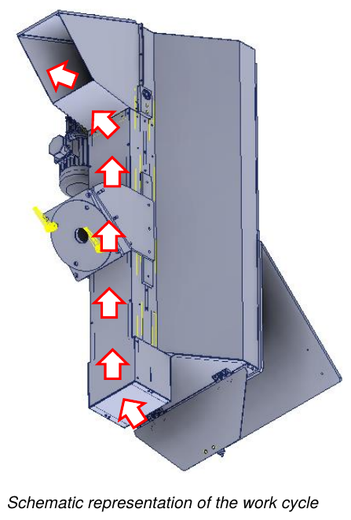

# **Utilisation**

## Contrôles initiaux

Avant de démarrer la machine incomplète, l'opérateur doit vérifier que :
- toutes les sources d'alimentation sont correctement raccordées aux lignes correspondantes ;
- il n'y a pas de corps étrangers à l'intérieur de la machine incomplète ;
- les dispositifs de sécurité présents fonctionnent correctement ;
- la machine incomplète n'est pas en état de réparation / nettoyage ;
- tous les protecteurs sont correctement positionnés et fixés.

## Cycle de travail

Après le démarrage de la machine incomplète, à la suite des contrôles effectués par l'opérateur, le cycle de travail est le suivant :
- le matériau est élevé par le tapis à palettes, entraîné par le moteur électrique, jusqu'à la sortie.

