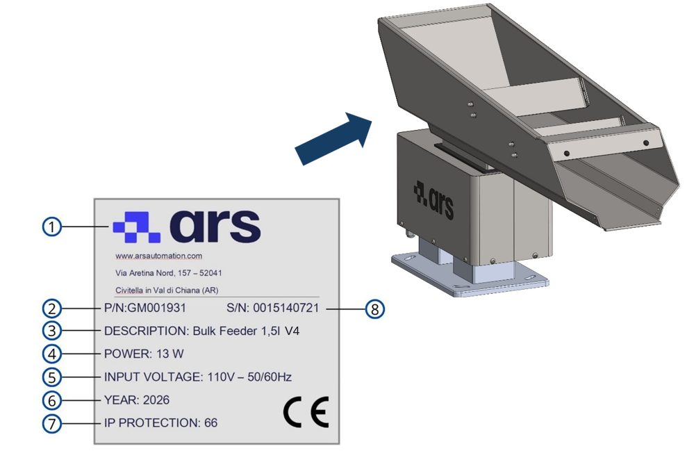
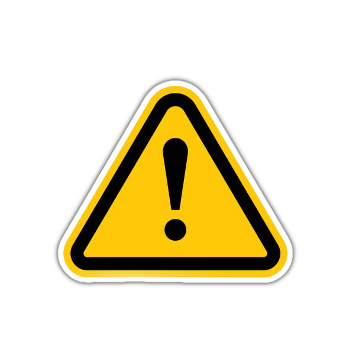
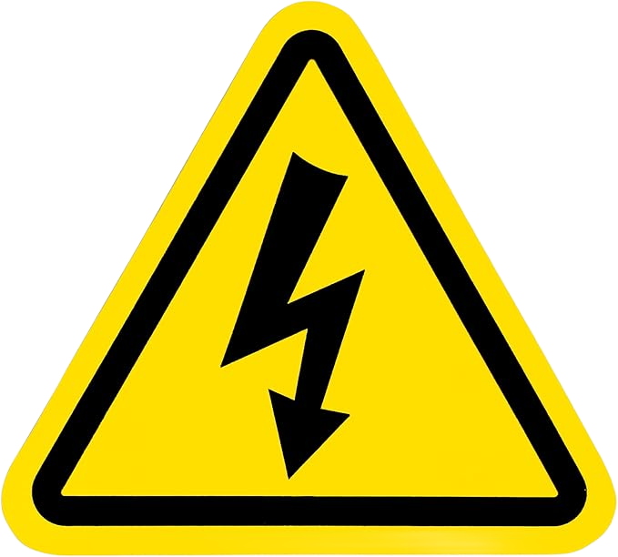
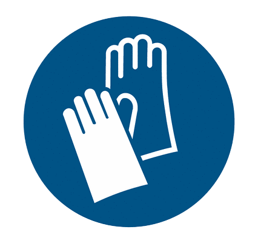
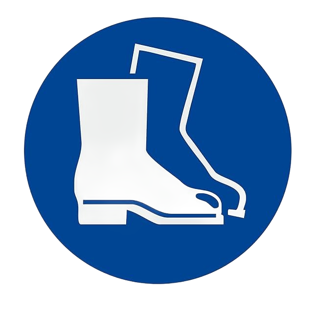
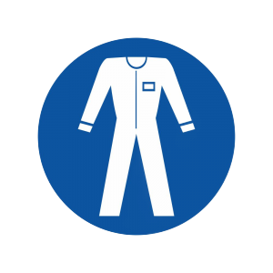
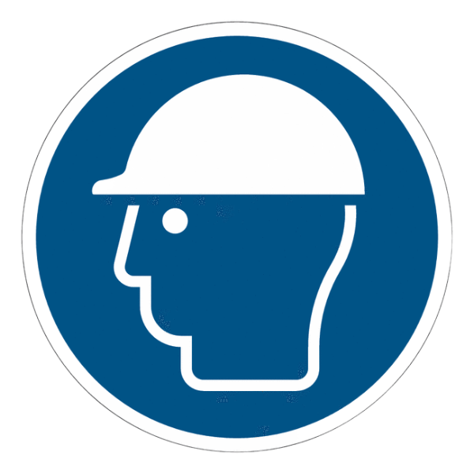
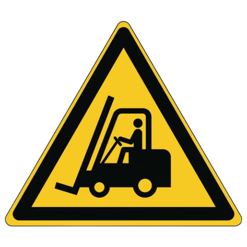
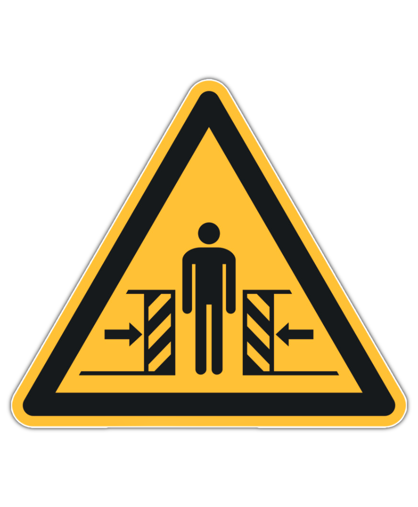

# **Informations préliminaires générales**

```{important}
Avant d'installer, d'utiliser ou d'effectuer la maintenance de la machine, lire attentivement l'intégralité du manuel et toute la documentation jointe.

Le non-respect des instructions fournies peut entraîner :
- des dommages à la machine ;
- la perte des conditions de sécurité ;
- des risques pour les opérateurs et les agents de maintenance ;
- la déchéance de la garantie.
```

<script src="https://unpkg.com/@phosphor-icons/web"></script>

<style>
/* ── Variabili e Reset ── */
.isw-page {
  --c-primary:    #1a3a52;
  --c-accent:     #2980b9;
  --c-accent-lt:  #d0e4f0;
  --c-bg:         #ffffff;
  --c-bg-alt:     #f7fbfe;
  --c-bg-hover:   #e8f4fc;
  --c-border:     #d0e4f0;
  --c-text:       #334e5e;
  --c-muted:      #7a9ab0;
  --radius:       10px;
  --shadow-sm:    0 1px 4px rgba(41,128,185,.08);
  --shadow-md:    0 3px 10px rgba(41,128,185,.12);
  max-width: 860px;
  margin: 0 auto;
  padding: 0 0 3rem;
}

/* ── Headings ── */
.isw-page h2 {
  color: var(--c-primary);
  font-weight: 700;
  border-bottom: 2px solid var(--c-accent-lt);
  padding-bottom: .4rem;
  margin-top: 2.5rem;
}
.isw-page h3 {
  color: var(--c-primary);
  font-weight: 600;
  margin-top: 1.6rem;
}

/* ── Meta Grid (Identificazione) ── */
.isw-meta-grid {
  display: grid;
  grid-template-columns: repeat(auto-fit, minmax(280px, 1fr));
  gap: 1rem;
  margin: 1rem 0 2rem;
}
.isw-meta-card {
  padding: 1.2rem 1.4rem;
  border: 1.5px solid var(--c-border);
  border-radius: var(--radius);
  background: var(--c-bg);
  box-shadow: var(--shadow-sm);
  transition: box-shadow .2s;
}
.isw-meta-card:hover { box-shadow: var(--shadow-md); }

.isw-meta-title {
  font-size: .75rem;
  font-weight: 700;
  text-transform: uppercase;
  letter-spacing: .06em;
  color: var(--c-accent);
  margin-bottom: .6rem;
  display: flex;
  align-items: center;
  gap: .4rem;
}
.isw-meta-content {
  font-size: .9rem;
  line-height: 1.6;
  color: var(--c-primary);
}
.isw-meta-content small { color: var(--c-muted); display: block; margin-top: .4rem; line-height: 1.3; }

/* ── Badge modelli ── */
.isw-model-badges {
  display: flex;
  flex-wrap: wrap;
  gap: .4rem;
  margin-top: .5rem;
}
.isw-badge {
  background: var(--c-bg-alt);
  border: 1px solid var(--c-border);
  border-radius: 4px;
  padding: .15rem .55rem;
  font-size: .78rem;
  font-weight: 700;
  color: var(--c-accent);
  font-family: monospace;
}

/* ── Tabelle standard ── */
.isw-table {
  width: 100%;
  border-collapse: collapse;
  font-size: .9rem;
  margin: .75rem 0 1.5rem;
  border-radius: var(--radius);
  overflow: hidden;
  box-shadow: var(--shadow-sm);
}
.isw-table thead th {
  background: var(--c-bg-alt);
  color: var(--c-primary);
  border-bottom: 2px solid var(--c-accent);
  padding: .65rem 1rem;
  text-align: left;
  font-weight: 700;
  font-size: .8rem;
  text-transform: uppercase;
  letter-spacing: .05em;
}
.isw-table tbody tr { transition: background .15s; }
.isw-table tbody tr:nth-child(odd)  { background: var(--c-bg); }
.isw-table tbody tr:nth-child(even) { background: var(--c-bg-alt); }
.isw-table tbody tr:hover { background: var(--c-bg-hover); }
.isw-table td {
  padding: .55rem 1rem;
  border-bottom: 1px solid var(--c-border);
  color: var(--c-text);
  vertical-align: top;
}
.isw-table td:first-child {
  font-family: monospace;
  font-weight: 700;
  color: var(--c-accent);
  white-space: nowrap;
  width: 80px;
}

/* ── Dichiarazione CE ── */
.isw-ce-box {
  background: var(--c-bg-alt);
  border: 1px dashed var(--c-accent-lt);
  border-left: 4px solid var(--c-accent);
  border-radius: var(--radius);
  padding: 1.6rem;
  margin: 1.5rem 0;
}
.isw-ce-header {
  text-align: center;
  font-weight: 700;
  font-size: 1.05rem;
  color: var(--c-primary);
  margin-bottom: 1.2rem;
  letter-spacing: .08em;
  text-transform: uppercase;
}
.isw-ce-box ul { margin: .4rem 0 .8rem 1.2rem; }
.isw-ce-box li { margin-bottom: .2rem; font-size: .88rem; }

.isw-ce-footer {
  display: grid;
  grid-template-columns: 1fr 1fr;
  gap: .4rem 2rem;
  margin-top: 1.2rem;
  padding-top: 1rem;
  border-top: 1px solid var(--c-border);
  font-size: .85rem;
}

/* ── Tabella Operatori / Profili ── */
.isw-profiles { margin: 1rem 0 1.5rem; display: flex; flex-direction: column; gap: .75rem; }
.isw-profile {
  border: 1.5px solid var(--c-border);
  border-radius: var(--radius);
  overflow: hidden;
  box-shadow: var(--shadow-sm);
}
.isw-profile-header {
  display: flex;
  align-items: center;
  gap: .6rem;
  background: var(--c-bg-alt);
  padding: .6rem 1rem;
  border-bottom: 1px solid var(--c-border);
}
.isw-profile-role {
  font-weight: 700;
  font-size: .85rem;
  color: var(--c-primary);
}
.isw-profile-body {
  padding: .8rem 1rem;
  font-size: .88rem;
  line-height: 1.6;
  color: var(--c-text);
}
.isw-profile-note {
  margin-top: .5rem;
  padding: .4rem .7rem;
  background: #fff8e1;
  border-left: 3px solid #f0b429;
  border-radius: 4px;
  font-size: .82rem;
  color: #7a5c00;
}

/* ── Persona Addestrata callout ── */
.isw-trained-person {
  display: flex;
  align-items: flex-start;
  gap: 1rem;
  padding: 1rem 1.2rem;
  border: 1.5px solid var(--c-border);
  border-radius: var(--radius);
  background: var(--c-bg);
  margin: 1rem 0 1.5rem;
  box-shadow: var(--shadow-sm);
}
.isw-trained-person-icon { font-size: 2rem; line-height: 1; flex-shrink: 0; }
.isw-trained-person-title { font-weight: 700; color: var(--c-accent); font-size: .8rem; text-transform: uppercase; letter-spacing: .05em; margin-bottom: .3rem; }

/* ── DPI / Simbologia Grid ── */
.isw-symbol-grid {
  display: grid;
  grid-template-columns: repeat(auto-fill, minmax(340px, 1fr));
  gap: .75rem;
  margin: 1rem 0 1.5rem;
}
.isw-symbol-item {
  display: flex;
  align-items: flex-start;
  gap: .9rem;
  padding: .8rem 1rem;
  border: 1px solid var(--c-border);
  border-radius: var(--radius);
  background: var(--c-bg);
  transition: box-shadow .2s, background .15s;
}
.isw-symbol-item:hover { background: var(--c-bg-hover); box-shadow: var(--shadow-sm); }
.isw-symbol-item img { width: 52px; height: 52px; object-fit: contain; flex-shrink: 0; }
.isw-symbol-label { font-weight: 700; font-size: .88rem; color: var(--c-primary); margin-bottom: .25rem; }
.isw-symbol-desc  { font-size: .82rem; color: var(--c-text); line-height: 1.4; }

/* ── Rischi residui ── */
.isw-risks { display: flex; flex-direction: column; gap: .75rem; margin: 1rem 0 1.5rem; }
.isw-risk {
  display: grid;
  grid-template-columns: 100px 1fr;
  gap: 0;
  border: 1.5px solid var(--c-border);
  border-radius: var(--radius);
  overflow: hidden;
  box-shadow: var(--shadow-sm);
}
.isw-risk-icons {
  background: var(--c-bg-alt);
  display: flex;
  flex-direction: column;
  align-items: center;
  justify-content: center;
  gap: .5rem;
  padding: .8rem;
  border-right: 1px solid var(--c-border);
}
.isw-risk-icons img { width: 44px; height: 44px; object-fit: contain; }
.isw-risk-body { padding: .9rem 1.1rem; }
.isw-risk-title { font-weight: 700; color: var(--c-primary); font-size: .9rem; margin-bottom: .4rem; }
.isw-risk-desc { font-size: .87rem; color: var(--c-text); line-height: 1.55; }
.isw-risk-desc ul { margin: .3rem 0 0 1.1rem; }
.isw-risk-desc li { margin-bottom: .15rem; }

/* ── Zone di sicurezza ── */
.isw-zones { display: flex; flex-direction: column; gap: .6rem; margin: 1rem 0 1.5rem; }
.isw-zone {
  display: grid;
  grid-template-columns: 160px 1fr;
  border: 1.5px solid var(--c-border);
  border-radius: var(--radius);
  overflow: hidden;
}
.isw-zone-label {
  background: var(--c-accent);
  color: #fff;
  font-weight: 700;
  font-size: .8rem;
  padding: .7rem .9rem;
  display: flex;
  align-items: center;
}
.isw-zone:nth-child(2) .isw-zone-label { background: #e67e22; }
.isw-zone:nth-child(3) .isw-zone-label { background: #c0392b; }
.isw-zone-desc { padding: .65rem .9rem; font-size: .87rem; color: var(--c-text); line-height: 1.5; background: var(--c-bg); }

/* ── Garanzia: due colonne ── */
.isw-warranty-grid {
  display: grid;
  grid-template-columns: 1fr 1fr;
  gap: 1rem;
  margin: 1rem 0 1.5rem;
}
@media (max-width: 640px) {
  .isw-warranty-grid { grid-template-columns: 1fr; }
  .isw-risk { grid-template-columns: 1fr; }
  .isw-risk-icons { flex-direction: row; border-right: none; border-bottom: 1px solid var(--c-border); }
  .isw-zone { grid-template-columns: 1fr; }
}
.isw-warranty-col {
  border: 1.5px solid var(--c-border);
  border-radius: var(--radius);
  overflow: hidden;
}
.isw-warranty-col-header {
  padding: .55rem 1rem;
  font-weight: 700;
  font-size: .8rem;
  text-transform: uppercase;
  letter-spacing: .05em;
}
.isw-warranty-col.valid   .isw-warranty-col-header { background: #e8f8f0; color: #1a6b3a; border-bottom: 2px solid #27ae60; }
.isw-warranty-col.invalid .isw-warranty-col-header { background: #fdecea; color: #7b1c1c; border-bottom: 2px solid #c0392b; }
.isw-warranty-col ul { margin: .5rem .5rem .7rem 1.4rem; padding: 0; }
.isw-warranty-col li { font-size: .84rem; color: var(--c-text); margin-bottom: .3rem; line-height: 1.4; }

/* ── Sicurezze inline ── */
.isw-safety-cards {
  display: grid;
  grid-template-columns: repeat(auto-fill, minmax(260px, 1fr));
  gap: .85rem;
  margin: 1rem 0 1.5rem;
}
.isw-safety-card {
  border: 1.5px solid var(--c-border);
  border-radius: var(--radius);
  padding: 1rem 1.1rem;
  background: var(--c-bg);
}
.isw-safety-card-title {
  font-weight: 700;
  color: var(--c-primary);
  font-size: .88rem;
  margin-bottom: .35rem;
  display: flex;
  align-items: center;
  gap: .4rem;
}
.isw-safety-card p { font-size: .85rem; color: var(--c-text); line-height: 1.5; margin: 0; }
</style>

<div class="isw-page">

## Identification

<div class="isw-meta-grid">
  <div class="isw-meta-card">
    <div class="isw-meta-title"><i class="ph ph-factory"></i> Constructeur</div>
    <div class="isw-meta-content">
      <strong>ARS S.r.l.</strong><br>
      Via Aretina Nord, 157<br> 52041 – Pieve al Toppo (AR), Italie<br> Tél. +39 0575 398611 &nbsp;·&nbsp; Fax +39 0575 398620<br>
      <a href="mailto:info@arsautomation.com">info@arsautomation.com</a><br>
      <a href="https://www.arsautomation.com" target="_blank">www.arsautomation.com</a>
    </div>
  </div>
  <div class="isw-meta-card">
    <div class="isw-meta-title"><i class="ph ph-cpu"></i> Identification de la machine</div>
    <div class="isw-meta-content">
      <strong>Machine :</strong> Bulk Feeder<br>
      <strong>Modèles de base :</strong>
      <div class="isw-model-badges">
        <span class="isw-badge">1,5 l</span>
        <span class="isw-badge">3 l</span>
        <span class="isw-badge">5 l</span>
        <span class="isw-badge">10 l</span>
        <span class="isw-badge">20 l</span>
        <span class="isw-badge">40 l</span>
      </div>
      <small>Dans certaines applications, des modèles personnalisés peuvent exister. L'identification est définie par le projet de référence.</small>
    </div>
  </div>
</div>

### Plaque d'identification

La machine est dotée d'une plaque d'identification située sur la **base vibrante**. Les références indiquées sur la plaque doivent être citées dans toute communication avec ARS S.r.l.



<table class="isw-table">
  <thead>
    <tr>
      <th>Pos.</th>
      <th>Élément de la plaque</th>
    </tr>
  </thead>
  <tbody>
    <tr><td>1</td><td>Logo du constructeur</td></tr>
    <tr><td>2</td><td>N° de pièce</td></tr>
    <tr><td>3</td><td>Modèle de la machine</td></tr>
    <tr><td>4</td><td>Puissance</td></tr>
    <tr><td>5</td><td>Tension d'alimentation</td></tr>
    <tr><td>6</td><td>Année de construction</td></tr>
    <tr><td>7</td><td>Indice de protection IP</td></tr>
    <tr><td>8</td><td>N° de série</td></tr>
  </tbody>
</table>

```{warning}
**ATTENTION — Plaque d'identification CE**

Il est absolument interdit de :
- retirer la plaque d'identification CE ;
- la remplacer par des plaques non autorisées.

Si la plaque venait à être endommagée ou retirée accidentellement, le client est **tenu** d'en informer immédiatement le Constructeur.
```

---

## Déclaration de conformité CE (copie)

<div class="isw-ce-box">
  <div class="isw-ce-header">"CE" Declaration of Conformity</div>
  <p style="font-size:.88rem; margin:0 0 .6rem;"><strong>We:</strong> ARS S.r.l. – Via Aretina Nord, 157 – 52041 Pieve al Toppo (AR), Italia</p>
  <p style="font-size:.88rem; margin:0 0 .4rem;">Declare under our exclusive responsibility that the product:</p>
  <p style="font-size:.95rem; font-weight:700; color:#1a3a52; margin:0 0 .8rem;">BULK FEEDER &nbsp;1,5 lt / 3 lt / 5 lt / 10 lt / 20 lt / 40 lt</p>
  <p style="font-size:.88rem; margin:0 0 .4rem;">is compliant with the following standards and regulations:</p>
  <ul>
    <li>DLGS 17/2010</li>
    <li>2006/42/EC – <em>"Partly completed machinery"</em></li>
  </ul>
  <p style="font-size:.85rem; margin:0;">The machinery described above is intended to be incorporated into other machinery and must not be put into service until the relevant machinery into which it is to be incorporated has been declared in conformity with the essential health and safety requirements of Directive 2006/42/EC.</p>
  <div class="isw-ce-footer">
    <div><strong>Lieu :</strong> Arezzo</div>
    <div><strong>Signature :</strong> [Signé]</div>
    <div><strong>Date :</strong> 01-FEB-2019</div>
    <div><strong>Nom :</strong> Marco Mazzini</div>
  </div>
</div>

---

## Directives de référence

La machine fournie par ARS S.r.l. ne relève pas des catégories énumérées à l'**Annexe IV** de la Directive Machines ; la procédure d'évaluation de la conformité avec **contrôle interne de la fabrication** (Annexe VIII) s'applique donc.

Le dossier technique de construction est rédigé conformément à l'**Annexe VII** de la Directive 2006/42/CE et est mis à la disposition des organes de surveillance sur demande motivée.

La machine est mise sur le marché accompagnée de :
- Marquage CE
- Déclaration CE de conformité
- Manuel d'instructions et avertissements *(point 1.7.4 de la Directive Machines 2006/42/CE)*

<table class="isw-table">
  <thead>
    <tr>
      <th>Directive</th>
      <th>Description / Domaine d'application</th>
    </tr>
  </thead>
  <tbody>
    <tr>
      <td style="font-family:inherit; font-weight:700; color:#1a3a52; width:auto;">2006/42/CE</td>
      <td>Directive Machines</td>
    </tr>
    <tr>
      <td style="font-family:inherit; font-weight:700; color:#1a3a52;">2014/30/UE</td>
      <td>Directive Compatibilité électromagnétique</td>
    </tr>
  </tbody>
</table>

---

## Destinataires, fourniture et conservation

Le manuel est destiné aux opérateurs chargés d'utiliser et de gérer la machine durant **toutes les phases de sa vie technique**. Le manuel, avec le certificat CE, est **partie intégrante de la machine** et doit l'accompagner lors de tout déplacement ou revente.

| Aspect | Prescription |
|---|---|
| **Intégrité** | À conserver intact. En cas de perte, demander immédiatement une copie au Constructeur. |
| **Changements de propriétaire** | Doit suivre la machine jusqu'à sa démolition (déplacements, vente, location, bail). |
| **Format** | Fourni au format électronique, avec annexes (schémas électriques, manuels des sous-traitants). |
| **Annexes** | Les manuels joints font partie intégrante du manuel ; les mêmes prescriptions s'appliquent. |
| **Langue originale** | Italien. En cas d'incohérences avec les traductions, le texte original fait foi. |
| **Mises à jour** | À la charge du Constructeur. L'utilisateur veille à ce que seules les versions à jour soient utilisées. |

```{attention}
La société constructrice décline toute responsabilité en cas d'usage inapproprié de la machine et/ou de dommages causés par des opérations non prévues dans la documentation technique.
```

---

## Profils des opérateurs et qualifications

<div class="isw-profiles">

  <div class="isw-profile">
    <div class="isw-profile-header">
      <i class="ph ph-user" style="color:#2980b9;font-size:1.1rem;"></i>
      <span class="isw-profile-role">Opérateur</span>
    </div>
    <div class="isw-profile-body">
      Personnel de l'utilisateur formé et habilité à la conduite de la machine à des fins productives. Effectue les opérations nécessaires au bon fonctionnement et à sa propre sécurité. Possède une expérience avérée et une formation spécifique. En cas de doute, signale les anomalies à son supérieur.
      <div class="isw-profile-note">⚠ N'est pas autorisé à effectuer une quelconque activité de maintenance.</div>
    </div>
  </div>

  <div class="isw-profile">
    <div class="isw-profile-header">
      <i class="ph ph-wrench" style="color:#2980b9;font-size:1.1rem;"></i>
      <span class="isw-profile-role">Agent de maintenance mécanique</span>
    </div>
    <div class="isw-profile-body">
      Technicien qualifié pour les interventions préventives/correctives sur les parties mécaniques. A accès à toutes les parties de la machine pour l'analyse visuelle, le réglage et l'étalonnage. Lit les schémas pneumatiques/hydrauliques, les dessins techniques et les listes de pièces de rechange. Dans des cas exceptionnels, peut intervenir avec des sécurités réduites.
      <div class="isw-profile-note">⚠ N'est pas habilité à intervenir sur des installations électriques sous tension.</div>
    </div>
  </div>

  <div class="isw-profile">
    <div class="isw-profile-header">
      <i class="ph ph-lightning" style="color:#2980b9;font-size:1.1rem;"></i>
      <span class="isw-profile-role">Agent de maintenance électrique</span>
    </div>
    <div class="isw-profile-body">
      Technicien qualifié pour la maintenance préventive/corrective de l'installation électrique. Lit les schémas électriques et vérifie les cycles fonctionnels. Peut intervenir sous tension dans les armoires électriques <strong>uniquement s'il possède l'habilitation PEI (norme EN 50110-1)</strong>.
      <div class="isw-profile-note">⚠ N'effectue pas de programmation logicielle (API ou logiques de sécurité) et ne modifie pas les mots de passe.</div>
    </div>
  </div>

  <div class="isw-profile">
    <div class="isw-profile-header">
      <i class="ph ph-code" style="color:#2980b9;font-size:1.1rem;"></i>
      <span class="isw-profile-role">Technicien expert logiciel</span>
    </div>
    <div class="isw-profile-body">
      Technicien du Constructeur ayant une expérience avérée sur les systèmes API/PC et les entraînements. Effectue des modifications des données machine, crée des programmes de travail et règle les paramètres des variateurs. Peut intervenir sous tension dans les armoires électriques uniquement s'il est <strong>habilité PEI (EN 50110-1)</strong>.
    </div>
  </div>

  <div class="isw-profile">
    <div class="isw-profile-header">
      <i class="ph ph-star" style="color:#2980b9;font-size:1.1rem;"></i>
      <span class="isw-profile-role">Technicien du Constructeur</span>
    </div>
    <div class="isw-profile-body">
      Technicien spécialisé et qualifié directement par ARS S.r.l. (ou par le distributeur) pour des opérations de haute complexité. Connaît en détail le cycle de construction de la machine et intervient sur demande spécifique de l'utilisateur.
    </div>
  </div>

</div>

Toutes les qualifications ci-dessus relèvent obligatoirement de la catégorie **« Personne formée »** :

<div class="isw-trained-person">
  <div>
    <div class="isw-trained-person-title">Personne formée</div>
    Personne informée, instruite et formée au travail et aux dangers découlant d'un usage inapproprié. Connaît l'importance des dispositifs de sécurité, les règles de prévention des accidents et les conditions opérationnelles pour travailler en sécurité.
  </div>
</div>

---

## Symboles de sécurité

<div class="isw-symbol-grid">

  <div class="isw-symbol-item">
    
    <div>
      <div class="isw-symbol-label">Avertissement général</div>
      <div class="isw-symbol-desc">Avertissements cruciaux pour la sécurité de l'opérateur et/ou l'intégrité de la machine.</div>
    </div>
  </div>

  <div class="isw-symbol-item">
    
    <div>
      <div class="isw-symbol-label">Danger électrique</div>
      <div class="isw-symbol-desc">Signale les dangers et risques de nature électrique (présence de tension).</div>
    </div>
  </div>

  <div class="isw-symbol-item">
    
    <div>
      <div class="isw-symbol-label">Information importante</div>
      <div class="isw-symbol-desc">Informations de particulière importance concernant la gestion opérationnelle du système.</div>
    </div>
  </div>

</div>

<style>
.isw-symbol-grid {
  display: flex;
  flex-direction: column; /* Mette i tre blocchi uno sotto l'altro */
  gap: 24px;              /* Crea lo spazio vuoto tra un blocco e l'altro */
}

.isw-symbol-item {
  display: flex;          /* Allinea l'immagine e i testi affiancati dentro la riga */
  align-items: center;    /* Centra verticalmente l'immagine rispetto al testo (opzionale) */
  gap: 15px;              /* Crea spazio tra l'immagine e il testo */
}
</style>

---

## Glossaire technique

<table class="isw-table">
  <thead>
    <tr>
      <th style="width:200px;">Terme</th>
      <th>Définition technique</th>
    </tr>
  </thead>
  <tbody>
    <tr><td style="font-family:inherit;font-weight:700;color:#1a3a52;">Accessoires de levage</td><td>Composants non reliés aux machines qui permettent la préhension de la charge, disposés entre la machine et la charge (y compris les élingues et leurs composants).</td></tr>
    <tr><td style="font-family:inherit;font-weight:700;color:#1a3a52;">Avarie</td><td>Panne qui empêche le fonctionnement normal d'une machine ou d'une installation.</td></tr>
    <tr><td style="font-family:inherit;font-weight:700;color:#1a3a52;">Chaînes, câbles ou sangles</td><td>Éléments conçus pour le levage en tant que partie intégrante de machines ou d'accessoires de levage.</td></tr>
    <tr><td style="font-family:inherit;font-weight:700;color:#1a3a52;">Dommage</td><td>Toute conséquence négative découlant de la survenue d'un événement dangereux.</td></tr>
    <tr><td style="font-family:inherit;font-weight:700;color:#1a3a52;">EPI</td><td>Équipement de Protection Individuelle : produits destinés à préserver la santé et la sécurité des travailleurs qui les portent.</td></tr>
    <tr><td style="font-family:inherit;font-weight:700;color:#1a3a52;">Machine</td><td>Ensemble équipé d'un système d'entraînement composé de pièces (dont au moins une est mobile), reliées pour une application déterminée.</td></tr>
    <tr><td style="font-family:inherit;font-weight:700;color:#1a3a52;">Dysfonctionnement</td><td>Fonctionnement défectueux ou inadéquat d'une machine ou de l'un de ses éléments.</td></tr>
    <tr><td style="font-family:inherit;font-weight:700;color:#1a3a52;">Danger</td><td>Source potentielle de dommage qui, si elle n'est pas évitée, entraîne un risque pour la sécurité et la santé.</td></tr>
    <tr><td style="font-family:inherit;font-weight:700;color:#1a3a52;">Protection</td><td>Défense contre ce qui peut causer un dommage. Elle peut être <strong>Active</strong> (actionnée par l'opérateur) ou <strong>Passive</strong> (intervient sans commande humaine).</td></tr>
    <tr><td style="font-family:inherit;font-weight:700;color:#1a3a52;">Protecteur</td><td>Barrière physique, conçue comme partie structurelle de la machine, destinée à assurer la protection.</td></tr>
    <tr><td style="font-family:inherit;font-weight:700;color:#1a3a52;">Risque</td><td>Combinaison de la probabilité et de la gravité d'une lésion ou d'une atteinte à la santé dans une situation dangereuse.</td></tr>
    <tr><td style="font-family:inherit;font-weight:700;color:#1a3a52;">Risque résiduel</td><td>Risque qui subsiste après l'adoption des mesures de protection et de prévention au stade de la conception.</td></tr>
    <tr><td style="font-family:inherit;font-weight:700;color:#1a3a52;">Utilisation prévue</td><td>Utilisation de la machine conformément aux informations fournies dans la notice d'instructions.</td></tr>
    <tr><td style="font-family:inherit;font-weight:700;color:#1a3a52;">Mauvais usage prévisible</td><td>Utilisation non prévue par le concepteur, résultant d'un comportement humain facilement prévisible.</td></tr>
  </tbody>
</table>

---

## Équipements de protection individuelle (EPI) obligatoires

Lorsque l'on se trouve à proximité de la machine (montage, maintenance, réglage), il est obligatoire d'utiliser les EPI suivants :

<div class="isw-symbol-grid">
  <div class="isw-symbol-item">
    
    <div>
      <div class="isw-symbol-label">Gants de protection</div>
      <div class="isw-symbol-desc">Port obligatoire de gants de protection ou isolants pour protéger les mains.</div>
    </div>
  </div>
  <div class="isw-symbol-item">
    
    <div>
      <div class="isw-symbol-label">Lunettes de protection</div>
      <div class="isw-symbol-desc">Port obligatoire de lunettes de protection pour préserver les yeux.</div>
    </div>
  </div>
  <div class="isw-symbol-item">
    
    <div>
      <div class="isw-symbol-label">Chaussures de sécurité</div>
      <div class="isw-symbol-desc">Port obligatoire de chaussures de sécurité pour protéger les pieds.</div>
    </div>
  </div>
  <div class="isw-symbol-item">
    
    <div>
      <div class="isw-symbol-label">Protection contre le bruit</div>
      <div class="isw-symbol-desc">Port obligatoire de casques ou de bouchons d'oreille pour protéger l'ouïe.</div>
    </div>
  </div>
  <div class="isw-symbol-item">
    
    <div>
      <div class="isw-symbol-label">Vêtements de protection</div>
      <div class="isw-symbol-desc">Port obligatoire des vêtements de travail de protection spécifiques.</div>
    </div>
  </div>
  <div class="isw-symbol-item">
    
    <div>
      <div class="isw-symbol-label">Consulter le manuel</div>
      <div class="isw-symbol-desc">Il est obligatoire de lire et de comprendre les instructions d'utilisation avant toute activité.</div>
    </div>
  </div>
  <div class="isw-symbol-item">
    
    <div>
      <div class="isw-symbol-label">Casque de protection</div>
      <div class="isw-symbol-desc">Port obligatoire du casque pour protéger la tête.</div>
    </div>
  </div>
</div>

```{warning}
**VÊTEMENTS DE SÉCURITÉ**

Les vêtements du personnel doivent être conformes aux exigences essentielles du **Règlement UE 2016/425** et aux lois en vigueur dans le pays d'installation. Le non-respect peut compromettre la sécurité de l'opérateur et des personnes exposées.
```

---

## Cartographie des zones de sécurité

<div class="isw-zones">
  <div class="isw-zone">
    <div class="isw-zone-label">Zones de commande</div>
    <div class="isw-zone-desc">Zones dans lesquelles l'opérateur contrôle les fonctions cycliques (en mode automatique ou semi-automatique), au moyen des panneaux dédiés.</div>
  </div>
  <div class="isw-zone">
    <div class="isw-zone-label">Zones de maintenance / réglage</div>
    <div class="isw-zone-desc">Accessibles uniquement aux agents de maintenance mécanique et électrique qualifiés pour les opérations de paramétrage. Elles restent interdites pendant le cycle de production standard.</div>
  </div>
  <div class="isw-zone">
    <div class="isw-zone-label">Zones dangereuses</div>
    <div class="isw-zone-desc">Zones internes ou périmétriques de la machine présentant des risques résiduels. <strong>L'accès est catégoriquement interdit à toute personne lorsque la machine est en fonctionnement.</strong></div>
  </div>
</div>

```{warning}
**ACCÈS AUX ZONES DANGEREUSES**

Les risques dans les zones de la machine sont protégés par des protecteurs physiques (carters, portes) et des dispositifs électriques interverrouillés (capteurs, microrupteurs).

Lorsque le système est actif, il est strictement interdit de :
- enjamber les protections ;
- contourner les dispositifs de sécurité ;
- intervenir à l'intérieur des zones protégées.

Le retrait ou le contournement des systèmes de sécurité peut causer de graves lésions aux personnes et des dommages à la machine.
```

---

## Conditions et limites de la garantie

Les clauses complètes sont établies dans le contrat de vente, dont les conditions prévalent toujours sur le présent manuel.

<div class="isw-warranty-grid">
  <div class="isw-warranty-col valid">
    <div class="isw-warranty-col-header">✔ Conditions de validité</div>
    <ul>
      <li>Ouverture des emballages effectuée avec des moyens adaptés sans dommages aux systèmes.</li>
      <li>Installation et mise en route effectuées en présence de techniciens habilités.</li>
      <li>Utilisation dans les limites nominales déclarées dans le contrat.</li>
      <li>Maintenance dans les délais prévus avec des <strong>pièces de rechange d'origine ARS S.r.l.</strong> confiée à du personnel qualifié.</li>
    </ul>
  </div>
  <div class="isw-warranty-col invalid">
    <div class="isw-warranty-col-header">✘ Causes de déchéance immédiate</div>
    <ul>
      <li>Non-respect des règles de sécurité ou des instructions.</li>
      <li>Installation ou emploi dans des environnements inadaptés.</li>
      <li>Retrait ou manipulation des dispositifs de contrôle et de sécurité.</li>
      <li>Retrait ou altération de la plaque CE ou des pictogrammes.</li>
      <li>Modifications non autorisées du logiciel (API, logiques, mots de passe).</li>
      <li>Usage inapproprié ou confiance à du personnel non autorisé.</li>
      <li>Modifications mécaniques/électriques/pneumatiques sans autorisation écrite du Constructeur.</li>
      <li>Anomalies dans la fourniture de l'énergie d'alimentation.</li>
      <li>Non-exécution du plan de maintenance programmée.</li>
      <li>Élimination finale en violation de la réglementation environnementale en vigueur.</li>
    </ul>
  </div>
</div>

---

## Sécurités

<div class="isw-safety-cards">

  <div class="isw-safety-card">
    <div class="isw-safety-card-title"><i class="ph ph-speaker-high"></i> Bruit</div>
    <p>Mesures effectuées conformément aux normes UNI EN 11200 et UNI EN ISO 3746. L'exposition au bruit pendant le fonctionnement est égale à <strong>90 dB</strong>. Le niveau réel sur site peut varier en fonction du type d'installation, des machines adjacentes et des caractéristiques de l'environnement.</p>
  </div>

  <div class="isw-safety-card">
    <div class="isw-safety-card-title"><i class="ph ph-wave-sine"></i> Vibrations</div>
    <p>Les vibrations produites par la machine dans des conditions normales de fonctionnement ne sont pas dangereuses pour la santé des opérateurs. Une vibration excessive est le symptôme d'une panne mécanique et doit être signalée et éliminée immédiatement.</p>
  </div>

  <div class="isw-safety-card">
    <div class="isw-safety-card-title"><i class="ph ph-broadcast"></i> Compatibilité électromagnétique</div>
    <p>La machine est conforme à la Directive CEM. Les valeurs d'émission sont dans les limites réglementaires grâce à l'emploi de composants certifiés, de connexions adaptées et de filtres si nécessaire. Des interventions de maintenance non conformes ou des remplacements erronés de composants peuvent compromettre cette conformité.</p>
  </div>

</div>

<style>
.isw-safety-cards {
  display: flex;
  flex-direction: column; 
  gap: 20px;              
}
</style>

```{attention}
**OBLIGATION** — L'utilisation des équipements de protection individuelle est obligatoire pendant le fonctionnement de la machine.
```

### Risques résiduels

La conception de la machine a été réalisée pour garantir les exigences essentielles de sécurité ; des risques résiduels subsistent néanmoins dans les phases de :
- transport et installation
- fonctionnement normal
- réglage et mise au point
- maintenance et nettoyage
- démontage et démantèlement

<div class="isw-risks">

  <div class="isw-risk">
    <div class="isw-risk-icons">
      
      
      
    </div>
    <div class="isw-risk-body">
      <div class="isw-risk-title">Dangers dus à la manutention</div>
      <div class="isw-risk-desc">
        Les opérations de déchargement, d'ouverture des emballages et de manutention de la machine exposent les opérateurs au risque de <strong>charges suspendues et d'écrasement</strong>. Elles doivent être effectuées exclusivement par du personnel spécialisé dans la conduite de moyens de levage et spécifiquement formé.
        <br><br>Les procédures détaillées sont décrites dans le chapitre <em>« Transport et installation »</em>.
      </div>
    </div>
  </div>

  <div class="isw-risk">
    <div class="isw-risk-icons">
      
      
    </div>
    <div class="isw-risk-body">
      <div class="isw-risk-title">Danger électrique</div>
      <div class="isw-risk-desc">
        Les opérations d'accès et de maintenance exposent au risque électrique. Les interventions sous tension doivent être effectuées exclusivement par du personnel expert et qualifié. Mesures de sécurité :
        <ul>
          <li>Respecter les pictogrammes de sécurité relatifs au risque électrique.</li>
          <li>Ne pas effectuer de maintenance sans avoir préalablement sectionné l'alimentation.</li>
          <li>Consulter les manuels des équipements du commerce pour des recommandations spécifiques.</li>
          <li>Inspecter périodiquement le circuit de protection équipotentielle.</li>
        </ul>
      </div>
    </div>
  </div>

  <div class="isw-risk">
    <div class="isw-risk-icons">
      
    </div>
    <div class="isw-risk-body">
      <div class="isw-risk-title">Danger dû aux poussières et aux éclats</div>
      <div class="isw-risk-desc">
        À la fin du cycle de travail, des résidus des pièces alimentées ou des accumulations de poussière peuvent rester sur la surface de la machine. Nettoyer soigneusement la surface vibrante après chaque utilisation (voir chap. 7).
      </div>
    </div>
  </div>

</div>

```{attention}
Ne pas effectuer d'activités de maintenance et de nettoyage sans avoir préalablement mis hors énergie toutes les sources d'énergie présentes.
```

```{attention}
Il est absolument interdit de retirer les protections de sécurité ou d'ouvrir les protecteurs fixes sans avoir préalablement sectionné l'alimentation électrique et pneumatique de la machine.
```

L'utilisateur est tenu de :
- analyser les risques de manutention et d'installation au sein de son site ;
- sensibiliser et instruire le personnel affecté aux opérations ;
- appliquer la signalisation visuelle de sécurité dans l'environnement de travail.

</div>