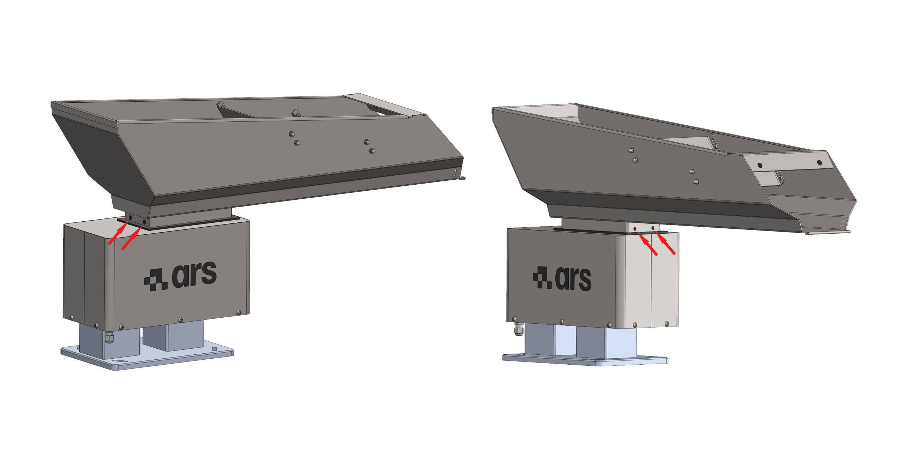

# **Maintenance et dépannage**

:::{warning}
Effectuer les opérations de maintenance lorsque la machine est à l'arrêt.
:::

:::{warning}
Les opérations de maintenance doivent être effectuées par du personnel qualifié et autorisé.
::: 

La maintenance de la machine comprend les interventions (inspection, vérification, contrôle, réglage et remplacement) rendues nécessaires par l'utilisation normale.

**Lignes directrices pour une maintenance correcte :**

  
  

    

    

      Composants
      
N'utiliser que des pièces de rechange d'origine et des outils adaptés à l'usage et en bon état.

    

  

  

    

    

      Fréquences d'intervention
      
Respecter les échéances indiquées dans le manuel pour la maintenance programmée (préventive et périodique). L'intervalle de temps ou les cycles de travail entre deux interventions s'entendent comme la valeur maximale acceptable et ne doivent pas être dépassés.

    

  

  

    

    

      Surveillance préventive
      
Vérifier rapidement la cause d'éventuelles anomalies telles qu'un bruit excessif, des surchauffes, des fuites de fluides, etc.

    

  

  

    

      Réactivité
      

        L'élimination immédiate des causes d'anomalie ou de dysfonctionnement évite d'autres dommages aux équipements et garantit la sécurité des opérateurs.
      

    

  

Le personnel préposé doit être bien formé et avoir une connaissance approfondie des règles de prévention des accidents. Le personnel non autorisé doit rester à l'extérieur de la zone de travail pendant les opérations.

Les activités de nettoyage et de réglage sont effectuées uniquement et exclusivement en phase de maintenance, machine à l'arrêt, hors énergie et armoire électrique sectionnée.

:::{important}
En cas de doute, il est interdit d'intervenir. Consulter le Constructeur pour les éclaircissements nécessaires.
:::

:::{attention}
Les interventions de réparation ou de maintenance non prévues dans le présent manuel ne peuvent être effectuées qu'avec l'autorisation préalable d'ARS S.r.l. Aucune responsabilité relative à des dommages aux personnes ou aux biens ne peut être imputée à ARS S.r.l. pour des interventions différentes de celles décrites ou exécutées selon des modalités différentes de celles indiquées.
:::

### Classification opérationnelle des maintenances

| Type de maintenance | Description |
| :--- | :--- |
| **Maintenance ordinaire** | Opérations préventives visant à garantir le bon fonctionnement de la machine dans le temps (inspection, contrôle, réglage, nettoyage et lubrification). |
| **Maintenance extraordinaire** | Interventions correctives en fonction des besoins (révision, réparation, rétablissement des conditions nominales ou remplacement d'un ensemble en panne, défectueux ou usé). |

---

## Avertissements de sécurité 

:::{attention} 
Avant de commencer toute intervention de maintenance sur la machine, sectionner et cadenasser toutes les sources d'énergie, et mettre en condition de blocage de sécurité les groupes mobiles qui la composent. Apposer le panneau « Machine en maintenance - ne pas mettre sous tension » près de l'interrupteur général.
:::

:::{attention}
Lorsque la machine est en maintenance, afin d'éviter qu'elle ne puisse être mise en marche accidentellement, apposer des panneaux portant la mention : « ATTENTION ! Machine en maintenance ».
:::

  

    

      

      

        EPI
        
Les agents de maintenance doivent obligatoirement porter tous les équipements de protection individuelle nécessaires (gants, lunettes, combinaisons) à l'activité à effectuer.

      

    

    

      

      

        Signalisation
        
Si l'opération prévoit le retrait de protections, délimiter la zone d'intervention et signaler l'interdiction d'accès aux personnes étrangères.

      

    

    

      

      

        Vérification de la déconnexion
        
Avant de procéder à toute activité, vérifier la déconnexion effective des sources d'énergie (courant électrique, air comprimé, énergie hydraulique, etc.).

      

    

    

      

        Compétence
        
L'agent de maintenance ne doit exécuter que les opérations relevant de sa compétence (Mécanique, Électrique, Fluidique) pour lesquelles il est expressément autorisé, en utilisant l'instrumentation adaptée à la recherche de pannes.

      

    

  

---

## Maintenance ordinaire 

La maintenance ordinaire permet de contrôler les conditions mécaniques et la propreté de la machine. Les périodicités indiquées se réfèrent à des conditions de fonctionnement normales.

:::{important}
Pour la maintenance ordinaire des machines provenant de fournisseurs externes, se référer aux manuels des sous-traitants joints.
::: 

:::{important}
Pour la fixation des vis, utiliser toujours LOCTITE 243 afin de garantir un serrage antivibratoire parfait.
:::

### Contrôles et vérifications

#### Tableau de maintenance ordinaire – Contrôles

| Opération | Quotidienne | Hebdomadaire | Mensuelle | Semestrielle | Annuelle |
| :--- | :---: | :---: | :---: | :---: | :---: |
| Contrôle de l'état de la cuve avant chaque démarrage | ◈ | | | | |
| Contrôle de l'état d'usure des relais | | | |  | ◈ |
| Contrôle du bon fonctionnement des fusibles | | | |  | ◈ |
| Contrôle de l'état d'usure des ressorts à lames | | | | ◈ |  |
| Contrôle du bon fonctionnement de l'électroaimant | | | | ◈ |  |
| Contrôle de l'usure du revêtement en polyuréthane *(le cas échéant)* | | | ◈ | |  |

#### Vérification des dispositifs de sécurité

Pour vérifier l'intégrité des systèmes de protection, effectuer les étapes suivantes :

  

    
1

    

      Vérifier que tous les capots et carters de la machine sont présents et correctement fixés.
    

  

  

    
2

    

      Vérifier que le câble d'alimentation électrique ne présente pas de dommages, de coupures ou de signes d'usure superficielle.
    

  

#### Nettoyage

:::{attention} 
Les opérations de nettoyage doivent être effectuées uniquement par du personnel qualifié et autorisé.
:::

:::{attention} 
Pour nettoyer la machine, ne pas utiliser de fragments d'éponge, de chiffons humides et/ou abrasifs, de chiffons filamenteux, d'essence ou de solvants inflammables comme détergent.
:::

:::{attention} 
Ne pas utiliser d'acides ni de solvants chimiques agressifs pour nettoyer la base du Bulk Feeder.
:::

:::{important}
Utiliser des produits doux et non abrasifs, tels que des dégraissants neutres ou du savon domestique ordinaire. Pour enlever les fragments et les poussières, utiliser un pinceau en veillant à porter des lunettes de protection.
:::

#### Tableau de maintenance ordinaire – Nettoyage

| Opération | Quotidienne | Hebdomadaire | Mensuelle | Semestrielle | Annuelle |
| :--- | :---: | :---: | :---: | :---: | :---: |
| Élimination des résidus et déchets de process de la surface de la cuve | ◈ | | | | |
| Élimination de la graisse et de l'huile avec des produits ou solvants neutres | ◈ |  | | | |
| Nettoyage général de la machine | | ◈ |  | | |

#### Procédure de nettoyage général

  

    
1

    

      Débrancher complètement l'alimentation électrique de la machine.
    

  

  

    
2

    

      Retirer manuellement les éventuels résidus de produit accumulés.
    

  

  

    
3

    

      Éliminer la saleté localisée à l'aide de solvants du commerce non inflammables et non toxiques.
    

  

  

    
4

    

      Si nécessaire, utiliser un aspirateur pour retirer les petits résidus présents sur la surface tournante.
    

  

  

    
5

    

      Une fois le nettoyage terminé, rétablir les raccordements de la machine.
    

  

:::{important}
Le nettoyage général de la machine doit être effectué chaque fois que le type de composant à traiter est changé, afin d'éliminer les résidus contaminants du traitement précédent.
:::

---

## Maintenance extraordinaire

:::{attention} 
La maintenance extraordinaire et la réparation de la machine sont réservées aux techniciens qualifiés, formés et autorisés, employés par le Constructeur ou par le centre d'assistance agréé.
:::

Si des événements exceptionnels surviennent nécessitant des interventions extraordinaires, les agents de maintenance internes de l'utilisateur doivent :
1. Vérifier avec précision l'état des ensembles endommagés ou déphasés.
2. Exécuter exclusivement les opérations décrites dans ce paragraphe, s'ils y sont autorisés.
3. Si les opérations ne sont pas prévues dans ce manuel, transmettre au Constructeur un rapport détaillé des faits, le résultat de l'inspection et les observations relevées.

:::{attention} 
Les pièces de rechange à remplacer doivent être commandées directement auprès d'ARS S.r.l. Si des pièces de rechange d'origine ou autorisées par écrit ne sont pas utilisées, le Constructeur décline toute responsabilité quant au fonctionnement de la machine et à la sécurité des opérateurs.
:::

:::{attention} 
Débrancher l'alimentation électrique et pneumatique avant toute opération de maintenance extraordinaire ou avant de retirer les capots de protection.
:::

:::{important}
Lors du serrage des vis, utiliser toujours du frein-filet LOCTITE 243 pour garantir la tenue mécanique.
:::

### Réglage de l'entrefer

L'entrefer est la distance physique entre le noyau et le contre-noyau ; un réglage millimétrique est fondamental :
* **Entrefer trop étroit :** Les surfaces du noyau et du contre-noyau entrent en contact mécanique pendant le fonctionnement, provoquant un « martèlement ».
* **Entrefer trop large :** Le courant électrique du vibrateur peut atteindre des niveaux critiques, provoquant la brûlure de l'enroulement et l'endommagement des composants internes du contrôleur.

:::{attention}
Ne faire fonctionner en aucun cas le vibrateur si l'une des deux conditions décrites ci-dessus se présente.
:::

:::{important}
L'entrefer est étalonné de manière appropriée en usine ; des interventions de réglage ne sont nécessaires qu'en cas de manipulations inappropriées ou d'application de surtensions.
:::

| Données opérationnelles | Spécifications d'intervention |
| :--- | :--- |
| **Qualification de l'opérateur** | Agent de maintenance mécanique |
| **Outils à utiliser** | Clé à fourche |

#### Procédure de réglage de l'entrefer

  

    
1

    

      Desserrer le contre-écrou de blocage <strong>(Écrou 2)</strong>.
    

  

  

    
2

    

      Visser la <strong>Vis 1</strong> dans le sens horaire jusqu'en fin de course, c'est-à-dire en butée mécanique contre le contre-noyau.
    

  

  

    
3

    

      Dévisser la <strong>Vis 1</strong> dans le sens antihoraire : se reporter au tableau ci-dessous pour identifier la valeur correcte et faire effectuer à la vis le nombre de tours et de fractions nécessaires pour régler la distance correcte.
    

  

  

    
4

    

      Serrer à fond l'<strong>Écrou 2</strong> pour assurer la stabilité de la vis de réglage 1.
    

  

:::{note} 
 Le réglage de l'entrefer est une opération de précision qui peut nécessiter des vérifications répétées pour obtenir le réglage idéal.
:::

#### Tableau technique de référence de l'entrefer

| Modèle | Taille de l'aimant | Entrefer requis | Rotation de la vis de réglage |
| :---: | :---: | :---: | :---: |
| **1,5 l** | Ø21 | 1,5 mm | 360° (1 tour complet) |
| **3 l** | Ø24 | 2 mm | 480° (1 tour + 1/3) |
| **5 l** | Ø28 | 3 mm | 720° (2 tours complets) |
| **10 l** | Ø28 | 3 mm | 720° (2 tours complets) |
| **20 l** | Ø28 | 3 mm | 720° (2 tours complets) |
| **40 l** | 32x30 | 3 mm | 720° (2 tours complets) |

### Remplacement des ressorts à lames

| Données opérationnelles | Spécifications d'intervention |
| :--- | :--- |
| **Qualification de l'opérateur** | Agent de maintenance mécanique |
| **Outils à utiliser** | Clé à fourche |

La modification du dimensionnement du paquet de ressorts à lames (nombre et épaisseur des lames) sert à faire varier et à adapter la capacité utile du vibrateur.

#### Procédure de remplacement des ressorts à lames

  

    
1

    

      Intervenir sur un seul paquet de ressorts à lames à la fois, en commençant impérativement par celui situé du côté arrière.
    

  

  

    
2

    

      Noter ou photographier la position exacte et l'ordre de séquence de chaque ressort à lames, entretoise et bride de retenue.
    

  

  

    
3

    

      Retirer les boulons d'ancrage mécanique à la base puis les boulons de fixation au pont du canal vibrant.
    

  

  

    
4

    

      Remplacer les éléments usés ou fissurés par des pièces de rechange d'origine.
    

  

  

    
5

    

      Remonter le paquet de ressorts à lames en suivant exactement l'ordre inverse du démontage.
    

  

  

    
6

    

      Serrer toutes les vis en appliquant le couple de serrage indiqué dans le tableau suivant.
    

  

#### Tableau technique des ressorts à lames et couples de serrage

| Modèle | Taille des ressorts à lames | Épaisseur des lames | Couple de serrage et filetage |
| :---: | :---: | :---: | :--- |
| **1,5 l** | 40x48 mm | 1 - 1,5 - 2 mm | 7,5 N·m – M5 |
| **3 l** | 40x48 mm | 1 - 1,5 - 2 mm | 7,5 N·m – M5 |
| **5 l** | 70x82 mm | 1,5 - 2 mm | 30 N·m – M8 |
| **10 l** | 70x82 mm | 1,5 - 2 mm | 30 N·m – M8 |
| **20 l** | 70x82 mm | 1,5 - 2 mm | 30 N·m – M8 |
| **40 l** | 80x91 mm | 1,5 - 2 - 2,5 mm | 70 N·m – M10 |

### Remplacement de la cuve

| Données opérationnelles | Spécifications d'intervention |
| :--- | :--- |
| **Qualification de l'opérateur** | Agent de maintenance mécanique |
| **Outils à utiliser** | Clé à fourche |

#### Procédure de démontage et de montage de la cuve

  

    
1

    

      Soutenir fermement la cuve pour éviter sa chute accidentelle lors du retrait.
    

  

  

    
2

    

      Desserrer les quatre vis sans tête de serrage présentes sur la plaque de base de la cuve.
    

  

  

    
3

    

      Soulever avec précaution la cuve d'origine et l'extraire de son logement.
    

  

  

    
4

    

      Retirer le joint de la plaque de base.
    

  

  

    
5

    

      Positionner le joint sur la nouvelle cuve en vérifiant son logement correct.
    

  

  

    
6

    

      Insérer la nouvelle cuve dans son logement en vérifiant sa bonne insertion sur les goujons de serrage et le bon positionnement du joint.
    

  

  

    
7

    

      Serrer les quatre vis sans tête présentes sur la plaque de base pour fixer la nouvelle cuve.
    

  

  

    
8

    

      Vérifier que la nouvelle cuve est correctement positionnée et solidement fixée.
    

  

:::{attention}
Dans le cas de modèles personnalisés, les composants peuvent différer, en partie ou en totalité, de ceux indiqués. Pour ces modèles, il faut se référer au dossier technique du projet.
:::

---

## Dépannage

:::{attention}
Pendant le fonctionnement normal, le vibrateur doit fonctionner silencieusement. En cas de bruit sourd causé par un martèlement interne, éteindre immédiatement le système.
:::

En cas de martèlement, contrôler et rétablir l'entrefer optimal : si les surfaces sont trop proches, elles s'entrechoqueront mécaniquement ; si elles sont trop éloignées, l'élévation anormale du courant brûlera les enroulements du stator.

| Symptôme constaté | Cause racine possible | Action corrective requise |
| :--- | :--- | :--- |
| **Le vibrateur fonctionne trop lentement** | La tension d'alimentation est inférieure au seuil nominal. | Augmenter la tension électrique jusqu'à la valeur correcte de plaque. |
| | L'unité entre en contact avec des objets rigides externes ou des structures adjacentes. | Rétablir les jeux physiques en isolant l'unité vibrante (3-5 cm). |
| | L'oscillation des paquets de ressorts à lames est entravée ou freinée par des accumulations. | Démonter, nettoyer à fond et éliminer les résidus des paquets de ressorts à lames. |
| | Les ressorts à lames présentent des fissures, des défauts ou un fléchissement structurel. | Procéder au remplacement immédiat du jeu de ressorts à lames. |
| | Le canal vibrant est fissuré ou mécaniquement usé. | Remplacer le canal. |
| **Le vibrateur fonctionne trop vite** | La tension d'alimentation dépasse les limites nominales *(cause première de martèlement)*. | Stabiliser et réduire la tension d'alimentation à la valeur de plaque. |
| **L'unité émet un bruit (ronflement) mais ne vibre pas** | La carte électronique de régulation à l'intérieur du boîtier est défectueuse. | Remplacer la carte électronique du contrôleur. |
| **L'unité ne s'active pas et ne répond pas** | Absence totale d'alimentation électrique en entrée du contrôleur. | Inspecter la ligne et éliminer d'éventuelles coupures électriques. |
| | Le disjoncteur magnétothermique ou le fusible de protection est coupé. | Remplacer les fusibles ou réarmer. |
| | La carte électronique interne au boîtier de commande est endommagée. | Remplacer la carte électronique. |
| | L'enroulement interne du vibrateur est brûlé ou décharge à la masse. | Remplacer l'ensemble électroaimant. |
| | L'enroulement est en court-circuit interne. | Remplacer l'enroulement. |
| | L'enroulement du rhéostat de réglage est ouvert. | Remplacer le composant défectueux. |

