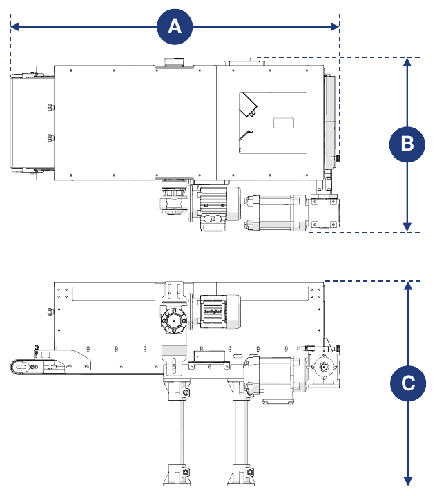
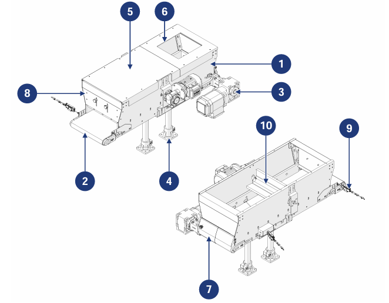

# **Descrizione Macchina**

:::{important}
La quasi-macchina, per poter essere utilizzata, deve essere incorporata in altre macchine/quasi-macchine opportunamente strutturate.
:::

## Descrizione

La Conveyor Hopper è progettata e costruita per ricevere componenti sfusi di piccola, media e grande dimensione da un sistema a monte e trasferirli a un sistema a valle.

È azionata da un motoriduttore collegato a un rullo di trazione, che muove il nastro trasportatore posto alla base della tramoggia. Sul retro è presente uno sportello per lo svuotamento manuale a fine ciclo, mentre sul fronte è presente una barriera dosatrice per regolare l'uscita del materiale.

La macchina può essere abbinata a un sistema di alimentazione (fornito dal cliente) che, collegandosi ai sensori di presenza forniti con la macchina, gestisce automaticamente il carico del materiale sul nastro.

## Uso Previsto

| Operazione | Permesso | Non permesso | Ambiente |
|:--- |:--- |:--- |:--- |
| Movimentazione di componenti sfusi di varie dimensioni e caratteristiche | Sì | Qualsiasi uso diverso da quello permesso | Industriale |

:::{important}
La macchina non può essere utilizzata per trasportare:
- oggetti più grandi delle dimensioni della tramoggia;
- oggetti con superfici esterne adesive o appiccicose;
- oggetti taglienti che potrebbero danneggiare il tessuto del nastro.
:::

La macchina è stata progettata per soddisfare le esigenze specifiche indicate nel contratto di vendita e per essere utilizzata secondo le istruzioni e i limiti d'uso indicati nel manuale. Lavora in sicurezza se:
- è incorporata in una linea dotata di adeguati dispositivi di sicurezza e protezione, secondo le norme vigenti;
- è utilizzata entro i limiti indicati nel contratto e nel manuale;
- si rispettano le procedure del manuale di istruzioni;
- la manutenzione ordinaria è eseguita nei tempi e nei modi indicati;
- la manutenzione straordinaria è eseguita tempestivamente quando necessario;
- i dispositivi di sicurezza non vengono rimossi e/o esclusi.

## Uso Scorretto (Ragionevolmente Prevedibile)

- uso della macchina senza aver prima letto il manuale di istruzioni;
- uso della macchina senza incorporarla in una linea secondo le norme vigenti;
- uso da parte di operatori non adeguatamente addestrati;
- uso della macchina come punto di appoggio, anche se non in funzione;
- uso per ottenere valori di produzione superiori ai limiti prescritti;
- uso in modo non specificato nella sezione "Uso previsto".

Qualsiasi altro uso non specificato deve essere autorizzato preventivamente per iscritto dal Costruttore. In assenza di tale autorizzazione l'uso è considerato "scorretto": il Costruttore declina ogni responsabilità per danni a cose o persone e ritiene decaduta ogni garanzia.

:::{important}
L'uso scorretto della macchina esclude ogni responsabilità del Costruttore.
:::

## Obblighi e Divieti

### Obblighi degli utilizzatori

L'utilizzatore (appaltatore o datore di lavoro) deve:
- tenere conto delle capacità e delle condizioni degli operatori in rapporto alla loro salute e sicurezza;
- fornire DPI adeguati per le singole procedure;
- fornire mezzi e procedure di sollevamento standard;
- assicurarsi che i lavoratori rispettino le norme aziendali sulla sicurezza e sull'uso dei dispositivi di protezione collettiva e individuale disponibili;
- istruire il personale sulle procedure in caso di infortunio;
- istruire il personale sui rischi residui esistenti;
- istruire il personale sui dispositivi predisposti per la sicurezza dell'operatore;
- istruire il personale sui rischi dovuti all'emissione di rumore sul posto di lavoro;
- istruire il personale sulle norme generali antinfortunistiche stabilite dalle direttive europee e dalla legislazione del Paese di destinazione.

Consentire di lavorare sulla macchina solo a personale che abbia letto il manuale e sia adeguatamente addestrato.

### Obblighi del personale addetto (operatori/manutentori/tecnici)

Il personale deve:
- eseguire interventi di manutenzione solo a macchina spenta;
- raccogliere i capelli (se lunghi) per evitare che restino impigliati o contaminino il prodotto;
- intervenire sul quadro elettrico, sulle scatole di derivazione, sui cavi e su tutti i componenti elettrici solo con l'interruttore generale disinserito;
- accertarsi che nessuno abbia accesso diretto alle parti in movimento durante il funzionamento;
- utilizzare correttamente i dispositivi di protezione forniti dal datore di lavoro;
- segnalare immediatamente al datore di lavoro, al dirigente o al preposto qualsiasi guasto dei dispositivi di sicurezza.

### Divieti del personale addetto

Il personale non deve:
- usare la macchina in modo improprio, cioè per usi non specificati nella sezione "Uso previsto";
- rimuovere o modificare dispositivi o segnali di sicurezza senza autorizzazione;
- compiere di propria iniziativa operazioni o manovre che non rientrano nelle proprie competenze o che possono compromettere la sicurezza propria o altrui;
- avvicinarsi alla macchina in stato di ebbrezza o sotto l'effetto di droghe;
- sostituire o modificare velocità e/o potenza dei componenti della macchina senza autorizzazione di un responsabile;
- modificare il ciclo della macchina;
- modificare i collegamenti elettrici per escludere i dispositivi di sicurezza interni;
- usare la macchina se non è stata installata in conformità alle norme applicabili;
- usare la macchina come punto di appoggio, anche se non è in funzione (rischio di caduta e/o di danneggiamento);
- usare la macchina al di fuori delle condizioni ambientali ammesse (vedere *Trasporto e Incorporazione*).

:::{attention}
Il Costruttore non è responsabile dei danni a cose o persone se:
- è accertato che la macchina è stata usata al di fuori degli ambienti ammessi;
- non sono stati rispettati gli obblighi e i divieti descritti nel manuale.
:::

## Dati Tecnici

```{list-table} Alimentazione elettrica
:header-rows: 0
:widths: 40 60

* - **Tensione**
  - 400 Vac
* - **Potenza**
  - 0,18 kW (motorizzazione nastro) · 0,09 kW (motorizzazione spazzola, opzionale)
* - **Frequenza**
  - 50 Hz
```

```{list-table} Limiti di utilizzo
:header-rows: 0
:widths: 40 60

* - **Peso massimo trasportabile**
  - 15 kg/m
* - **Velocità massima del nastro**
  - 8 m/min
```

:::{important}
Per ulteriori informazioni fare riferimento allo schema elettrico e ai manuali dei sub-fornitori, allegati al manuale.
:::

## Dimensioni di Ingombro



| Dimensione | Valore |
|:--- |:--- |
| **Lunghezza (A)** | 1075 mm (con motorizzazione a sinistra) · 1050 mm (con motorizzazione a destra) |
| **Larghezza (B)** | 564 mm (con motorizzazione a sinistra) · 562 mm (con motorizzazione a destra) |
| **Altezza (C)** | 666 mm |

## Componenti Principali



| Pos. | Descrizione |
|:--- |:--- |
| 1 | Vasca della tramoggia |
| 2 | Nastro trasportatore |
| 3 | Gruppo di azionamento |
| 4 | Piede di appoggio |
| 5 | Coperchio della tramoggia |
| 6 | Vano di ingresso del materiale |
| 7 | Sportello posteriore |
| 8 | Sportello anteriore |
| 9 | Sensore di presenza materiale |
| 10 | Spazzola motorizzata *(componente opzionale)* |

## Ciclo di Lavorazione

| Fase | Descrizione |
|:--- |:--- |
| 1 | Il materiale, proveniente dal sistema a monte, viene introdotto nella tramoggia attraverso il vano di carico e cade sul nastro. |
| 2 | Il nastro trasporta il materiale verso la zona di uscita. |
| 3 | Il materiale viene scaricato verso il sistema a valle in base alle esigenze di produzione. |

:::{important}
I sensori presenti hanno la funzione di verificare la presenza o l'assenza di prodotto sul nastro, nelle zone di ingresso e di uscita.

In fase di incorporazione devono essere opportunamente collegati, in modo da consentire la comunicazione della macchina con i sistemi a monte e a valle (non inclusi nella fornitura).
:::
