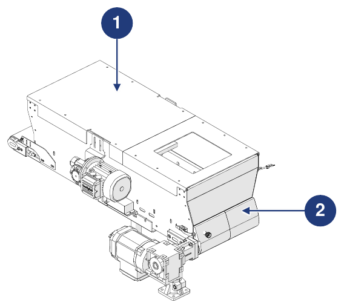
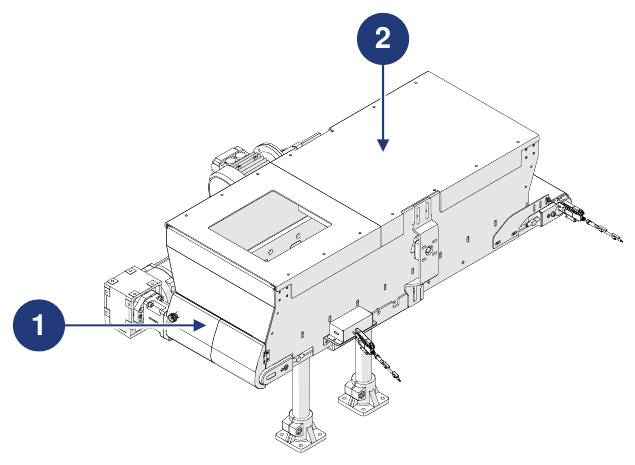

# **Informazioni Preliminari e Sicurezza**

:::{important}
Prima di installare, utilizzare o effettuare manutenzione sulla macchina, leggere attentamente l'intero manuale e tutta la documentazione allegata.

Il mancato rispetto delle istruzioni riportate può causare:
- danni alla macchina;
- perdita delle condizioni di sicurezza;
- rischi per operatori e manutentori;
- decadenza della garanzia.
:::

## Identificazione

### Costruttore

| | |
|:--- |:--- |
| **Costruttore** | ARS S.r.l. |
| **Indirizzo** | Via Aretina Nord, 157 – 52041 Pieve al Toppo (AR), Italia |
| **Contatti** | Tel. +39 0575 398611 · Fax +39 0575 398620 |
| **E-mail / Web** | info@arsautomation.com · www.arsautomation.com |

### Identificazione della quasi-macchina

| | |
|:--- |:--- |
| **Tipologia** | Tramoggia con nastro trasportatore motorizzato |
| **Denominazione** | Conveyor Hopper |
| **Modello** | CH60 |
| **Capacità** | 60 L |

### Targa di Identificazione

La macchina è dotata di una targa di identificazione posizionata sul lato della motorizzazione del nastro. Comunicando al Costruttore i dati riportati sulla targa è possibile risalire all'identificazione esatta della macchina.

:::{warning}
**ATTENZIONE — Targa identificativa**

È assolutamente vietato asportare la targa identificativa o sostituirla con altre targhe. Se la targa viene danneggiata o rimossa accidentalmente, il cliente è **obbligato** a informare il Costruttore.
:::

## Dichiarazione di Incorporazione

La macchina è fornita con la **Dichiarazione di Incorporazione di quasi-macchina**, redatta ai sensi della Direttiva Macchine 2006/42/CE (Allegato II, parte 1, sezione B).

```{list-table}
:header-rows: 0
:widths: 30 70

* - **Macchina**
  - Tramoggia a nastro 60 litri – Tramoggia con nastro trasportatore motorizzato, capacità 60 litri
* - **Modello**
  - CH60, revisione 1.0 e seguenti
* - **Funzione**
  - Sistema a nastro per l'alimentazione di componenti sfusi
* - **Requisiti essenziali applicati**
  - 1.1.1, 1.1.2, 1.1.3, 1.3.7, 1.5.1, 1.5.5, 1.5.6, 1.5.8, 1.6.1, 1.7.1, 1.7.3, 1.7.4
* - **Direttive**
  - 2006/42/CE (Direttiva Macchine) · 2014/30/UE (Compatibilità Elettromagnetica)
* - **Documentazione tecnica**
  - Redatta secondo l'Allegato VII, parte B, e messa a disposizione delle autorità nazionali su richiesta motivata
```

:::{attention}
La quasi-macchina non deve essere messa in servizio finché la macchina finale in cui deve essere incorporata non è stata dichiarata conforme alle disposizioni della Direttiva 2006/42/CE.
:::

## Direttive di Riferimento

Prima dell'immissione sul mercato il Costruttore ha eseguito la valutazione dei rischi per verificare la conformità ai requisiti essenziali di sicurezza e salute, nonché le prove e i controlli previsti dalle norme di riferimento. Il fascicolo tecnico di costruzione è redatto secondo l'**Allegato VII** della Direttiva 2006/42/CE ed è disponibile agli organi di vigilanza su richiesta motivata.

La macchina è immessa sul mercato corredata di:
- Dichiarazione di Incorporazione
- Manuale di istruzioni *(punto 1.7.4 e Allegato VI della Direttiva Macchine 2006/42/CE)*

| Riferimento | Descrizione / Ambito |
|:--- |:--- |
| **2006/42/CE** | Direttiva Macchine |
| **2014/30/UE** | Direttiva per la Compatibilità Elettromagnetica |
| **UNI EN ISO 12100:2010** | Sicurezza del macchinario – Principi generali di progettazione – Valutazione del rischio e riduzione del rischio |

## Destinatari, Fornitura e Conservazione

Il manuale è destinato agli operatori incaricati di utilizzare e gestire la macchina in **tutte le fasi della sua vita tecnica**. Insieme alla Dichiarazione di Incorporazione è **parte integrante della macchina** e deve accompagnarla ad ogni spostamento o rivendita.

| Aspetto | Prescrizione |
|:--- |:--- |
| **Integrità** | Conservare integro in tutte le sue parti. In caso di smarrimento o danneggiamento, richiedere subito una copia al Costruttore. |
| **Passaggi di proprietà** | Deve seguire la macchina fino alla demolizione (spostamenti, vendita, ecc.). |
| **Formato** | Fornito in formato cartaceo ed elettronico; la documentazione aggiuntiva è fornita in allegato. |
| **Allegati** | I documenti allegati sono parte costitutiva; si applicano le medesime prescrizioni. |
| **Lingua originale** | Italiano. In caso di incongruenze con le traduzioni, fa fede il testo originale. |
| **Aggiornamenti** | In caso di modifiche o sostituzioni funzionali, l'aggiornamento è a cura del Costruttore. L'utilizzatore garantisce che nei punti di utilizzo sia disponibile solo la versione aggiornata. |

:::{attention}
Il Costruttore declina ogni responsabilità per uso improprio della macchina e per danni causati da operazioni non contemplate nella documentazione tecnica.
:::

## Profili degli Operatori e Qualifiche

| Qualifica | Definizione |
|:--- |:--- |
| **Operatore** | Personale addestrato dal Costruttore, qualificato a utilizzare la macchina per la produzione. Deve saper eseguire tutte le operazioni necessarie al regolare funzionamento e tutelare sé stesso e i colleghi. In caso di dubbio segnala le anomalie al proprio responsabile. **Non è autorizzato a eseguire interventi di manutenzione.** |
| **Manutentore meccanico** | Tecnico qualificato per la manutenzione preventiva e correttiva di tutte le parti meccaniche. Può condurre la macchina come un operatore, intervenire su regolazioni, manutenzioni e riparazioni meccaniche, e leggere schemi, disegni tecnici ed elenchi ricambi. Non è qualificato a intervenire su impianti elettrici in tensione. |
| **Manutentore elettrico** | Tecnico qualificato per la manutenzione preventiva e correttiva di tutte le parti elettriche. Può condurre la macchina come un operatore, intervenire su regolazioni e impianti elettrici e leggere gli schemi elettrici. In presenza di tensione può lavorare nei quadri e nelle scatole di derivazione solo se è persona designata (PEI – EN 50110-1). |
| **Conducente mezzi di sollevamento** | Persona in buona salute, formata e istruita alla movimentazione dei carichi e all'uso dei mezzi di sollevamento. |

Tutte le qualifiche devono rientrare nella categoria di **persona addestrata**: individuo informato, istruito e formato sul lavoro e sui pericoli derivanti da un uso improprio, che conosce l'importanza dei dispositivi di sicurezza, delle norme antinfortunistiche e delle condizioni di lavoro sicure.

## Simboli Utilizzati nel Manuale

| Simbolo | Significato |
|:--- |:--- |
| **Attenzione / Pericolo** | Avvertenze importanti per la sicurezza dell'operatore e/o della macchina. |
| **Importante / Nota** | Informazioni importanti, anche relative alla sicurezza del personale coinvolto nell'uso della macchina. |

## Glossario

| Termine | Definizione |
|:--- |:--- |
| **Accessori di sollevamento** | Componenti o attrezzature non collegati alle macchine, posti tra la macchina e il carico o sul carico stesso, che ne consentono la presa. Sono accessori di sollevamento anche le brache e i loro componenti. |
| **ATEX** | Da *ATmosphères EXplosibles*: nome convenzionale di due direttive UE (2014/34/UE per le apparecchiature destinate ad atmosfere esplosive; 99/92/CE per la sicurezza e la salute dei lavoratori in atmosfere esplosive). |
| **Catene, funi e cinghie** | Elementi progettati e costruiti per il sollevamento come parte di macchine o accessori di sollevamento. |
| **Carrello elevatore** | Veicolo operatore per la movimentazione di merci in magazzini, ambienti industriali o piazzali, dotato di ruote e azionato da motore elettrico, diesel o a gas. |
| **Danno** | Qualsiasi conseguenza negativa derivante da un evento pericoloso. |
| **DPI** | Dispositivo di Protezione Individuale: indumento o attrezzatura destinati a proteggere chi li indossa da rischi per la salute e la sicurezza. |
| **Guasto** | Stato di un'entità caratterizzato dall'incapacità di svolgere la funzione richiesta. |
| **Macchina** | Insieme equipaggiato o destinato a essere equipaggiato di un sistema di azionamento, composto di parti o componenti, di cui almeno uno mobile, solidali per un'applicazione specifica. |
| **Quasi-macchina** | Insieme che costituisce quasi una macchina, ma che non può di per sé garantire un'applicazione specifica. |
| **Misura di protezione** | Misura per ridurre il rischio, attuata dal progettista (progettazione intrinsecamente sicura, protezioni, informazioni per l'uso) e/o dall'utilizzatore (organizzazione, procedure di lavoro sicure, DPI, formazione). |
| **Pericolo** | Potenziale fonte di lesione o danno alla salute. |
| **Persona esposta** | Qualsiasi persona che si trovi interamente o in parte in una zona pericolosa. |
| **Prevenzione** | Insieme di disposizioni o misure necessarie, secondo la particolarità del lavoro, l'esperienza e la tecnica, per evitare i rischi o ridurne la probabilità. |
| **Riparo** | Barriera fisica, progettata come parte della macchina, per garantire protezione. |
| **Riparo fisso** | Riparo mantenuto in posizione (chiuso) in modo permanente o tramite sistemi di fissaggio (viti, bulloni, ecc.) che ne impediscono la rimozione o apertura senza utensili. Non sono ammessi sistemi di fissaggio facili da rimuovere (ad es. pomelli di plastica). |
| **Riparo mobile** | Riparo collegato meccanicamente alla struttura (ad es. con cerniere o guide) che può essere aperto senza l'uso di utensili. |
| **Rischio** | Combinazione della probabilità di un danno e della sua gravità. |
| **Rischio residuo** | Rischio rimanente dopo l'adozione delle misure di protezione e prevenzione. |
| **Uso previsto** | Uso della macchina in conformità alle informazioni fornite nelle istruzioni per l'uso. |
| **Uso scorretto ragionevolmente prevedibile** | Uso della macchina in modo non previsto dal progettista, ma che può derivare da un comportamento umano facilmente prevedibile. |

## Dispositivi di Protezione Individuale (DPI)

Quando si opera in prossimità della macchina (installazione, manutenzione, regolazioni) è obbligatorio rispettare le norme generali antinfortunistiche e utilizzare i DPI previsti per ogni operazione. L'abbigliamento di chi opera sulla macchina deve rispettare i requisiti essenziali di sicurezza del Reg. UE 2016/425 e le leggi vigenti nel Paese di installazione.

| Obbligo | Descrizione |
|:--- |:--- |
| **Guanti** | Obbligo di indossare guanti di sicurezza o isolanti per uso professionale. |
| **Occhiali** | Obbligo di indossare occhiali di sicurezza per proteggere gli occhi. |
| **Calzature** | Obbligo di indossare calzature di sicurezza per proteggere i piedi. |
| **Protezione dell'udito** | Obbligo di indossare cuffie o tappi per proteggere l'udito. |
| **Indumenti protettivi** | Obbligo di indossare indumenti protettivi specifici. |
| **Lettura del manuale** | Obbligo di leggere (e comprendere) le istruzioni per l'uso e le avvertenze di sicurezza prima di usare la macchina. |

## Garanzia

:::{important}
Le condizioni complete di garanzia sono riportate nel contratto di vendita. Le condizioni del contratto, se diverse, prevalgono su quanto riportato in questa sezione.
:::

La garanzia è subordinata alle seguenti condizioni generali:
- l'apertura dell'imballo e l'incorporazione devono avvenire alla presenza di tecnici autorizzati dal Costruttore;
- il primo avviamento e il collaudo devono essere eseguiti alla presenza e sotto la guida dei tecnici del Costruttore, salvo diverso accordo tra le parti;
- la macchina deve essere utilizzata nei limiti dichiarati nel contratto e specificati nella documentazione tecnica;
- la manutenzione deve essere eseguita nei tempi e nei modi indicati nel manuale, con ricambi originali e da personale qualificato.

La garanzia **decade** in caso di:
- mancato rispetto delle norme di sicurezza;
- rimozione o manomissione dei dispositivi di comando e sicurezza (ripari, sensori, ecc.);
- uso improprio della macchina;
- uso da parte di personale non addestrato e/o non autorizzato, o privo dei requisiti previsti dal manuale;
- modifiche o riparazioni eseguite dall'utilizzatore senza autorizzazione del Costruttore;
- mancato rispetto, parziale o totale, delle istruzioni;
- anomalie dell'alimentazione elettrica;
- mancata manutenzione;
- uso di ricambi non originali;
- eventi eccezionali come alluvioni o incendi (se non causati dalle macchine).

## Misure di Sicurezza

### Dispositivi di sicurezza

La macchina è progettata e dotata di sistemi di sicurezza per ridurre al minimo i rischi per l'operatore.



| Pos. | Dispositivo | Descrizione |
|:--- |:--- |:--- |
| 1 | **Riparo fisso** | Ripari fissi (carter) che, nelle aree ad accesso esclusivo durante la manutenzione, impediscono l'accesso alle zone pericolose. Per la rimozione sono necessari utensili specifici. |
| 2 | **Riparo mobile** | Ripari ad apertura (portelli) che consentono, in determinate situazioni, l'accesso all'area di lavoro. Per aprirli in sicurezza occorre seguire procedure specifiche. |

:::{warning}
Per l'incorporazione della macchina nella linea finale deve essere previsto il collegamento elettrico esterno per l'integrazione delle funzioni di sicurezza della macchina nella logica di controllo della linea stessa.
:::

### Rumore

Il rumore è stato misurato secondo le norme UNI EN 11200 e UNI EN ISO 3746. Durante i cicli di lavoro il personale è esposto a un livello di rumore:
- inferiore a **70 dB(A)** senza pezzi all'interno;
- inferiore a **75 dB(A)** con pezzi all'interno. Il valore si basa sull'esperienza del Costruttore; alcuni pezzi/componenti, per il loro movimento relativo causato da nastro e spazzola, possono produrre un'emissione superiore. La valutazione del rumore emesso, in base alla specifica, spetta all'integratore/incorporatore.

Il livello di rumore effettivo della macchina installata in un processo produttivo differisce da quello misurato, perché influenzato dal tipo e dalle caratteristiche del sito e dalle altre macchine in funzione nelle vicinanze. L'utilizzatore è responsabile dell'applicazione delle misure di prevenzione e protezione previste dalla legislazione del Paese di installazione.

### Vibrazioni

Il livello di vibrazioni prodotto dalla macchina è trascurabile e non pericoloso per la salute degli operatori.

:::{warning}
Vibrazioni eccessive possono essere causate solo da un guasto meccanico, che deve essere segnalato e risolto immediatamente per non compromettere la sicurezza della macchina e degli operatori.
:::

### Compatibilità elettromagnetica

La macchina contiene componenti elettronici soggetti alle norme sulla Compatibilità Elettromagnetica, interessati da emissioni condotte e irradiate. I valori di emissione rientrano nei requisiti normativi grazie all'uso di componenti conformi, a collegamenti adeguati e, ove necessario, all'installazione di filtri. La macchina è quindi conforme alla direttiva EMC.

:::{warning}
Qualsiasi manutenzione non conforme sull'impianto elettrico o la sostituzione scorretta di componenti può compromettere l'efficacia delle soluzioni adottate.
:::

### Rischi residui

La sicurezza è stata integrata il più possibile nella progettazione e costruzione della macchina; permangono tuttavia alcuni rischi da cui gli operatori devono essere protetti.

| Rischio | Descrizione e indicazioni |
|:--- |:--- |
| **Rischi dovuti al trasporto** | Scarico dell'imballo, apertura dell'imballo e movimentazione della macchina espongono al rischio di carichi sospesi e schiacciamento. Le procedure sono descritte nella pagina *Trasporto e Incorporazione*. Queste operazioni possono essere eseguite solo da personale esperto nell'uso di mezzi di sollevamento e opportunamente addestrato, con DPI idonei. |
| **Rischio dovuto a parti in tensione** | Gli interventi di manutenzione e l'accesso alla macchina espongono a rischio elettrico. Il lavoro su impianti in tensione può essere eseguito solo da personale esperto e qualificato. Prestare la massima attenzione ai pittogrammi di rischio elettrico; non eseguire manutenzioni finché l'alimentazione non è stata disinserita; consultare i manuali dei componenti commerciali per le indicazioni specifiche; controllare periodicamente il circuito equipotenziale, accertandosi che non vi siano discontinuità. |
| **Rischio dovuto alla presenza di polveri, frammenti, ecc.** | A fine ciclo possono rimanere residui di materiale o accumulo di polvere sulle superfici della macchina. Pulire accuratamente dopo ogni utilizzo, come descritto nella pagina *Manutenzione*. |

:::{warning}
Il costruttore finale della linea di destinazione deve provvedere alla riduzione dei rischi meccanici nelle diverse aree della macchina, in base all'analisi dei rischi generale della linea stessa.
:::

:::{warning}
Le funzioni di sicurezza della fornitura ARS S.r.l. devono essere integrate dal costruttore della linea di destinazione nelle funzioni di sicurezza delle altre quasi-macchine o macchine associate.
:::

**Compete all'utilizzatore:**
- analizzare i rischi che possono presentarsi durante la movimentazione e l'incorporazione presso la propria sede (le analisi sulla movimentazione tengono conto solo delle caratteristiche della macchina);
- delimitare con segnaletica a pavimento il percorso di carrelli elevatori e/o veicoli a guida laser;
- sensibilizzare e istruire il personale coinvolto nelle operazioni e nell'uso della macchina;
- apporre segnali di sicurezza visivi intorno al posto di lavoro dopo aver valutato i rischi nelle zone di transito o di controllo.

### Pittogrammi di sicurezza applicati alla macchina

La macchina è fornita con una serie di pittogrammi che permettono di identificare immediatamente i rischi residui.

:::{warning}
È vietato rimuovere e/o sostituire i pittogrammi con altri di significato diverso. L'utilizzatore ha l'obbligo di sostituire quelli mancanti o poco leggibili.
:::



| Pos. | Descrizione |
|:--- |:--- |
| 1 | Pericolo di trascinamento / schiacciamento delle mani. |
| 2 | Divieto di rimuovere i dispositivi di sicurezza. |
