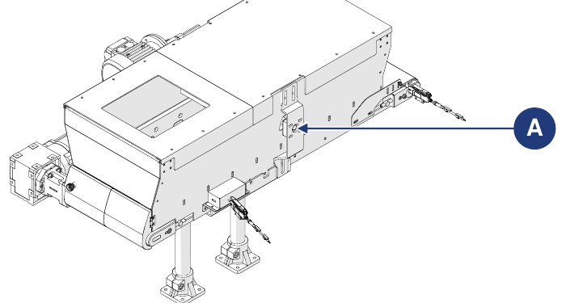

# **Manutenzione**

:::{warning}
Eseguire la manutenzione solo a macchina spenta e priva di tensione (interruttore generale del quadro di alimentazione in posizione "0-OFF"). Applicare sull'interruttore generale il cartello "MACCHINA IN MANUTENZIONE – NON ACCENDERE".
:::

:::{warning}
Le operazioni di manutenzione devono essere eseguite da personale qualificato e autorizzato.
:::

La manutenzione comprende gli interventi (ispezioni, controlli, regolazioni e sostituzioni) che si rendono necessari in seguito al normale uso.

**Linee guida per una corretta manutenzione:**
- utilizzare solo ricambi originali e attrezzi idonei allo scopo e in buono stato;
- rispettare le frequenze di intervento indicate per la manutenzione programmata (preventiva e periodica): la distanza (indicata in tempo o in cicli di lavoro) tra un intervento e il successivo è da intendersi come massima ammissibile; non deve essere superata ma può essere ridotta.

Una buona manutenzione preventiva richiede attenzione costante e monitoraggio continuo della macchina. Verificare subito la causa di eventuali anomalie (rumorosità eccessiva, surriscaldamenti, perdite di fluidi, ecc.) e porvi rimedio: l'eliminazione tempestiva delle cause di anomalia previene ulteriori danni e garantisce la sicurezza dell'operatore.

Il personale addetto alla manutenzione deve essere ben addestrato e conoscere a fondo le norme antinfortunistiche; il personale non autorizzato deve restare fuori dall'area di lavoro durante le operazioni. Anche la pulizia e le regolazioni vanno eseguite solo durante la manutenzione, con la macchina ferma e scollegata dal quadro elettrico.

:::{warning}
Eventuali riparazioni o interventi di manutenzione non indicati nel manuale possono essere eseguiti solo previa autorizzazione del Costruttore, che non risponde dei danni a persone o cose derivanti da operazioni diverse da quelle descritte o eseguite in modo diverso da quanto indicato.
:::

| Tipo | Descrizione |
|:--- |:--- |
| **Manutenzione ordinaria** | Tutte le operazioni che il manutentore deve eseguire in via preventiva per garantire nel tempo il buon funzionamento della macchina: ispezioni, controlli, regolazioni, pulizia e lubrificazione. |
| **Manutenzione straordinaria** | Tutte le operazioni che il manutentore deve eseguire quando la macchina lo richiede: ispezioni, riparazioni, ripristino delle condizioni nominali di funzionamento o sostituzione di un'unità rotta, guasta o usurata. |

## Manutenzione ordinaria

La manutenzione ordinaria comprende le ispezioni, i controlli e gli interventi che, per prevenire i guasti, tengono sotto controllo:
- le condizioni meccaniche della macchina;
- la lubrificazione;
- la pulizia;
- l'impianto di alimentazione elettrica.

Le frequenze indicate si riferiscono alle normali condizioni di funzionamento, cioè conformi alle condizioni d'uso previste.

### Controlli e ispezioni

| Operazione | Frequenza |
|:--- |:---: |
| Controllare visivamente l'integrità di tutti i dispositivi di protezione e sicurezza della macchina. | Giornaliera |
| Controllare visivamente lo stato di usura e la pulizia della macchina. | Giornaliera |
| Controllare il corretto funzionamento dei sensori (se utilizzati). | Settimanale |
| Controllare il corretto funzionamento degli azionamenti. | Mensile |
| Controllare lo stato di usura dell'isolamento dei cavi di collegamento e dei connettori elettrici. | Mensile |
| Controllare il corretto tensionamento del tessuto del nastro. | Mensile |
| Controllare lo stato di usura del tessuto del nastro e sostituirlo se necessario. | Semestrale |

:::{important}
Per la descrizione delle procedure di manutenzione del nastro integrato nella macchina fare riferimento al manuale del fornitore del nastro, allegato alla documentazione.
:::

### Pulizia

:::{warning}
Le operazioni di pulizia devono essere eseguite da personale qualificato e autorizzato. Rispettare le norme vigenti nel Paese di installazione per il trattamento di eventuali acque di lavaggio.
:::

| Operazione | Frequenza |
|:--- |:---: |
| Pulizia generale. | Settimanale |

:::{important}
La pulizia generale deve essere eseguita ogni volta che si immette materiale nella macchina, per eliminare eventuali residui della lavorazione precedente.
:::

:::{warning}
Non dirigere mai getti d'acqua o di liquidi verso le parti elettriche della macchina. Non utilizzare acidi, solventi, sostanze infiammabili e utensili abrasivi per la pulizia.
:::

**Pulizia generale**

| Fase | Azione |
|:--- |:--- |
| 1 | Scollegare l'alimentazione della macchina. *Nota: fare riferimento al manuale della linea in cui la macchina è incorporata.* |
| 2 | Con aria compressa o con un panno morbido imbevuto di detergente non aggressivo, rimuovere residui di lavorazione e sporco accumulati sulle superfici. *Nota: per facilitare l'operazione accedere al nastro dallo sportello posteriore.* |
| 3 | Rimuovere eventuali residui di grasso e/o olio dalle superfici con un panno morbido imbevuto di detergente non aggressivo. |
| 4 | Attendere che la macchina sia completamente asciutta prima di rimetterla in funzione. |

### Lubrificazione

:::{important}
Tutti gli azionamenti della macchina non richiedono lubrificazione. Per le operazioni di lubrificazione utilizzare una pompa a grasso manuale.
:::

| Operazione | Frequenza |
|:--- |:---: |
| Ingrassaggio del supporto (A) della spazzola motorizzata (opzionale). | Mensile |

## Manutenzione straordinaria

:::{warning}
Gli interventi di manutenzione straordinaria e le riparazioni devono essere eseguiti solo da tecnici qualificati, addestrati e autorizzati, dipendenti del Costruttore o del centro di assistenza autorizzato. Questi interventi richiedono una conoscenza approfondita e specialistica della macchina, delle operazioni necessarie, dei rischi connessi e delle corrette procedure per lavorare in sicurezza.
:::

In caso di eventi eccezionali che richiedano una manutenzione straordinaria, i manutentori ordinari dell'utilizzatore devono:
- verificare lo stato delle unità danneggiate o fuori fase;
- eseguire le operazioni descritte in questa sezione;
- se le operazioni da eseguire non sono indicate nel manuale, inviare al Costruttore la relazione dell'accaduto, l'esito dell'ispezione ed eventuali osservazioni.

Il Costruttore o il centro di assistenza autorizzato valuterà caso per caso e concorderà con il personale di manutenzione la soluzione più idonea:
- il Costruttore invia un tecnico autorizzato, addestrato e qualificato per eseguire i lavori necessari;
- oppure il Costruttore autorizza i manutentori ordinari dell'utilizzatore a eseguire i lavori e invia eventuali istruzioni aggiuntive.

:::{warning}
I ricambi devono essere ordinati al Costruttore. Se il cliente non utilizza ricambi originali o autorizzati per iscritto dal Costruttore, quest'ultimo è esonerato da ogni responsabilità sul funzionamento della macchina e sulla sicurezza degli operatori. Autorizzazioni e/o istruzioni devono sempre essere fornite per iscritto: in assenza di autorizzazione scritta è vietato intervenire.
:::

:::{important}
Se è necessario eseguire procedure non riportate nel manuale, o in caso di dubbio, è vietato intervenire. Contattare il Costruttore per chiarimenti.
:::

### Sostituzione del tessuto del nastro

| | |
|:--- |:--- |
| **Qualifica operatore** | Manutentore elettrico |
| **Attrezzi da utilizzare** | Attrezzi di avvitatura |

| Fase | Azione |
|:--- |:--- |
| 1 | Svitare le viti di fissaggio (A) del corpo tramoggia alla piastra di supporto dei piedi di appoggio, su entrambi i lati della struttura. |
| 2 | Separare il corpo tramoggia (B) dai piedi di appoggio (C): manualmente, con due operatori; oppure con l'ausilio di un carrello elevatore (vedere le informazioni sulla movimentazione in *Trasporto e Incorporazione*). |
| 3 | Portare il corpo tramoggia al banco di lavoro. |
| 4 | Rimuovere le viti di fissaggio (D) del nastro alla tramoggia, su entrambi i lati della struttura. |
| 5 | Separare il nastro (E) dalla tramoggia (F). *Nota: può essere eseguito manualmente da un operatore.* |
| 6 | Per la sostituzione del tessuto seguire le istruzioni del manuale del fornitore del nastro. *Nota: il manuale del fornitore del nastro è allegato alla documentazione.* |
| 7 | Rimontare la macchina procedendo in senso inverso. |
