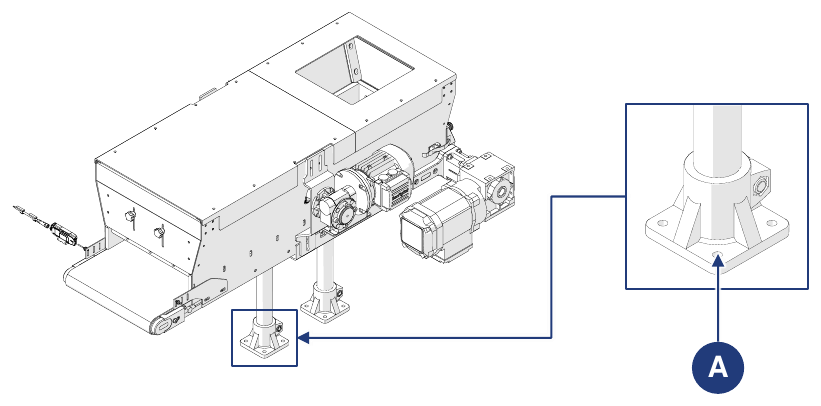

# **Trasporto e Incorporazione**

## Imballo

La macchina viene spedita dal Costruttore dallo stabilimento di produzione alla sede del Cliente. In base alla distanza, alle richieste del Cliente e alla durata della permanenza nell'imballo, la spedizione avviene con:
- imballo protettivo normale per distanze brevi e medie;
- imballo protettivo speciale per lunghe distanze.

Il trasporto deve avvenire con mezzi chiusi o centinati, a seconda del tipo di carico.

Alla ricezione della macchina il cliente deve verificare che non vi siano danni causati dal trasporto o dal personale addetto alle operazioni.
- Se si riscontrano danni, lasciare l'imballo come trovato e richiedere subito la stima del danno allo spedizioniere; quindi inviare un verbale di danno per informare l'assicurazione del trasportatore e il punto vendita.
- Se la macchina è consegnata in gabbia su bancale o su tavole di legno protette da cellophane termoretraibile, rimuovere prima l'imballo o la copertura. Per liberare completamente la macchina, rimuovere le viti e le reggette metalliche. Sollevare quindi la macchina con gru o carrello elevatore e togliere il bancale utilizzato per il trasporto.

### Rimozione dell'imballo

| Fase | Azione |
|:--- |:--- |
| 1 | Portare la macchina nel luogo previsto. |
| 2 | Disimballare le parti consegnate in gabbia: rimuovere il cellophane termoretraibile; rimuovere le reggette; rimuovere la gabbia; rimuovere eventuali sistemi di fissaggio al pavimento di legno. |
| 3 | Disimballare le parti consegnate su bancale: rimuovere le reggette; rimuovere il cellophane termoretraibile; rimuovere eventuali sistemi di fissaggio al pavimento di legno. |

Per movimentare la macchina e/o le sue parti vedere la sezione *Movimentazione*.

### Smaltimento dell'imballo

L'imballo è parte integrante della fornitura e non viene ritirato: deve essere smaltito dall'acquirente. Qualsiasi smaltimento o distruzione deve avvenire nel rispetto delle norme vigenti nel Paese dell'utilizzatore, tenendo conto della natura dei materiali.

## Movimentazione

:::{important}
Le attività di movimentazione descritte in questa sezione devono essere eseguite da personale qualificato e addestrato per le operazioni di carico, scarico e movimentazione con mezzi di sollevamento. Il personale deve essere autorizzato, addestrato all'uso dei mezzi di sollevamento e rispettare le norme vigenti sulla protezione individuale.
:::

:::{warning}
Il Costruttore:
- non risponde di danni a cose o persone dovuti a incidenti causati dal mancato rispetto delle istruzioni del manuale;
- non risponde di danni alla macchina derivanti dal mancato rispetto delle istruzioni fornite.
:::

### Unità e pesi

La macchina viene normalmente suddivisa e trasportata nei seguenti gruppi:

| Unità | Peso |
|:--- |:--- |
| **Corpo tramoggia + nastro** | Vedere documento di trasporto |
| **Piedi di appoggio** | Vedere documento di trasporto |

In alcuni casi la macchina può essere trasportata anche intera:

| Unità | Peso |
|:--- |:--- |
| **Macchina intera (senza opzioni)** | 45 kg |

Caratteristiche dell'imballo utilizzato per la spedizione:

| Imballo | |
|:--- |:--- |
| **Tipo di imballo** | Gabbia di legno |
| **Dimensioni della gabbia** | 1200 x 800 x 650 mm |
| **Peso della macchina con imballo** | 80 kg |

### Movimentazione con carrello elevatore

| | |
|:--- |:--- |
| **Qualifica operatore** | Conducente mezzi di sollevamento |
| **Mezzo di sollevamento** | Carrello elevatore |
| **Attrezzi necessari** | Corde, morsetti o simili (se necessari) |

:::{danger}
- Utilizzare solo mezzi di sollevamento idonei e omologati, compatibili con dimensioni e peso della macchina.
- Accertarsi che nessuno si trovi nel raggio d'azione del mezzo di sollevamento.
:::

**Macchina imballata**

| Fase | Azione |
|:--- |:--- |
| 1 | Posizionare le forche del carrello sotto la base del carico da trasportare. |
| 2 | Accertarsi che le forche sporgano dal fronte del carico quanto basta per eliminare il rischio di ribaltamento. |
| 3 | Sollevare le forche fino a toccare il carico. *Nota: se necessario, fissare il carico alle forche con corde, morsetti o dispositivi simili.* |
| 4 | Sollevare lentamente il carico di circa dieci centimetri da terra e controllarne la stabilità, verificando che il baricentro sia a metà delle forche. |
| 5 | Regolare la velocità di trasporto in base al pavimento e al tipo di carico, evitando manovre brusche. |

**Macchina senza imballo**

| Fase | Azione |
|:--- |:--- |
| 1 | Posizionare le forche del carrello sotto il piano di lavoro della macchina. |
| 2 | Accertarsi che le forche sporgano dal fronte del carico quanto basta per eliminare il rischio di ribaltamento. |
| 3 | Sollevare le forche fino a toccare il carico. *Nota: se necessario, fissare il carico alle forche con corde, morsetti o dispositivi simili.* |
| 4 | Sollevare lentamente il carico di circa dieci centimetri da terra e controllarne la stabilità, verificando che il baricentro sia a metà delle forche. |
| 5 | Regolare la velocità di trasporto in base al pavimento e al tipo di carico, evitando manovre brusche. |

## Incorporazione

### Predisposizioni

Normalmente spetta all'utilizzatore predisporre:
- i locali (comprese eventuali opere murarie, come fondazioni o canalizzazioni, e l'illuminazione);
- gli impianti elettrici della macchina, secondo le norme vigenti nel Paese di utilizzo e in base alla logica di funzionamento della linea in cui la macchina sarà incorporata;
- l'alimentazione della macchina, compreso il conduttore di terra;
- i servizi ausiliari adeguati alle esigenze della macchina;
- gli attrezzi e i materiali di consumo necessari all'incorporazione;
- gli eventuali lubrificanti necessari per la messa in servizio;
- i mezzi di sollevamento e movimentazione idonei.

### Condizioni ambientali ammesse

L'ambiente di utilizzo deve essere al chiuso, protetto dagli agenti atmosferici (pioggia, grandine, neve, nebbia, polvere in sospensione e polveri combustibili) e dagli agenti aggressivi (vapori corrosivi, fonti di calore eccessivo), e **non deve essere classificato ATEX**. Non è consentito utilizzare la macchina, i sistemi di controllo associati e gli azionamenti in condizioni diverse da quelle elencate.

In particolare l'ambiente di utilizzo non deve essere:
- esposto a fumi corrosivi;
- esposto a umidità eccessiva (oltre l'85%) e a rapide variazioni di umidità relativa (oltre 0,005 p.u./h);
- esposto a polvere eccessiva o abrasiva;
- esposto a vapori oleosi;
- esposto a miscele esplosive di polveri o gas;
- esposto ad aria salina;
- esposto a vibrazioni, urti o colpi anomali;
- esposto a condizioni atmosferiche avverse oltre i limiti ammessi o a stillicidio;
- esposto a condizioni anomale di trasporto o immagazzinamento;
- esposto a variazioni di temperatura elevate o rapide (oltre 5 K/h);
- esposto a radiazioni nucleari.

La macchina è progettata e costruita per lavorare in sicurezza nelle seguenti condizioni ambientali:

| Condizione | Valore |
|:--- |:--- |
| **Temperatura ambiente** | min. +5 °C / max. +40 °C |
| **Umidità relativa** | min. 5% / max. 90% (senza condensa) |
| **Luogo di installazione** | Capannone industriale |
| **Superficie di appoggio** | Pavimento industriale in cemento |
| **Illuminazione** | Luce attorno alla macchina >100 lux; luce a disposizione dell'operatore ≥400 lux (neon) |

:::{warning}
Condizioni ambientali diverse da quelle specificate possono causare gravi danni alla macchina. Il posizionamento in ambienti non conformi a quanto sopra comporta la decadenza della garanzia sulle parti da sostituire.
:::

:::{important}
Il piano di lavoro deve essere sufficientemente illuminato. In presenza di zone d'ombra o irregolari nel luogo di lavoro, spetta all'utilizzatore predisporre dispositivi di illuminazione adeguati. Se questi requisiti non sono rispettati, il Costruttore declina ogni responsabilità.
:::

### Montaggio

Nel caso in cui la macchina arrivi suddivisa in gruppi, questi devono essere assemblati.

| Fase | Azione |
|:--- |:--- |
| 1 | Posizionare la piastra di supporto dei piedi di appoggio in corrispondenza dei fori sulla base del corpo tramoggia. |
| 2 | Fissare i due gruppi con apposite viti di fissaggio. |

### Posizionamento

:::{important}
Il posizionamento della macchina all'interno della linea di destinazione deve avvenire secondo il layout concordato con il Costruttore.
:::

Per il posizionamento e i successivi collegamenti, predisporre un'area adatta alle dimensioni della macchina e dei mezzi di sollevamento, prestando attenzione agli eventuali ostacoli (altre macchine, pareti o simili) lungo il percorso dei mezzi di movimentazione.

:::{important}
Una volta individuata la posizione ottimale della macchina nel luogo di lavoro, questa deve essere fissata a terra con tasselli idonei, da posizionare negli appositi fori (A) sui piedi di appoggio.
:::

## Collegamenti

Per avviare la macchina è necessario collegarla correttamente alle reti locali: **collegamento elettrico** (compreso il collegamento di terra), conforme alle norme vigenti nel Paese di installazione. È responsabilità dell'utilizzatore garantire le caratteristiche di collegamento richieste.

:::{warning}
I collegamenti richiesti devono essere eseguiti da personale qualificato e autorizzato.
:::

### Collegamento elettrico

:::{warning}
- Prima di eseguire qualsiasi collegamento elettrico accertarsi che la macchina sia spenta e che l'alimentazione elettrica sia già stata disinserita.
- L'operazione deve essere eseguita solo da personale specializzato e autorizzato (manutentore elettrico).
:::

Prima di procedere con il collegamento elettrico, accertarsi che:
- il manutentore conosca pienamente le norme vigenti nel Paese di installazione;
- i valori di frequenza e tensione di alimentazione della macchina corrispondano a quelli della rete;
- la sezione dei cavi elettrici sia adeguata all'assorbimento;
- la linea di alimentazione sopporti i massimi assorbimenti della macchina;
- la messa a terra del circuito sia conforme alla norma EN 60204-1;
- i materiali dell'impianto di terra abbiano resistenza adeguata o adeguata protezione meccanica.

:::{warning}
Non lavorare con le mani o con oggetti bagnati. In caso di incendio non utilizzare acqua sui componenti elettrici.
:::

| | |
|:--- |:--- |
| **Qualifica operatore** | Manutentore elettrico |
| **Attrezzi da utilizzare** | Attrezzi di avvitatura |

:::{important}
L'utilizzatore deve prevedere il collegamento della macchina a una linea di alimentazione dotata di un interruttore generale idoneo a sezionare l'alimentazione energetica della macchina.
:::

| Fase | Azione |
|:--- |:--- |
| 1 | Inserire i cavi R, S e T nei rispettivi morsetti all'interno della scatola morsettiera del motore. *Nota: accertarsi che la guaina di plastica sia stata rimossa dalla parte iniziale del cavo.* |
| 2 | Serrare le viti per fissare i cavi ai morsetti. |
| 3 | Fissare il terminale del cavo di terra alla piastra di terra serrando l'apposito bullone. *Nota: accertarsi che la guaina di plastica sia stata rimossa dalla parte iniziale del cavo.* |
| 4 | Verificare con un tester la presenza delle tensioni previste e delle tre fasi ai morsetti. |
