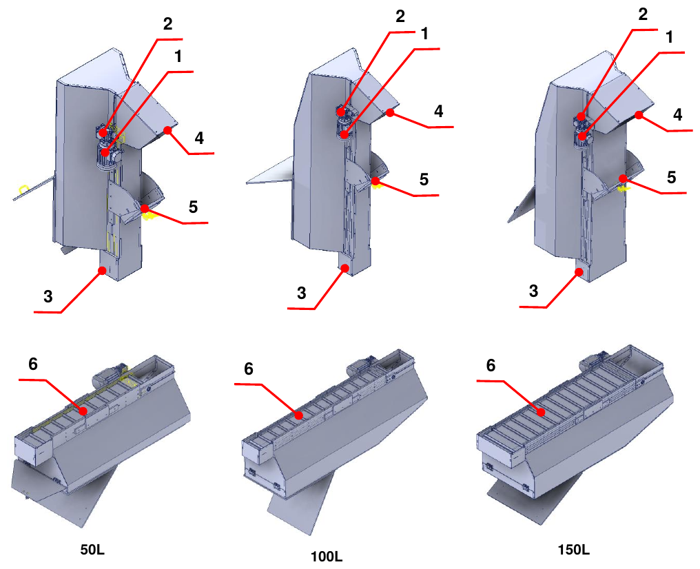
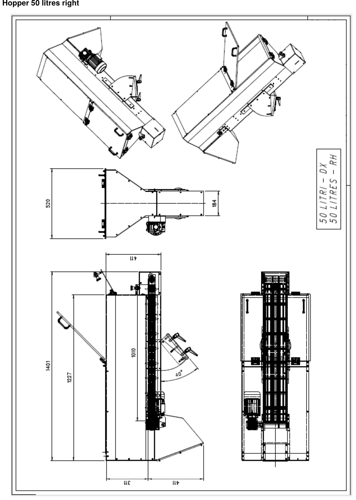
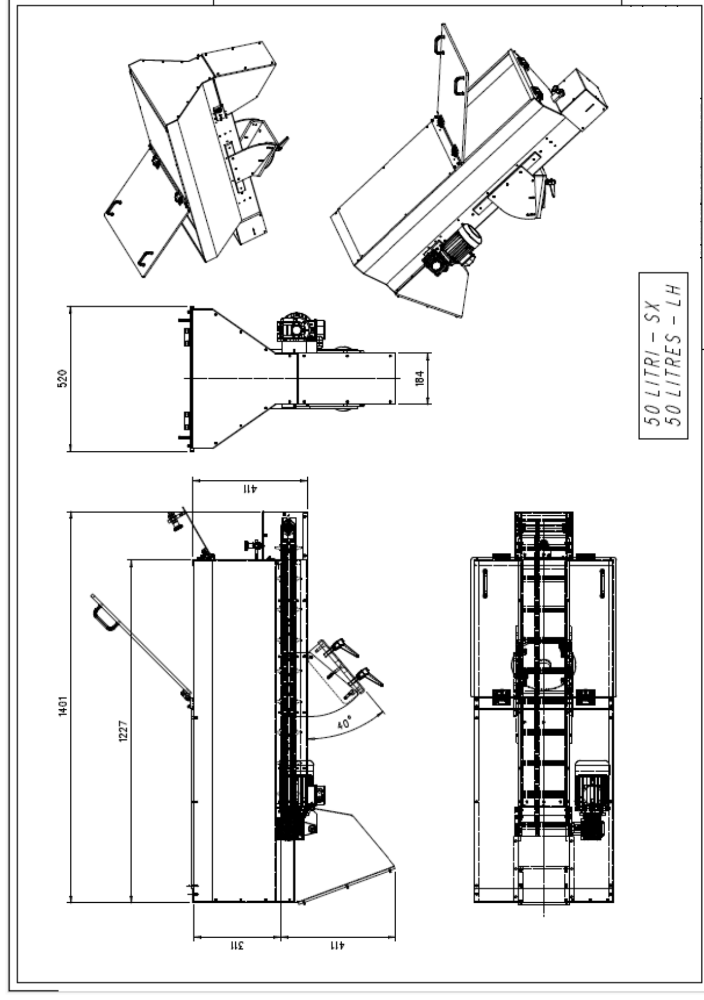
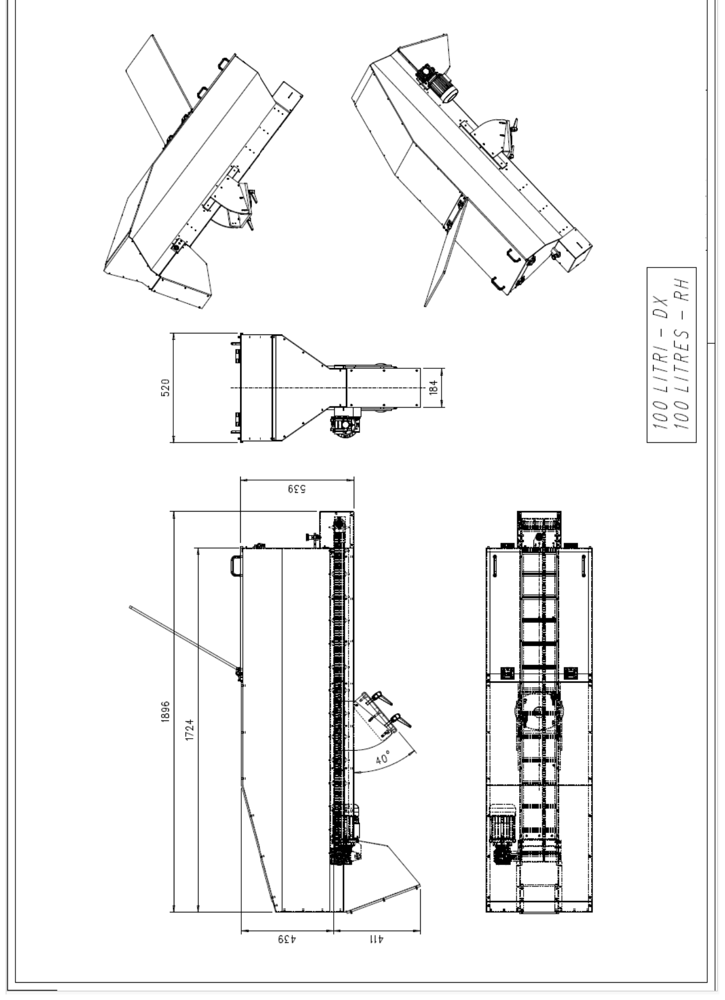
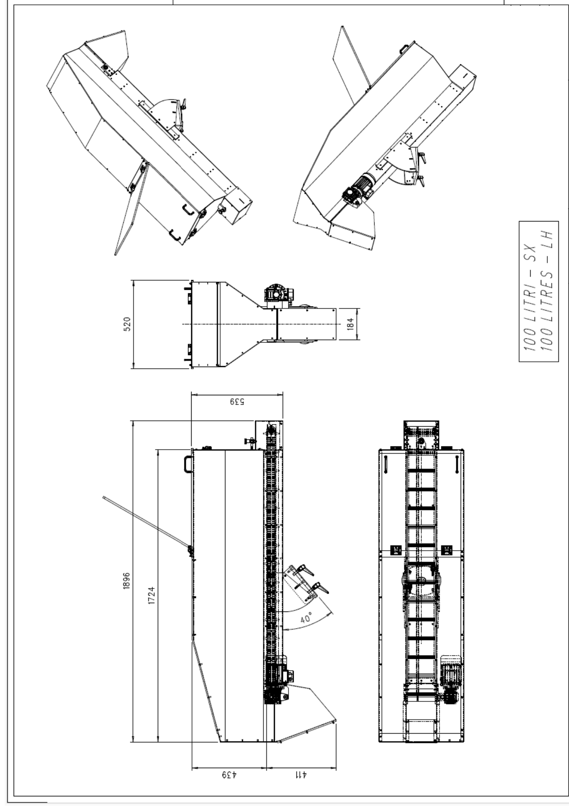
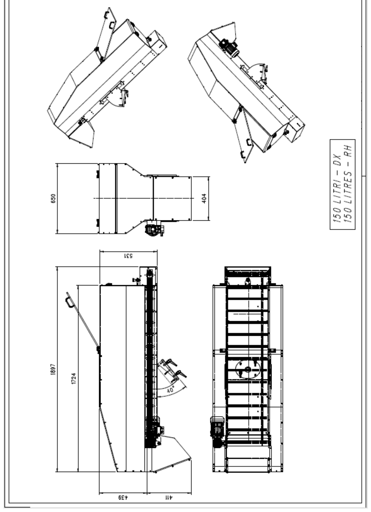
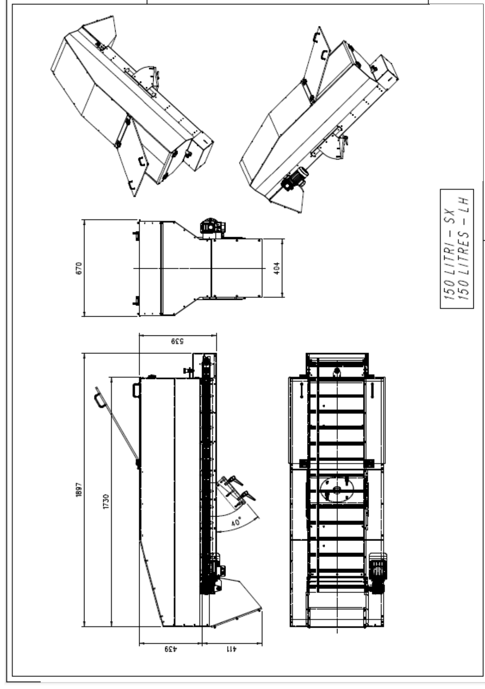
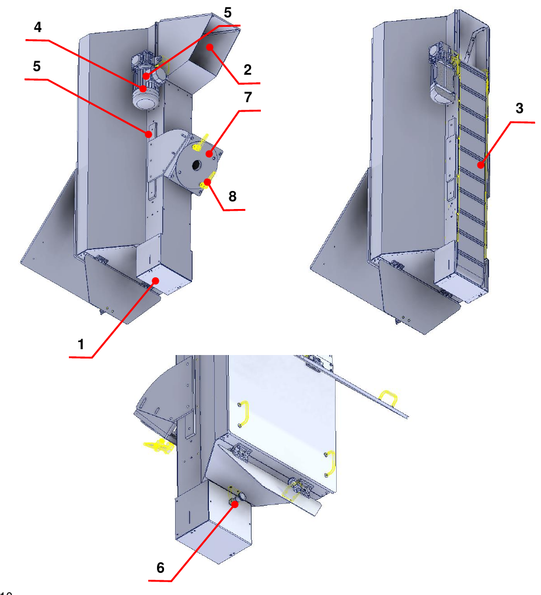

# **Descrizione Macchina**

La quasi-macchina è progettata e costruita per **trasportare materiale dal basso verso l'alto tramite un nastro a palette**.

## Layout

| Pos. | Descrizione | Pos. | Descrizione |
|:--- |:--- |:--- |:--- |
| 1 | Motore elettrico | 4 | Sportello di svuotamento |
| 2 | Riduttore | 5 | Supporto regolabile |
| 3 | Sportello di riempimento | 6 | Nastro a palette |

## Dati Tecnici

Le tabelle seguenti riportano le principali caratteristiche tecniche della quasi-macchina.

| | **50 litri** | **100 litri** | **150 litri** |
|:--- |:--- |:--- |:--- |
| **Materiale delle palette** | PVC | PVC | PVC |
| **Inclinazione massima / minima** | 50° / 34° | 50° / 34° | 50° / 34° |
| **Peso della tramoggia** | 75 kg | 100 kg | 125 kg |
| **Diametro del rullo di trascinamento del nastro** | 50 mm | 50 mm | 50 mm |
| **Motore di trascinamento del nastro** | 0,18 kW, 4 poli, flangia B14 – corrente 0,75 A con collegamento a stella, 400 Vac | 0,18 kW, 4 poli, flangia B14 – corrente 0,75 A con collegamento a stella, 400 Vac | 0,18 kW, 4 poli, flangia B14 – corrente 0,75 A con collegamento a stella, 400 Vac |
| **Coppia nominale** | 1,2 Nm | 1,2 Nm | 1,2 Nm |
| **Riduttore di trascinamento del nastro** | A vite senza fine, rapporto 1:50 | A vite senza fine, rapporto 1:50 | A vite senza fine, rapporto 1:50 |
| **Carico massimo ammesso** | Volume 50 litri / peso 30 kg | Volume 100 litri / peso 30 kg | Volume 150 litri / peso 30 kg |

:::{note}
Le caratteristiche indicate possono subire modifiche: per maggiore precisione o verifiche fare riferimento agli schemi allegati.
:::

## Dimensioni di Ingombro

Per ogni taglia è disponibile la versione con motorizzazione a destra e a sinistra.

### Tramoggia da 50 litri

### Tramoggia da 100 litri

### Tramoggia da 150 litri

## Descrizione della Quasi-macchina

La quasi-macchina è dotata di una struttura di supporto su cui sono presenti uno sportello di riempimento (1), da cui viene introdotto il materiale, e uno sportello di svuotamento (2) per l'uscita del materiale.

All'interno della tramoggia si trova un nastro a palette (3) mosso da un motore elettrico (4) e da un riduttore (5), che sposta il materiale all'interno della quasi-macchina.

Nella parte inferiore è presente lo sportello di riempimento, la cui chiusura e apertura è regolata da uno specifico spinotto di indicizzazione (6). Per mantenere in posizione la quasi-macchina è previsto un supporto regolabile (7) azionabile tramite apposite maniglie (8).

