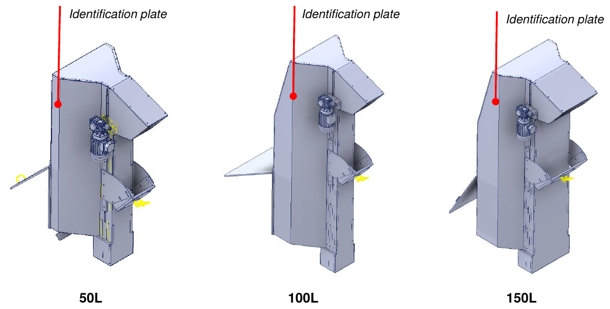
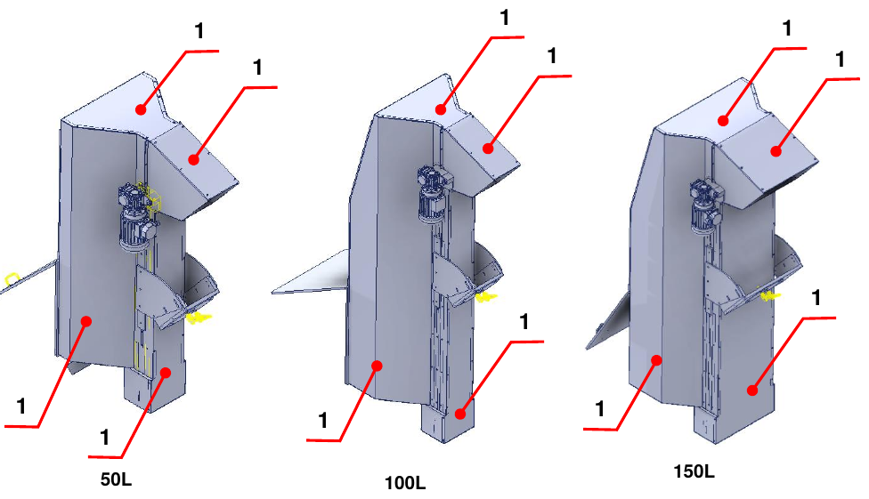
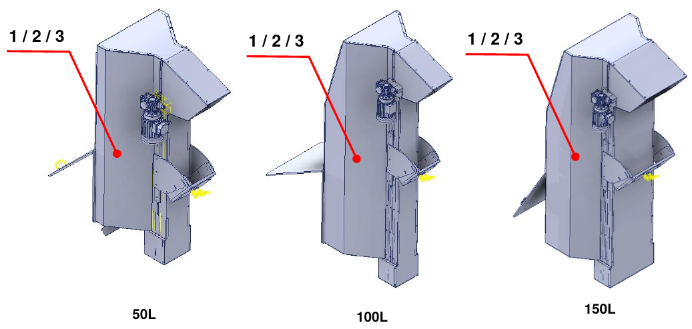

# **Informazioni Preliminari e Sicurezza**

:::{important}
Prima di installare, utilizzare o effettuare manutenzione sulla macchina, leggere attentamente l'intero manuale e tutta la documentazione allegata.

Il mancato rispetto delle istruzioni riportate può causare:
- danni alla macchina;
- perdita delle condizioni di sicurezza;
- rischi per operatori e manutentori;
- decadenza della garanzia.
:::

## Introduzione

Il manuale contiene tutte le informazioni necessarie per installare, utilizzare e mantenere correttamente la quasi-macchina. Il Costruttore impone la lettura del documento al personale incaricato della conduzione e della manutenzione, nonché al personale addetto al trasporto e al montaggio.

Il documento è il manuale di istruzioni per il montaggio delle **Motorized Hopper 50 L / 100 L / 150 L** (modelli TRM/MOT 50/100/150 D/S) ed è redatto in conformità alla Direttiva Macchine 2006/42/CE. È parte integrante della quasi-macchina e deve essere conservato fino allo smantellamento definitivo, a cura del responsabile della quasi-macchina dopo l'installazione finale.

:::{note}
ARS S.r.l., costruttrice della quasi-macchina, è indicata nel manuale come **Costruttore**. L'azienda che acquista la quasi-macchina è indicata come **Cliente**.
:::

## Assistenza e Contatti

L'Ufficio Tecnico del Costruttore è sempre a disposizione per informazioni o chiarimenti su uso, manutenzione, installazione, ecc. Formulare le domande in modo chiaro, con riferimento al manuale e indicando sempre i dati riportati sulla targa di identificazione della quasi-macchina.

| | |
|:--- |:--- |
| **Costruttore** | ARS S.r.l. |
| **Indirizzo** | Via Aretina Nord, 157 – 52041 Pieve al Toppo (AR), Italia |
| **Contatti** | Tel. +39 0575 398611 · Fax +39 0575 398620 |
| **E-mail / Web** | info@arsautomation.com · www.arsautomation.com |

## Identificazione

La posizione della targa di identificazione, con i dati principali della quasi-macchina, è indicata nella figura per le tre taglie.

## Glossario

| Termine | Definizione |
|:--- |:--- |
| **Arresto di emergenza** | Funzione destinata a evitare l'insorgere di pericoli o ridurre quelli esistenti per le persone, i danni alla macchina o al lavoro in corso, attivata da una singola azione umana. |
| **Componente di sicurezza** | Componente destinato a svolgere una funzione di sicurezza, immesso sul mercato separatamente, il cui guasto e/o malfunzionamento mette a repentaglio la sicurezza delle persone, e che non è indispensabile al funzionamento della quasi-macchina. |
| **Direttiva Macchine** | Direttiva 2006/42/CE del Parlamento europeo e del Consiglio relativa alle macchine. |
| **Dispositivo di protezione** | Mezzo di protezione diverso da un riparo. |
| **Fornitore** | Soggetto (costruttore, installatore, integratore di sistemi) che fornisce apparecchiature o servizi associati alla quasi-macchina. |
| **Funzione di sicurezza** | Funzione della quasi-macchina il cui guasto può comportare un aumento immediato dei rischi. |
| **Guasto** | Cessazione dell'attitudine di un elemento a svolgere la funzione richiesta. |
| **Informazioni per l'uso** | Misura di protezione consistente in mezzi di comunicazione (testi, parole, segnali, simboli, diagrammi) usati separatamente o in combinazione per trasmettere informazioni all'utilizzatore. |
| **Malfunzionamento** | Incapacità di una quasi-macchina di svolgere la funzione prevista. |
| **Marcatura** | Simbolo e scritta per l'identificazione della quasi-macchina, applicati dal costruttore. |
| **Materiale** | Prodotto da movimentare. |
| **Misura di sicurezza** | Mezzo che elimina o riduce un pericolo. |
| **Operatore** | Persona incaricata di condurre la quasi-macchina. |
| **Pericolo** | Potenziale fonte di danno. |
| **Tecnico qualificato / manutentore specializzato** | Persona che ha frequentato corsi di specializzazione, formazione professionale, ecc. ed è esperta di installazione, messa in servizio, manutenzione, riparazioni, trasporto e movimentazione della quasi-macchina. |
| **Quasi-macchina** | Insieme che costituisce quasi una macchina, ma che non può di per sé garantire un'applicazione specifica. È destinata esclusivamente a essere incorporata o assemblata con altre macchine, quasi-macchine o apparecchiature per costituire una macchina disciplinata dalla direttiva. |
| **Riparo** | Barriera fisica, progettata come parte della quasi-macchina, per garantire protezione. |
| **Rischio** | Combinazione della probabilità di un danno e della sua gravità. |
| **Rischio residuo** | Rischio rimanente dopo l'adozione delle misure di protezione. |
| **Situazione di emergenza** | Situazione pericolosa che richiede di essere urgentemente terminata o evitata. |
| **Trasporto** | Insieme delle operazioni per trasferire la quasi-macchina dal luogo di montaggio del costruttore a quello definitivo presso il cliente. |
| **Uso previsto** | Uso della quasi-macchina in conformità alle informazioni per l'uso fornite nelle istruzioni. |
| **Uso scorretto ragionevolmente prevedibile** | Uso della quasi-macchina in modo non previsto dal progettista, ma che può derivare da un comportamento umano facilmente prevedibile. |
| **Utilizzatore** | Soggetto che utilizza la quasi-macchina e le relative apparecchiature elettriche. |
| **Zona di lavoro** | Volume delimitato dai ripari antinfortunistici e destinato al funzionamento della quasi-macchina. |
| **Zona pericolosa** | Qualsiasi spazio all'interno e/o intorno alla macchina in cui una persona può essere esposta a un pericolo. |

## Simboli Utilizzati nel Manuale

| Simbolo | Significato |
|:--- |:--- |
| **PERICOLO** | Situazione di pericolo imminente che, se non evitata, può causare lesioni gravi o la morte dell'operatore. Identifica operazioni rigorosamente vietate e procedure obbligatorie da applicare per evitarle. |
| **AVVERTENZA** | Situazione di potenziale pericolo che, se non evitata, può causare lesioni gravi o la morte dell'operatore. Descrive operazioni che richiedono particolare attenzione. |
| **ATTENZIONE** | Situazione di pericolo non immediato o potenziale che, se non evitata, può causare lesioni anche lievi o danni alla salute dell'operatore. |
| **NOTA** | Informazioni importanti e/o procedure che, se ignorate o osservate solo parzialmente, possono danneggiare la quasi-macchina o le attrezzature collegate. |
| **INFORMAZIONI AGGIUNTIVE** | Informazioni utili e/o rimandi ad altra documentazione (manuali di istruzioni allegati, documenti tecnici o altre sezioni del manuale). |

## Norme di Sicurezza

Prescrizioni, istruzioni, regolamenti e relative note di sicurezza descritti nel manuale definiscono i comportamenti e le regole da seguire nelle attività che costituiscono l'uso previsto della quasi-macchina, per operare in sicurezza per il personale, le attrezzature e l'ambiente circostante. Le istruzioni di sicurezza sono rivolte a tutto il personale autorizzato, addestrato e delegato alle attività di:
- trasporto;
- installazione;
- uso;
- gestione;
- manutenzione;
- pulizia;
- messa fuori servizio e smantellamento.

## Responsabilità del Costruttore

Il Costruttore declina ogni responsabilità derivante dall'uso errato o improprio della quasi-macchina e da danni causati dall'uso di ricambi non prescritti, da manutenzioni non correttamente eseguite e da manomissioni di circuiti e componenti.

La responsabilità per l'applicazione dei requisiti di sicurezza spetta al personale tecnico responsabile delle attività previste dalla quasi-macchina, che deve assicurarsi che gli operatori autorizzati siano qualificati, rispettino e conoscano le prescrizioni del manuale e le norme di sicurezza di carattere generale. Il mancato rispetto delle istruzioni di sicurezza può causare lesioni alle persone e danni alle attrezzature.

## Gestione della Quasi-macchina

La gestione è consentita solo a persone autorizzate e adeguatamente addestrate, o comunque con adeguata competenza tecnica. Chi usa e mantiene la quasi-macchina deve sapere che la conoscenza e l'applicazione delle norme di sicurezza sono parte integrante del proprio lavoro.

Prima di avviare la quasi-macchina:
- leggere attentamente il manuale;
- sapere quali ripari e dispositivi di arresto di emergenza sono presenti, dove si trovano e come funzionano.

È rigorosamente vietata la rimozione, anche parziale, di ripari, dispositivi di sicurezza e targhe di avvertenza applicati sulla quasi-macchina. In caso di malfunzionamento o guasto di tali dispositivi, devono essere riparati o sostituiti immediatamente.

## Garanzia

Il Costruttore garantisce che le proprie macchine sono prive di difetti di materiale e/o di fabbricazione. Per ogni chiarimento fare riferimento alle condizioni contrattuali.

- L'acquirente ha diritto solo alla sostituzione delle parti riconosciute difettose; le spese di imballo, trasporto ed eventuale installazione sono a suo carico. In tal caso devono essere specificati: data e numero del documento di acquisto, modello della quasi-macchina, numero di matricola.
- Non sono riconosciuti risarcimenti per perdita di produzione causata da eventuali periodi di inattività della quasi-macchina.
- Sono esclusi dalla garanzia i danni causati da un uso diverso da quello indicato nel manuale, compresa la manutenzione non conforme alle istruzioni.
- La garanzia non è riconosciuta per le quasi-macchine sulle quali sono state eseguite modifiche non autorizzate. Sono rigorosamente vietate modifiche o manomissioni dei dispositivi di sicurezza.
- In caso di danni durante il periodo di garanzia, la garanzia è valida solo con l'uso di ricambi originali.
- Le riparazioni possono essere eseguite solo da operatori qualificati che conoscono la quasi-macchina.

## Sicurezza

### Informazioni generali

Il Cliente deve istruire gli operatori sui rischi di infortunio, sui dispositivi di sicurezza installati sulla quasi-macchina e sulle norme generali antinfortunistiche previste dalle direttive comunitarie e dalla legislazione del Paese di installazione. Gli operatori devono conoscere la posizione e il funzionamento di tutti i comandi e le caratteristiche della quasi-macchina.

La manomissione o la sostituzione non autorizzata di uno o più componenti, l'adozione di accessori e l'uso di parti diverse da quelle raccomandate possono comportare rischi di infortunio.

:::{warning}
È assolutamente vietato escludere o manomettere i dispositivi di sicurezza della quasi-macchina. Il Costruttore declina ogni responsabilità sulla sicurezza della quasi-macchina in caso di mancato rispetto di questo divieto.
:::

:::{warning}
Spetta all'operatore che utilizza la quasi-macchina assicurarsi che l'area sia sicura e libera da persone e/o oggetti.
:::

### Certificazione

La quasi-macchina è fornita con la Dichiarazione di Incorporazione, in conformità ai requisiti essenziali di sicurezza specificati nella Direttiva Macchine 2006/42/CE (Allegato II B) e nella Direttiva sulla Compatibilità Elettromagnetica 2014/30/UE.

:::{note}
Qualsiasi modifica apportata alla quasi-macchina annulla immediatamente la Certificazione di Incorporazione rilasciata dal Costruttore.
:::

### Usi previsti e non previsti

La quasi-macchina è progettata e costruita per **trasportare materiale dal basso verso l'alto tramite un nastro a palette**. Non può essere utilizzata per usi diversi da quelli previsti né per la lavorazione di pezzi oltre i limiti concordati.

:::{danger}
L'uso della quasi-macchina per scopi di lavorazione non descritti nel manuale è **USO IMPROPRIO**. Il Costruttore declina ogni responsabilità per danni a cose e/o persone, ritenendo decaduta ogni tipo di garanzia. Il Costruttore declina ogni responsabilità in caso di manomissione, modifiche non autorizzate o interventi di manutenzione eseguiti da personale non addestrato.
:::

:::{warning}
La quasi-macchina deve essere utilizzata solo da operatori esperti e qualificati, che abbiano letto e compreso il contenuto del manuale.
:::

:::{note}
È vietato eseguire qualsiasi movimento in caso di comportamento anomalo della quasi-macchina o di mancanza di alimentazione, perché è competenza specifica del personale di manutenzione.
:::

### Condizioni ambientali di funzionamento

La quasi-macchina deve essere installata in un ambiente coperto, dotato di tutte le misure di sicurezza previste dalle leggi vigenti nel Paese dell'utilizzatore.

| Aspetto | Indicazione |
|:--- |:--- |
| **Protezione antincendio** | La quasi-macchina non è dotata di un proprio sistema antincendio. |
| **Atmosfera esplosiva** | Non è progettata né costruita per lavorare in atmosfere esplosive o parzialmente esplosive. |
| **Illuminazione** | Non dispone di un proprio sistema di illuminazione: è dovere e responsabilità del cliente collocarla in un'area adeguatamente illuminata. |
| **Rumore** | Misurato in conformità alle norme acustiche. Senza carico, il rumore complessivo generato è inferiore a **75 dB(A)**, misurato nella postazione dell'operatore. Il livello effettivo dipende dal tipo di lavorazione; la misurazione dell'esposizione dei lavoratori al rumore spetta all'utilizzatore, secondo la legislazione vigente nel suo Paese. |
| **Emissioni elettromagnetiche** | I valori di emissione sono conformi alle norme grazie all'uso di componenti compatibili EMC, collegamenti adeguati e, ove necessario, filtri. Una manutenzione non conforme sull'impianto elettrico o una sostituzione errata di componenti può comprometterne l'efficacia. |
| **Vibrazioni** | La quasi-macchina non produce vibrazioni pericolose per la salute del personale. Vibrazioni eccessive possono essere causate solo da un guasto meccanico, da segnalare ed eliminare immediatamente. |

### Funzioni di sicurezza

| Tipo di dispositivo | Funzione |
|:--- |:--- |
| **Ripari fissi** | Segregazione delle zone pericolose della quasi-macchina. |

**Ripari fissi:** impediscono l'accesso alle parti in movimento durante il funzionamento. Non sono controllati e la loro rimozione deve avvenire solo per operazioni di manutenzione, con le fonti di energia della quasi-macchina scollegate.

:::{warning}
Il Costruttore non è in alcun modo responsabile se la quasi-macchina viene utilizzata con ripari incompleti, aperti e/o non installati.
:::

### Dispositivi di Protezione Individuale (DPI)

L'operatore deve utilizzare i dispositivi di protezione individuale per ridurre al minimo la possibilità di rischi.

:::{warning}
Il personale deve indossare abiti da lavoro adeguati per prevenire gli infortuni. Per evitare rischi meccanici (trascinamento, intrappolamento, ecc.) tenere i capelli raccolti e non indossare braccialetti, orologi, anelli o catenine.
:::

:::{note}
L'abbigliamento di chi lavora o esegue manutenzione sulla quasi-macchina deve rispettare i requisiti essenziali di sicurezza stabiliti dalle direttive UE e dalle leggi del Paese di installazione.
:::

### Rischi residui

In fase di progettazione sono state valutate tutte le zone o parti ad alto rischio e sono state adottate le precauzioni necessarie per evitare rischi alle persone e danni ai componenti della quasi-macchina. Dall'analisi dei rischi eseguita, conservata nel Fascicolo Tecnico del Costruttore, non risultano rischi residui.

:::{warning}
Controllare periodicamente il funzionamento di tutti i dispositivi di sicurezza. Non rimuovere i ripari installati.
:::

### Targhe applicate alla quasi-macchina

Il Costruttore ha installato sulla quasi-macchina una serie di targhe di avvertenza, definite in conformità alle norme europee sui simboli grafici da utilizzare e collocate in posizione ben visibile. Il servizio di manutenzione deve sostituire immediatamente tutte le targhe che, per usura, diventino illeggibili.

:::{warning}
È assolutamente vietato rimuovere le targhe di avvertenza applicate sulla quasi-macchina. Il Costruttore declina ogni responsabilità sulla sicurezza della quasi-macchina in caso di mancato rispetto di questo divieto.
:::

:::{note}
Per le informazioni sulle targhe di avvertenza installate sulle parti incorporate della quasi-macchina consultare i manuali specifici.
:::

| Targa | Descrizione |
|:--- |:--- |
| 1 | Divieto di intervenire su organi in movimento. |
| 2 | Divieto di rimuovere i dispositivi di sicurezza. |
| 3 | Obbligo di leggere il manuale d'uso e manutenzione. |
