# **Manutenzione**

## Precauzioni generali di sicurezza

Manutenzione, ricerca guasti e riparazioni sono riservate al solo personale autorizzato. Il personale incaricato della conduzione e della manutenzione deve essere ben addestrato e avere piena conoscenza delle norme antinfortunistiche; il personale non autorizzato deve restare fuori dall'area di lavoro durante le operazioni. Le precauzioni di sicurezza di questa sezione devono essere sempre rispettate. Al termine di ogni intervento è obbligatorio ripristinare le protezioni, verificandone il corretto funzionamento.

### Avvertenze generali di pericolo

- Le alte tensioni possono causare la morte per contatto. Operare sempre con la massima cautela e secondo le norme di sicurezza vigenti nel Paese.
- Sulla quasi-macchina in funzione sono presenti parti in movimento che possono causare gravi danni alle persone. Le operazioni specialistiche di pulizia e manutenzione, relative alla rimozione o sostituzione di componenti o delle unità di controllo, devono essere eseguite con l'alimentazione disinserita e con gli impianti non in pressione.
- Gli interruttori generali di alimentazione devono essere in posizione OFF e bloccati con lucchetto di sicurezza.
- Applicare appositi cartelli di avvertimento ("QUASI-MACCHINA IN MANUTENZIONE – NON ALIMENTARE") sul quadro elettrico e sul gruppo di trattamento dell'aria.
- Tenersi lontani da fori di sfiato e rubinetti durante le operazioni di scarico della pressione dell'impianto.
- Utilizzare sempre occhiali e guanti protettivi durante gli interventi sulle apparecchiature.
- Accertarsi che gli utensili in uso siano in perfette condizioni e dotati di impugnature isolanti, ove richiesto.
- Controllare che l'isolamento di cavi e conduttori delle apparecchiature di prova non presenti la minima rottura o danneggiamento.
- Le apparecchiature non collegate a terra possono causare gravi lesioni personali. Accertarsi sempre della presenza dei collegamenti di terra e della loro conformità alle norme.
- In caso di incendio non usare mai getti d'acqua sull'apparecchiatura: scollegare ogni alimentazione e usare estintori a CO2.
- Prima di eseguire i collegamenti, controllarli attentamente e accertarsi dell'assenza di difetti o sporcizia sulle filettature.
- Prima di mettere in pressione l'impianto dopo una riparazione, controllare la tenuta di raccordi e giunzioni.
- Prima di avviare l'apparecchiatura accertarsi sempre che il personale di manutenzione sia fuori dallo spazio protetto e che non siano stati lasciati attrezzi o materiali nelle vicinanze.
- La ricerca dei guasti deve essere effettuata, per quanto possibile, restando fuori dall'area protetta; quando è necessario intervenire con l'unità di controllo e l'impianto alimentati, adottare tutte le precauzioni previste dalle norme di sicurezza per operare in presenza di tensioni pericolose e di gruppi mossi sotto tensione.
- Non indossare nulla che possa impigliarsi nelle apparecchiature o fungere da conduttore (collane, braccialetti, ecc.).
- Manutenzione, riparazione e ricerca guasti devono terminare con la verifica del corretto funzionamento della quasi-macchina e con il ripristino di tutti i dispositivi di sicurezza.

### Avvertenze generali

- La massima affidabilità e i minori costi di manutenzione sono il risultato di un programma di manutenzione e ispezione pianificato e seguito scrupolosamente per tutta la vita della quasi-macchina. Rispettare gli intervalli di manutenzione indicati e programmare gli interventi in base alle esigenze specifiche del ciclo produttivo.
- Se sono necessari interventi di una certa entità, contattare il Costruttore per qualsiasi dubbio o assistenza tecnica.
- Prima di iniziare qualsiasi operazione di controllo e manutenzione, rimuovere lo sporco dalla quasi-macchina.
- Per la pulizia utilizzare sempre aria perfettamente asciutta con pressione non superiore a 0,2 MPa.
- Utilizzare sempre attrezzi in perfetto stato di conservazione e appositamente realizzati per l'operazione da eseguire: attrezzi impropri o inefficienti possono causare gravi danni.
- Durante lo smontaggio contrassegnare le singole parti con una targhetta, per garantirne il corretto riposizionamento.
- Dopo ogni manutenzione che comporti lo scollegamento di cablaggi e/o di parti fisse e mobili, verificare la corrispondenza della numerazione delle parti fisse e mobili.
- Prima di rimettere in funzione l'apparecchiatura dopo un guasto, ispezionarla e controllarla attentamente per individuare eventuali danni.
- Oltre alle attività di manutenzione tradizionali, il manutentore deve eseguire, quando previsto, anche operazioni di manutenzione predittiva consistenti in analisi strumentali e controlli specialistici, volti a prevedere in tempo il verificarsi di guasti di alcuni componenti.

## Qualifica del personale di manutenzione

:::{warning}
Il Responsabile della sicurezza deve accertarsi che tutte le persone che operano sulla quasi-macchina abbiano ricevuto tutte le istruzioni contenute nel manuale, comprese le operazioni iniziali di installazione e messa in servizio.
:::

Il personale di manutenzione deve:
- conoscere le direttive vigenti sulla prevenzione degli infortuni durante i lavori sulle macchine ed essere in grado di applicarle;
- aver letto e compreso il capitolo sulla sicurezza;
- conoscere la costruzione di base e le funzioni dei sistemi di movimentazione;
- saper utilizzare e consultare i documenti di costruzione e la documentazione della quasi-macchina;
- assumersi la responsabilità delle proprie decisioni sugli interventi sulla quasi-macchina;
- essere disponibile ad adattarsi ai cambiamenti tecnologici sulla quasi-macchina;
- osservare le irregolarità nel processo produttivo e, se necessario, adottare le misure del caso.

## Piano dei controlli di sicurezza

:::{warning}
Controllare periodicamente l'efficienza dei sistemi di sicurezza della quasi-macchina. Questa procedura deve essere ripetuta come normale pratica di manutenzione.
:::

Il personale di manutenzione ha l'obbligo di controllare periodicamente il funzionamento dei dispositivi di sicurezza. L'operazione deve essere eseguita da personale competente, con conoscenza specifica dell'uso dei dispositivi di sicurezza.

:::{warning}
Eseguire i controlli funzionali, di serraggio e di posizionamento dei sistemi di sicurezza indicati nella sezione *Funzioni di sicurezza*.
:::

## Procedura di arresto della quasi-macchina

Prima di eseguire le procedure di manutenzione descritte di seguito, l'operatore deve arrestare la quasi-macchina e metterla in stato di manutenzione seguendo questa procedura:
- verificare l'eventuale presenza di energia residua e, se necessario, scaricarla prima di intervenire sui dispositivi;
- applicare il cartello "NON ESEGUIRE MOVIMENTI – MACCHINA IN MANUTENZIONE" in prossimità dell'interruttore generale;
- dopo gli interventi di manutenzione, ripristinare le fonti di energia precedentemente disattivate;
- prima di riprendere il normale funzionamento, controllare nuovamente l'intero sistema, come descritto nel manuale.

## Norme di sicurezza per la manutenzione

Le principali precauzioni da adottare durante gli interventi di manutenzione:
- le operazioni complesse sulla quasi-macchina sono consentite solo a operatori specializzati;
- non toccare mai morsetti nudi o dispositivi elettrici prima di aver scollegato l'alimentazione (interruttore generale in posizione OFF);
- scollegare l'alimentazione elettrica prima di rimuovere qualsiasi riparo fisso o sostituire qualsiasi componente elettrico;
- non indossare anelli, orologi, collane o braccialetti durante la manutenzione;
- porre sotto i piedi un tappeto di gomma ad alta impedenza durante gli interventi; non operare su pavimenti bagnati o in ambienti molto umidi; evitare l'accumulo di elettricità statica che potrebbe danneggiare i componenti elettrici;
- indossare sempre guanti e indumenti protettivi che coprano il maggior numero possibile di parti del corpo;
- non usare fiamme libere, utensili appuntiti o spilli per la pulizia;
- non fumare.

## Tabella di manutenzione

Per garantire l'affidabilità della quasi-macchina è necessario assicurare una manutenzione regolare ed efficace e il controllo costante dei parametri degli strumenti indicatori. Manutenzione, ricerca guasti e riparazioni sono consentite solo a personale autorizzato.

| Frequenza | Descrizione | Mezzo |
|:--- |:--- |:--- |
| Giornaliera | Eseguire una pulizia accurata della quasi-macchina. | Panno + alcool |
| Mensile | Controllare il corretto tensionamento del nastro a palette. | Manuale |
| Mensile | Controllare il serraggio di viti e dadi delle parti in movimento. | Chiave dinamometrica |
| Mensile | Controllare l'usura delle parti in movimento. | Controllo visivo |

## Tabella di lubrificazione

| Componente | Lubrificante consigliato |
|:--- |:--- |
| Dischi rotanti | Olio per ingranaggi, ISO VG 320 |
| Freni idraulici | Olio idraulico, ISO VG 46 |
| Parti in movimento in genere | Grasso multiuso EP |

## Regolazioni meccaniche

### Tensionamento e regolazione del nastro

La quasi-macchina comprende un nastro a palette che solleva i pezzi dalla vasca di carico allo scivolo di uscita. Perché il nastro scorra correttamente è necessario tenderlo e regolarlo agendo sulle viti.

Il **tensionamento** serve a evitare qualsiasi slittamento tra nastro e rullo di trascinamento, mentre la **regolazione** garantisce che il nastro resti nella posizione corretta durante la corsa e non derivi verso sinistra o destra.

Tensionamento e regolazione si eseguono avvitando o svitando le viti M8 **mentre il nastro è in movimento**, controllando poi il comportamento del nastro su entrambi i lati del rullo. La regolazione deve essere eseguita contemporaneamente sul lato sinistro e destro, perché occorre trovare il giusto equilibrio tra le due viti.

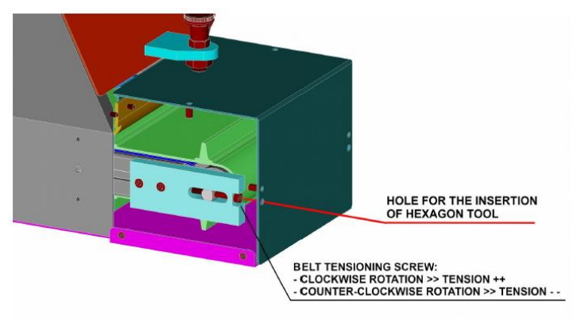

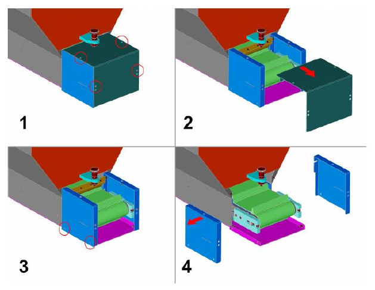

### Sostituzione del nastro a palette

:::{warning}
Questa operazione deve essere eseguita solo da tecnici esperti, con conoscenze e attrezzi adeguati. In caso di dubbio contattare i tecnici ARS.
:::

| Fase | Azione |
|:--- |:--- |
| 1 | Scollegare la tramoggia dalle fonti di alimentazione, per evitare movimenti involontari del nastro. |
| 2 | Separare la tramoggia dalla struttura di supporto (non inclusa nella fornitura): si consiglia di utilizzare opportuni mezzi di sollevamento (ad es. imbracature) per evitare movimenti bruschi del carico durante la movimentazione. Una volta separata, appoggiare la tramoggia su una superficie piana, coricata su un fianco e con il motore rivolto verso il basso. Per mantenerla in posizione, inserire un blocco tra il pavimento e il fianco della tramoggia. |
| 3 | Separare la piastra laterale dal corpo della tramoggia. |
| 4 | Separare il coperchio inferiore (composto da 3 parti: parte centrale + lato destro + lato sinistro) dal corpo della tramoggia. |
| 5 | Separare lo sportello di svuotamento dal corpo della tramoggia. |
| 6 | Separare il riparo fisso sul lato superiore della tramoggia dal corpo principale. |
| 7 | Separare lo scivolo di uscita dal corpo della tramoggia. Rimuovere prima le 4 viti evidenziate (due sul lato superiore + due sul lato inferiore); poi rimuovere le altre viti che uniscono le parti esterne delle lamiere. |
| 8 | Separare il riparo trasparente dal lato superiore del corpo della tramoggia. |
| 9 | Separare lo sportello di riempimento dal corpo della tramoggia. |
| 10 | Separare la lamiera laterale dal corpo della tramoggia. |
| 11 | Allentare completamente il nastro come descritto in *Tensionamento e regolazione del nastro*. |
| 12 | Rimuovere il nastro tirandolo verso l'alto. Se l'allentamento non basta a superare le piastre laterali che guidano il nastro, sarà necessario rimuoverle. |
| 13 | Inserire il nuovo nastro, lasciandolo cadere dall'alto. |
| 14 | Eseguire un primo tensionamento del nastro, per garantire una buona presa tra rullo di trascinamento e nastro. La regolazione fine del tensionamento sarà eseguita in seguito, quando sarà possibile far scorrere il nastro. |
| 15 | Rimontare la lamiera laterale sul corpo della tramoggia (vedere fase 10). |
| 16 | Rimontare lo sportello di riempimento sul corpo della tramoggia (vedere fase 9). |
| 17 | Rimontare il riparo trasparente sul lato superiore della tramoggia (vedere fase 8). |
| 18 | Rimontare lo scivolo di scarico sul corpo della tramoggia (vedere fase 7). Reinserire prima le viti tra le parti esterne delle lamiere, poi le quattro viti evidenziate (due dall'alto + due dal basso). |
| 19 | Rimontare il riparo fisso superiore sul corpo della tramoggia (vedere fase 6). |
| 20 | Rimontare lo sportello di svuotamento sul corpo della tramoggia (vedere fase 5). |
| 21 | Rimontare il coperchio inferiore (3 parti: parte centrale + lato destro + lato sinistro) sul corpo della tramoggia (vedere fase 4). |
| 22 | Rimontare la piastra laterale sul corpo della tramoggia (vedere fase 3). |
| 23 | Rimontare la tramoggia sulla struttura di supporto. Si consiglia di utilizzare opportuni mezzi di sollevamento (ad es. imbracature) per evitare movimenti bruschi del carico durante la movimentazione. |
| 24 | Ricollegare la tramoggia alle fonti di alimentazione. |
| 25 | Avviare la tramoggia senza pezzi all'interno ed eseguire la regolazione fine del tensionamento del nastro. |

**Figure di riferimento (fasi 2–12)**

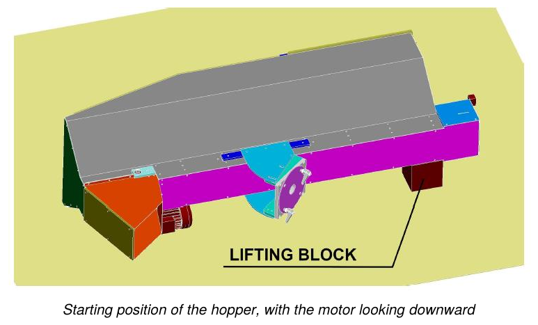

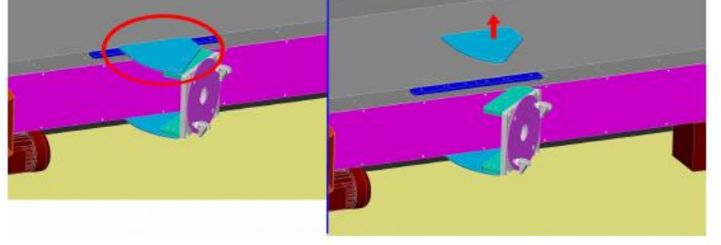

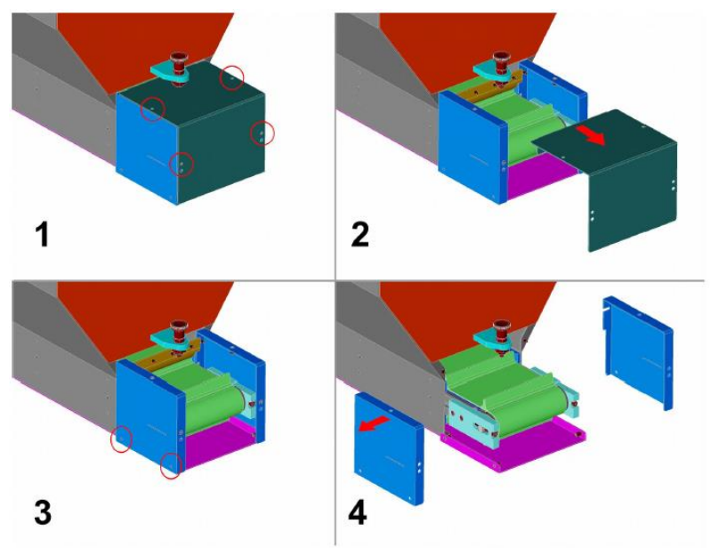

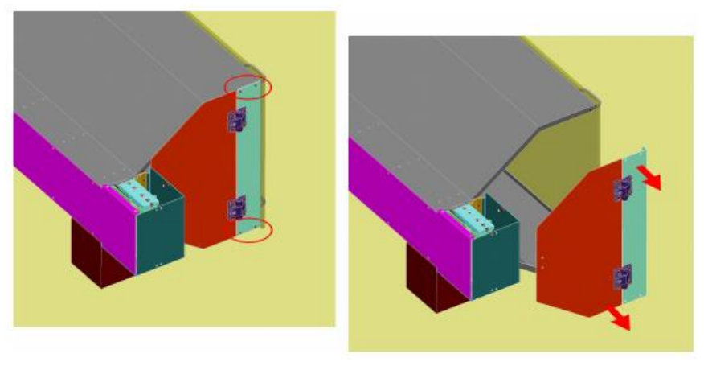

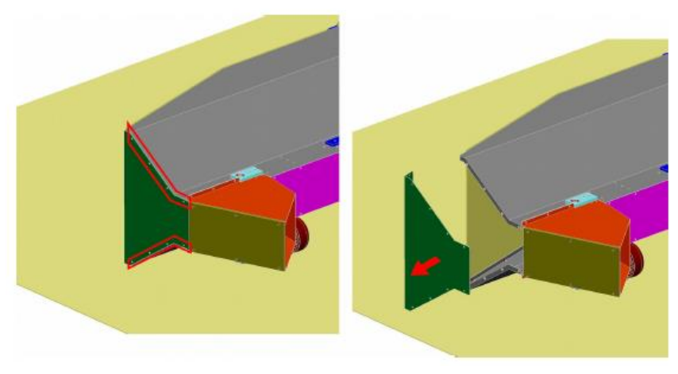

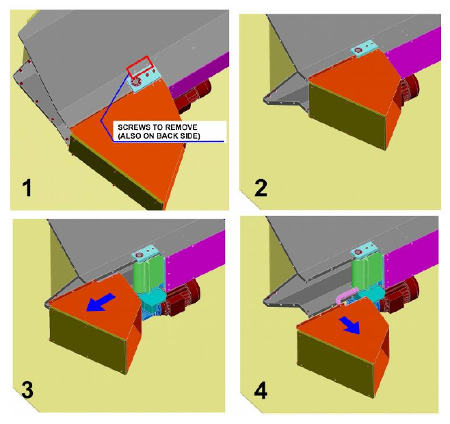

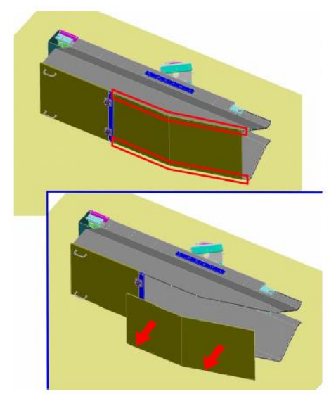

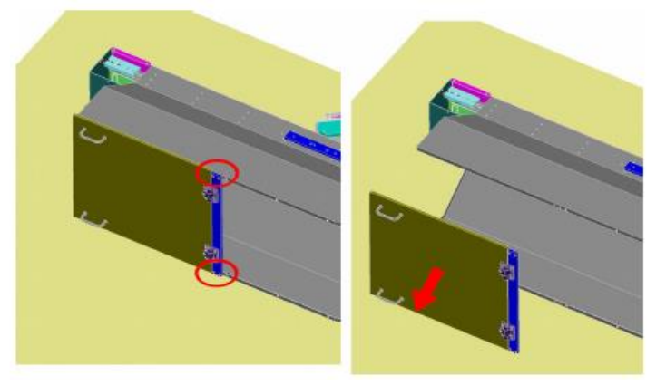

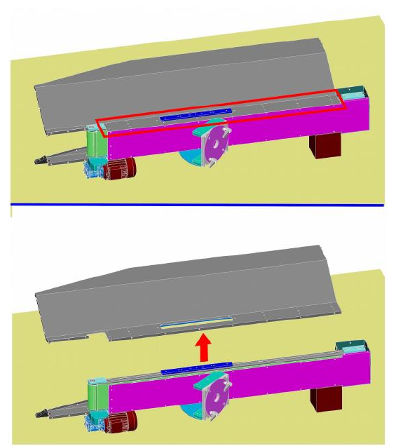

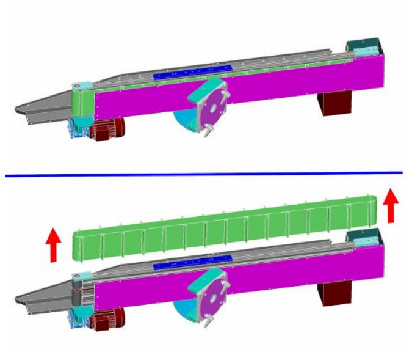

## Diagnosi dei guasti meccanici

| Guasto | Cause | Soluzioni |
|:--- |:--- |:--- |
| **Perdita di olio lubrificante** | 1. Usura della guarnizione. 2. Quantità eccessiva di olio lubrificante. | 1. Sostituire il componente usurato. 2. Ridurre la quantità di olio lubrificante. |
| **Graffi o giochi sui sistemi di guida (aste, boccole, guide)** | 1. Usura dei componenti. 2. Necessità di regolazione. 3. Lubrificazione insufficiente. | 1. Sostituire il componente usurato. 2. Regolare il componente. 3. Ripristinare il corretto livello di lubrificante. |

## Manutenzione straordinaria

Gli interventi di manutenzione straordinaria sono quelli non ordinari, relativi alla sostituzione di componenti soggetti a usura/rottura e allo smontaggio di parti della quasi-macchina. Inoltre tali interventi:
- possono prolungare la vita utile e/o migliorare, in subordine, efficienza, affidabilità, produttività, manutenibilità e procedure di ispezione;
- non modificano le caratteristiche originali (dati di targa, dimensionamento, valori costruttivi, ecc.) né la struttura essenziale;
- non creano variazioni nella destinazione d'uso.

:::{warning}
Gli interventi di manutenzione straordinaria devono essere eseguiti solo da tecnici qualificati, esperti nei vari settori (elettrico o meccanico).
:::

:::{note}
Per procedere con gli interventi di manutenzione straordinaria contattare il Costruttore, come indicato nella sezione *Assistenza e Contatti*.
:::

## Scheda degli interventi di manutenzione

| Data | Operatore | Descrizione dell'intervento |
|:--- |:--- |:--- |
| | | |
| | | |
| | | |
