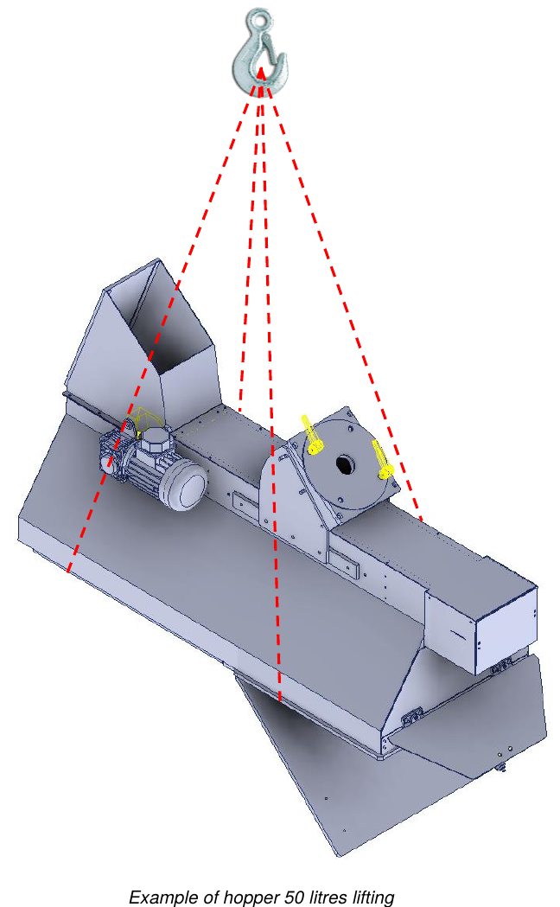

# **Imballo, Trasporto e Installazione**

## Imballo

La quasi-macchina viene spedita dal Costruttore dallo stabilimento di produzione alla sede del Cliente imballata in **pellicola di cellophane**.

L'imballo non protegge dagli agenti atmosferici esterni come pioggia, neve, grandine, ecc.: se la quasi-macchina resta esposta alle intemperie deve essere conservata in contenitori chiusi fino allo stoccaggio finale. Tutte le parti esterne soggette a ossidazione (superfici lavorate, parti non verniciate, ecc.) sono protette da una pellicola di olio antiossidante.

:::{note}
Il carico deve essere sempre mantenuto in posizione verticale.
:::

## Trasporto

I punti di ancoraggio per il sollevamento sono indicati sull'imballo spedito. All'esterno degli imballi sono inoltre riportate tutte le indicazioni per identificare il contenuto e per la movimentazione in sicurezza:
- indirizzo del destinatario e del mittente;
- dimensioni (lunghezza, larghezza, altezza);
- peso lordo, netto e tara;
- baricentro;
- note e simboli (ad es. fragile, alto, ecc.);
- tasca portadocumenti con la packing list.

## Sollevamento e Movimentazione

Prima di qualsiasi movimentazione e/o sollevamento è importante conoscere il peso.

:::{note}
- Tutte le operazioni di movimentazione e sollevamento devono essere eseguite da operatori qualificati, che conoscono e rispettano le norme sul sollevamento e la movimentazione dei carichi.
- Utilizzare mezzi di sollevamento adatti al peso e alle dimensioni del carico.
- Controllare sempre il corretto bilanciamento del carico. Se è sbilanciato, appoggiarlo immediatamente a terra e riposizionare forche/brache.
- Per il trasporto su lunghe distanze si consiglia di posizionare la tramoggia su un bancale e di fissarla con apposite cinghie. Il bancale va poi movimentato con transpallet o carrelli elevatori.
:::

:::{warning}
Quando il carico è sollevato a più di 50 cm da terra, gli operatori devono restare a distanza di sicurezza, oltre 2 m dal perimetro. Un movimento incontrollato del carico è infatti un grave pericolo per la sicurezza degli operatori.
:::

| Descrizione | Peso |
|:--- |:--- |
| **Tramoggia 50 litri** | 75 kg circa |
| **Tramoggia 100 litri** | 100 kg circa |
| **Tramoggia 150 litri** | 125 kg circa |

### Sollevamento con gru a ponte

Per sollevare e movimentare la quasi-macchina procedere come segue:
- imbracare opportunamente la quasi-macchina nei punti indicati;
- fissare le cinghie ai ganci del mezzo di sollevamento;
- sollevare lentamente il carico evitando movimenti bruschi e trasferirlo mantenendolo il più vicino possibile al suolo;
- una volta giunti a destinazione, abbassare il carico lentamente e gradualmente;
- togliere le cinghie solo dopo che il carico poggia perfettamente a terra.

## Installazione

Prima di installare la quasi-macchina è necessario rimuovere l'imballo protettivo ed eventuali vincoli di fissaggio utilizzati per il trasporto.

### Controllo dell'integrità

Verificare che la quasi-macchina non abbia subito danni durante il trasporto. In caso di incidenti o danni visibili (segni o tracce di urti) procedere come segue:
- annotare il danno sul documento di trasporto;
- informare del danno riscontrato lo spedizioniere e il Costruttore con lettera raccomandata, entro 48 ore dal ricevimento della quasi-macchina.

### Precauzioni generali di sicurezza

Le operazioni descritte in questo capitolo devono essere eseguite da personale autorizzato. Le persone non autorizzate devono restare fuori dall'area di installazione.

:::{warning}
Accertarsi che durante l'installazione non vi siano nell'area circostante elementi (cavi, tubi, ecc.) che possano causare interferenze o pericoli per gli operatori.
:::

:::{note}
Gli operatori addetti a installazione, collegamento, controlli e ispezioni devono essere ben addestrati, per evitare operazioni errate che potrebbero danneggiare la quasi-macchina. Per le informazioni sui dispositivi incorporati consultare i manuali specifici.
:::

### Scelta del luogo di utilizzo e verifica dei requisiti di installazione

Il Cliente **DEVE** predisporre:
- un'area sufficientemente ampia e libera da ostacoli, attrezzata secondo le norme di sicurezza vigenti nel Paese dell'utilizzatore;
- corretta ventilazione e illuminazione;
- spazi operativi;
- corridoi di passaggio;
- vie di fuga;
- pavimentazione in grado di sostenere il peso della quasi-macchina;
- alimentazione elettrica generale, compreso il conduttore di terra, secondo le caratteristiche e le tolleranze richieste;
- alimentazione pneumatica secondo le caratteristiche e le tolleranze richieste.

### Posizionamento

Prima di iniziare a operare, montare la quasi-macchina su una struttura di supporto stabile, di rigidità e resistenza sufficienti. Il carico massimo della struttura di supporto deve essere **almeno 2 volte** il peso indicato sulla targa della quasi-macchina.

Verificare quindi il corretto livellamento, appoggiando una livella a bolla su una superficie piana, sia in senso longitudinale sia trasversale. Per ulteriori informazioni contattare il servizio tecnico del Costruttore.

### Collegamenti

:::{warning}
Le operazioni di collegamento delle alimentazioni devono essere eseguite solo da tecnici esperti, che devono utilizzare i necessari dispositivi di protezione individuale.
:::

:::{note}
Tutti i collegamenti dell'alimentazione esterna della quasi-macchina devono essere eseguiti in fase di installazione sotto la supervisione del Costruttore. È rigorosamente vietato collegare la quasi-macchina a fonti di alimentazione esterne prima dell'arrivo dei tecnici del Costruttore. Il collegamento elettrico necessario al funzionamento della quasi-macchina è a carico del Cliente.
:::

## Controlli e Ispezioni

Prima dell'avviamento eseguire una serie di controlli e ispezioni generali, per evitare problemi durante il funzionamento della quasi-macchina.

:::{warning}
Il primo avviamento deve essere eseguito da un tecnico esperto del Costruttore.
:::

:::{note}
Prima di avviare qualsiasi movimento accertarsi che non vi siano guasti, per evitare danni alla quasi-macchina. I controlli e le ispezioni elencati di seguito sono da considerare operazioni di normale manutenzione.
:::

### Controlli generali sulle unità meccaniche

- Eseguire un'ispezione visiva generale dei vari gruppi che compongono la quasi-macchina, accertandosi che non vi siano anomalie meccaniche particolari o corpi estranei.
- Verificare che le parti della quasi-macchina e i relativi ripari siano ancorati correttamente.
- Controllare il serraggio di viti e dadi dei componenti principali.

In caso di problemi contattare immediatamente il Costruttore.

### Coppie di serraggio

La tabella seguente indica le coppie di serraggio per ciascuna dimensione di vite. Per serrare utilizzare una chiave dinamometrica.

| Ø Vite | Passo | Coppia di pre-serraggio [kgm] | Coppia di serraggio [kgm] |
|:---: |:---: |:---: |:---: |
| M6 | 1 | 0,75 | 1 |
| M8 | 1,25 | 1,8 | 2,4 |
| M10 | 1,5 | 3,6 | 4,8 |
| M12 | 1,75 | 6,5 | 8,5 |
| M14 | 2 | 10 | 13 |
| M16 | 2 | 15 | 20,5 |
| M18 | 2,5 | 22 | 29 |
| M20 | 2,5 | 30 | 40 |
| M22 | 2,5 | 42 | 56 |
| M24 | 3 | 50 | 70 |
| M27 | 3 | 80 | 105 |
| M30 | 3,5 | 95 | 130 |

### Controllo dei dispositivi commerciali

In generale controllare i gruppi commerciali installati, in particolare:
- il corretto collegamento alle fonti di alimentazione;
- che siano installati correttamente e funzionino correttamente.

Per ulteriori informazioni consultare la documentazione allegata di ciascun dispositivo.

### Controllo dei sistemi di sicurezza

Verificare che i ripari e i dispositivi di sicurezza installati siano correttamente montati e funzionanti.

:::{warning}
Non è possibile garantire la sicurezza della quasi-macchina in caso di rimozione o manomissione dei dispositivi di sicurezza.
:::

:::{note}
Eseguire i controlli funzionali, di serraggio e di posizionamento dei sistemi di sicurezza indicati nella sezione *Funzioni di sicurezza*. Questa procedura va adottata come normale procedura di manutenzione.
:::

## Codici Internazionali di Riciclaggio

| Codice | Descrizione |
|:--- |:--- |
| **Plastiche** | |
| #1 PET / PETE | Polietilene tereftalato: bottiglie d'acqua, bibite, shampoo |
| #2 HDPE | Polietilene ad alta densità: contenitori di yogurt, flaconi di detersivo |
| #3 PVC | Polivinilcloruro: contenitori per alimenti |
| #4 LDPE | Polietilene a bassa densità: sacchetti per surgelati, flaconi comprimibili |
| #5 PP | Polipropilene: bottiglie |
| #6 PS | Polistirene: bicchieri monouso |
| #7–#19 | Altre plastiche |
| **Carta** | |
| #20 PAP | Cartone ondulato: scatole di mobili da montare |
| #21 PAP | Cartoncino non ondulato: confezioni di panini nei fast-food |
| #22 PAP | Carta: confezioni di patatine nei fast-food, giornali, sacchetti di carta |
| #23–#39 | Altri tipi di carta |
| **Metalli** | |
| #40 FE | Acciaio |
| #41 ALU | Alluminio: lattine |
| #42–#49 | Altri tipi di metallo |
| **Legno** | |
| #50 FOR | Legno |
| #51 FOR | Sughero |
| #52–#59 | Altri tipi |
| **Tessili** | |
| #60 TEX | Cotone |
| #61 TEX | Juta |
| #60–#69 | Altri materiali tessili |
| **Vetro** | |
| #70 | Vetro trasparente / incolore: bottiglie d'acqua |
| #71 | Vetro verde: bottiglie di vino |
| #72 | Vetro marrone: bottiglie di birra |
| #73–#79 | Altri materiali in vetro e lattine |
| **Materiali compositi** | |
| #80 | Carta e cartone / metalli vari |
| #81 | Carta e cartone / plastica |
| #82 | Carta e cartone / alluminio: sacchetti di biscotti |
| #83 | Carta e cartone / banda stagnata |
| #84 | Carta e cartone / plastica / alluminio |
| #85 | Carta e cartone / plastica / alluminio / banda stagnata |
| #86–#89 | Altri materiali compositi |
| #90 | Plastica / alluminio |
| #91 | Plastica / banda stagnata |
| #92 | Plastica / metalli vari |
| #93–#94 | Altri materiali composti |
| #95 | Vetro / plastica |
| #96 | Vetro / alluminio |
| #97 | Vetro / banda stagnata |
| #98 | Vetro / metalli vari |
| #99 | Altri materiali compositi |
