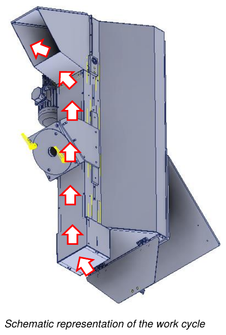

# **Uso**

## Controlli iniziali

Prima di avviare la quasi-macchina l'operatore deve verificare che:
- tutte le fonti di alimentazione siano correttamente collegate alle relative linee;
- non vi siano corpi estranei all'interno della quasi-macchina;
- i dispositivi di sicurezza presenti funzionino correttamente;
- la quasi-macchina non sia in stato di riparazione / pulizia;
- tutti i ripari siano correttamente posizionati e fissati.

## Ciclo di lavoro

Dopo l'avviamento della quasi-macchina, a seguito dei controlli eseguiti dall'operatore, il ciclo di lavoro è il seguente:
- il materiale viene sollevato dal nastro a palette, mosso dal motore elettrico, fino all'uscita.

